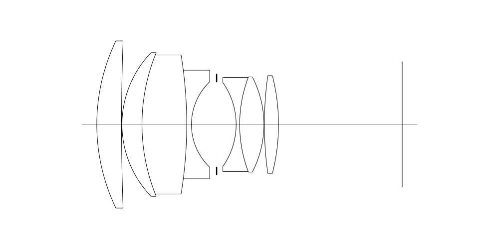
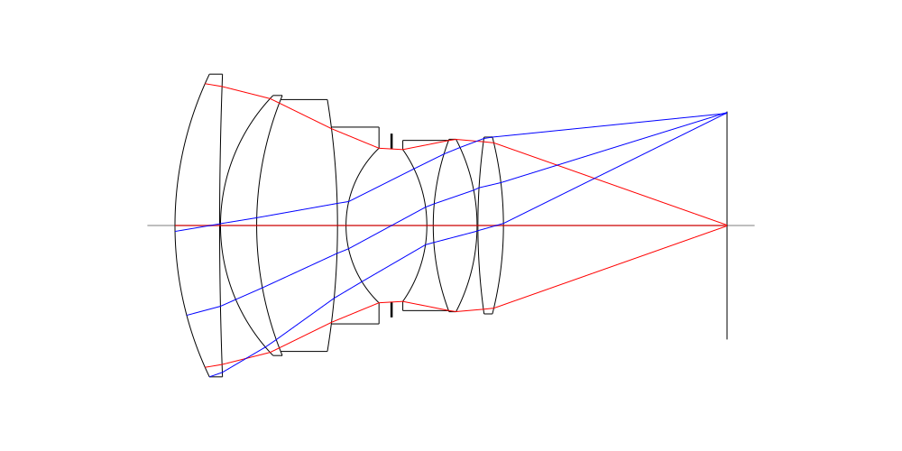
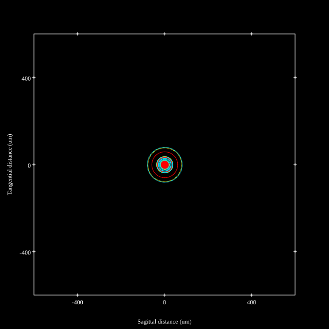
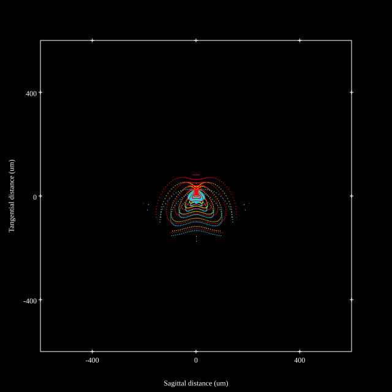
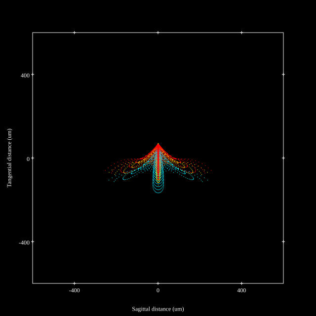
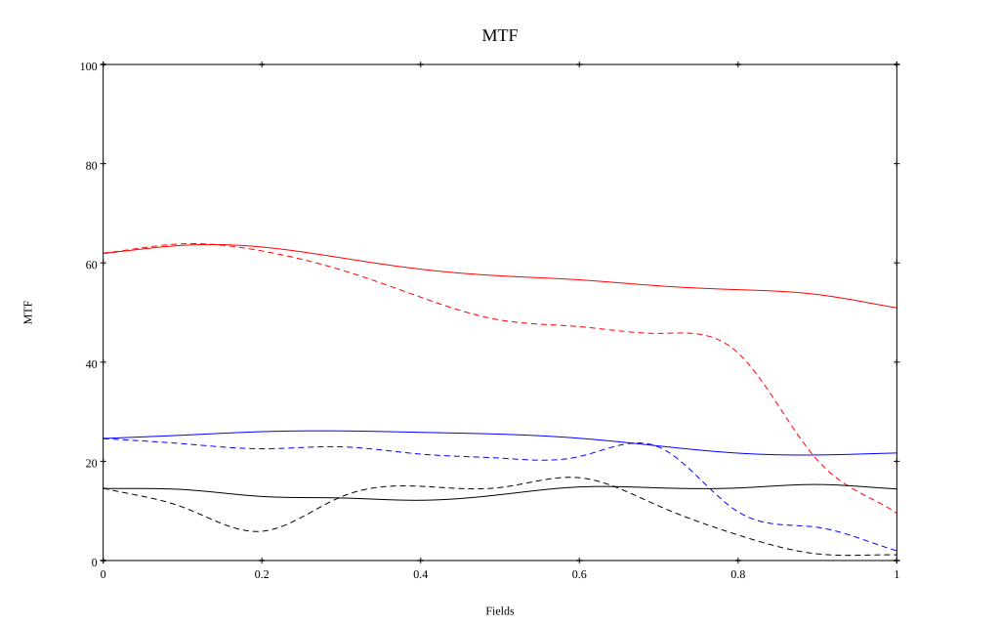
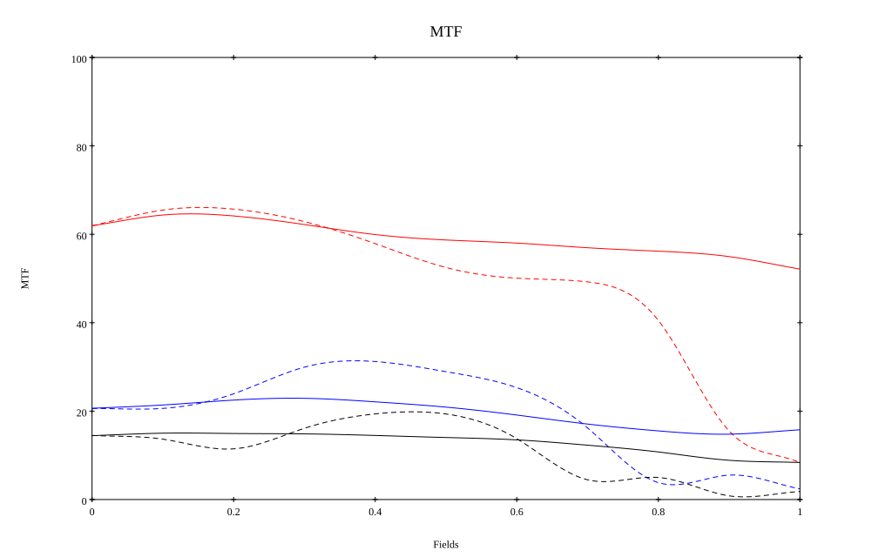

# Canon Serenar 85mm f1.5
## Patent Information
| Country | Patent Number | Example | Year of Application | Inventors | Organisation | Link |
| ---     | ---           | ---     | ---                 | ---       | ---          | ---  |
|US | US2645973 | 1 | 1951 | Ito Hiroshi | Canon Camera Co Inc | [link](https://patents.google.com/patent/US2645973A/en) |
## Surface Data
Note that where glass types are shown the refractive index and abbe number is as per assigned glass type

| ID  | Radius | Thickness | Diameter | nd  | vd  | Glass Make | Glass |
| --- | ---    | ---       | ---      | --- | --- | ---        | ---   |
| 1 | 69.87 | 8.925 | 60.48 | 1.6228 | 56.91 | Hoya | BACD10 |
| 2 | 807.5 | 0.17 | 59.257 |  |  |  |
| 3 | 37.4 | 7.225 | 51.96 | 1.6385 | 55.5 | CORNING | C39-56 |
| 4 | 68.425 | 16.15 | 50.3126 | 1.51633 | 64.05 | SUMITA | BK7 |
| 5 | -157.25 | 1.7 | 39.3086 | 1.68893 | 31.12 | SUMITA | K-SFLD8 |
| 6 | 21.42 | 9.1 | 30.91 |  |  |  |
| 7 | AS | 7.05 | 30.5933 |  |  |  |
| 8 | -26.35 | 1.275 | 30.3384 | 1.53169 | 48.9 | Schott | N-LLF6 |
| 9 | 48.62 | 8.755 | 34.0043 | 1.65844 | 50.84 | Hikari | J-SSK5 |
| 10 | -37.4 | 0.17 | 34.46 |  |  |  |
| 11 | 127.5 | 5.1 | 35.3027 | 1.6385 | 55.5 | CORNING | C39-56 |
| 12 | -71.91 | 44.6677 | 35.32 |  |  |  |
## Layouts

## Spot Diagrams

## Paraxial Parameters
| parameter | value |
| ---       | ---   |
| effective_focal_length |84.999
| back_focal_length | 44.79
| optical_invariant | 7.592
| object_distance | 1.0E10
| image_distance | 44.79
| power | 0.012
| pp1_H | 46.427
| ppk_H' | -40.209
| ffl_F | -38.572
| fno | 1.5
| enp_dist_P | 64.7
| enp_radius | 28.333
| exp_dist_P' | -25.047
| exp_radius | 23.32
| m | -0
| red | -1.176488088099778E8
| n_obj | 1
| n_img | 1
| img_ht | 22.775
| obj_ang | 15
| obj_na | 0
| img_na | -0.333|
## Spot Analysis
| Field | Spot Mean Radius (µm) | Spot Max Radius (µm) |
| ---   | ---              | ---             |
 | Field(x=0.0, y=0.0) | 27.477 | 84.165|
 | Field(x=0.0, y=0.1) | 26.01 | 91.785|
 | Field(x=0.0, y=0.2) | 28.615 | 109.027|
 | Field(x=0.0, y=0.3) | 35.398 | 129.738|
 | Field(x=0.0, y=0.4) | 43.313 | 162.179|
 | Field(x=0.0, y=0.5) | 49.398 | 180.354|
 | Field(x=0.0, y=0.6) | 52.032 | 185.137|
 | Field(x=0.0, y=0.7) | 53.08 | 205.509|
 | Field(x=0.0, y=0.8) | 54.009 | 235.858|
 | Field(x=0.0, y=0.9) | 57.93 | 254.002|
 | Field(x=0.0, y=1.0) | 69.193 | 267.332|
## Polychromatic Geometric MTF

* 10=red,30=blue,50=black cycles/mm
* Solid lines represent sagittal, dashed lines tangential
* To generate above, MTFs for wavelengths 587.5618(d), 486.1327(F), 656.2725(C) were calculated across 10 fields, and then averaged
## Polychromatic Geometric MTF (Weighted)

* 10=red,30=blue,50=black cycles/mm
* Solid lines represent sagittal, dashed lines tangential
* To generate above, MTFs for wavelengths 587.5618(d) wt(1.0), 656.2725(C) wt(0.475), 546.074(e) wt(0.98), 486.1327(F) wt(0.49), 435.8343(g) wt(0.15) were calculated across 10 fields, and then combined using weighted average
## Resources
* [OpticalBench Compatible Data File, tab delimited](./prescription.txt)
* [Zemax file](./US002645973_Example01P.zmx)

Generated from `US002645973_Example01P.txt`, status **Candidate**

Report / Zemax file generated using [Beam42](https://github.com/BeamFour/Beam42) on 2026-11-21
