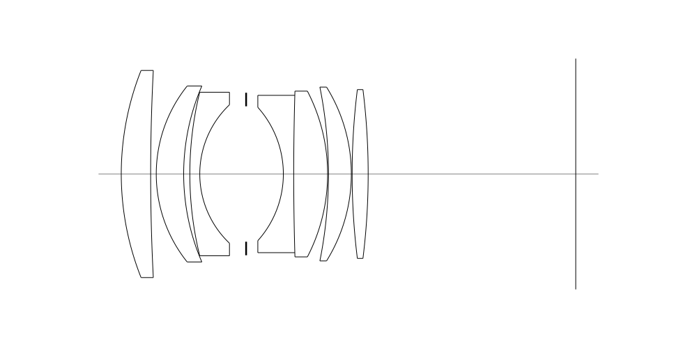
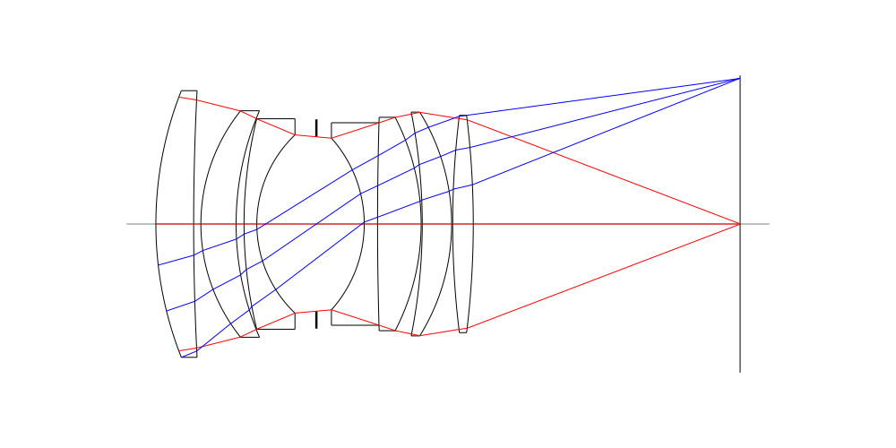
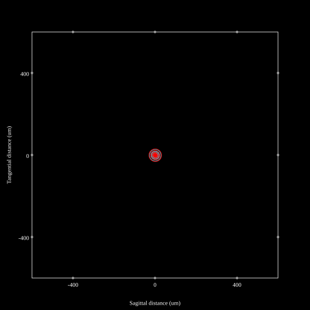
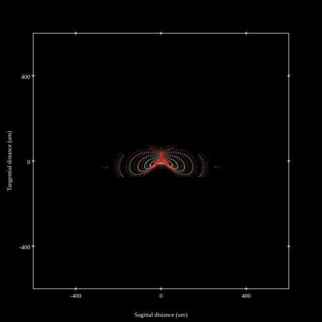
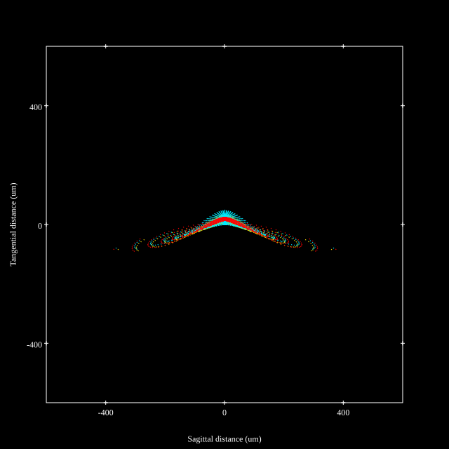
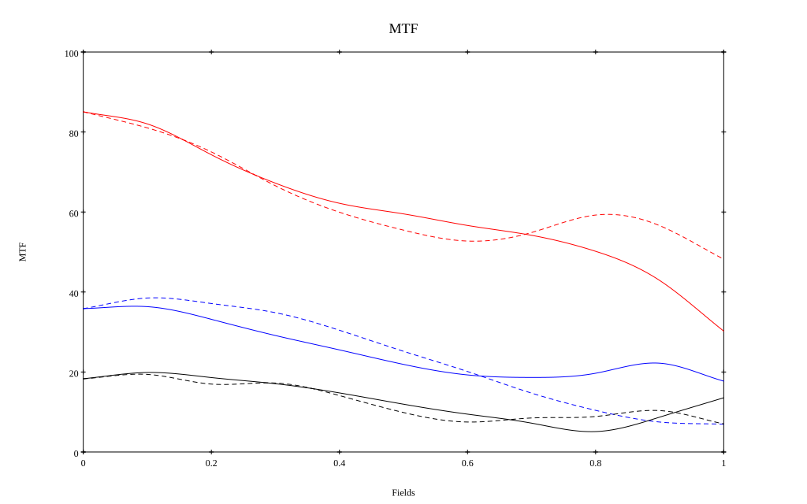
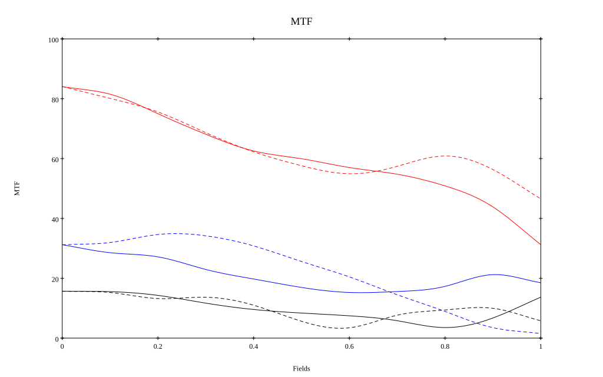

## Surface Data
Note that where glass types are shown the refractive index and abbe number is as per assigned glass type

| ID  | Radius | Thickness | Diameter | nd  | vd  | Glass Make | Glass |
| --- | ---    | ---       | ---      | --- | --- | ---        | ---   |
| 1 | 53.71131 | 5.60465 | 39.56 | 1.7725 | 49.62 | Hoya | TAF1 |
| 2 | 385.50999 | 1.06981 | 38.4659 |  |  |  |
| 3 | 26.89913 | 5.22731 | 33.6 | 1.83481 | 42.72 | Hoya | TAFD5F |
| 4 | 42.47831 | 1.17679 | 31.3068 |  |  |  |
| 5 | 65.66894 | 1.89562 | 31.2286 | 1.64769 | 33.84 | Hoya | E-FD2 |
| 6 | 18.26635 | 8.83859 | 26.4423 |  |  |  |
| 7 | AS | 7.1 | 25.8647 |  |  |  |
| 8 | -19.0832 | 1.97678 | 25.4618 | 1.80518 | 25.46 | Hoya | FD60 |
| 9 | 536.24727 | 6.46576 | 30.0452 | 1.757 | 47.71 | Hoya | NBF2 |
| 10 | -34.42048 | 0.16284 | 31.6579 |  |  |  |
| 11 | -84.89759 | 4.36145 | 32.6961 | 1.883 | 40.81 | Hoya | TAFD30 |
| 12 | -31.49984 | 0.15283 | 33.2 |  |  |  |
| 13 | 131.10811 | 3.05713 | 32.24 | 1.804 | 46.58 | Ohara | LAH65 |
| 14 | -131.11022 | 39.5879 | 32.24 |  |  |  |
## Layouts

## Spot Diagrams

## Paraxial Parameters
| parameter | value |
| ---       | ---   |
| effective_focal_length |52.691
| back_focal_length | 39.601
| optical_invariant | 7.872
| object_distance | 1.0E10
| image_distance | 39.601
| power | 0.019
| pp1_H | 44.326
| ppk_H' | -13.091
| ffl_F | -8.366
| fno | 1.4
| enp_dist_P | 28.761
| enp_radius | 18.818
| exp_dist_P' | -35.167
| exp_radius | 26.707
| m | -0
| red | -1.8978510685041067E8
| n_obj | 1
| n_img | 1
| img_ht | 22.041
| obj_ang | 22.7
| obj_na | 0
| img_na | -0.357|
## Spot Analysis
| Field | Spot Mean Radius (µm) | Spot Max Radius (µm) |
| ---   | ---              | ---             |
 | Field(x=0.0, y=0.0) | 13.034 | 35.051|
 | Field(x=0.0, y=0.1) | 16.134 | 73.77|
 | Field(x=0.0, y=0.2) | 24.106 | 129.747|
 | Field(x=0.0, y=0.3) | 31.877 | 148.346|
 | Field(x=0.0, y=0.4) | 37.245 | 147.514|
 | Field(x=0.0, y=0.5) | 41.915 | 162.745|
 | Field(x=0.0, y=0.6) | 47.542 | 219.923|
 | Field(x=0.0, y=0.7) | 54.958 | 274.387|
 | Field(x=0.0, y=0.8) | 63.779 | 328.615|
 | Field(x=0.0, y=0.9) | 74.583 | 370.826|
 | Field(x=0.0, y=1.0) | 84.98 | 384.88|
## Polychromatic Geometric MTF

* 10=red,30=blue,50=black cycles/mm
* Solid lines represent sagittal, dashed lines tangential
* To generate above, MTFs for wavelengths 587.5618(d), 486.1327(F), 656.2725(C) were calculated across 10 fields, and then averaged
## Polychromatic Geometric MTF (Weighted)

* 10=red,30=blue,50=black cycles/mm
* Solid lines represent sagittal, dashed lines tangential
* To generate above, MTFs for wavelengths 587.5618(d) wt(1.0), 656.2725(C) wt(0.475), 546.074(e) wt(0.98), 486.1327(F) wt(0.49), 435.8343(g) wt(0.15) were calculated across 10 fields, and then combined using weighted average
## Resources
* [OpticalBench Compatible Data File, tab delimited](./prescription.txt)
* [Zemax file](./JP1994-242370_Example02P.zmx)

Generated from `JP1994-242370_Example02P.txt`, status **TODO**

Report / Zemax file generated using [Beam42](https://github.com/BeamFour/Beam42) on 2026-10-17
