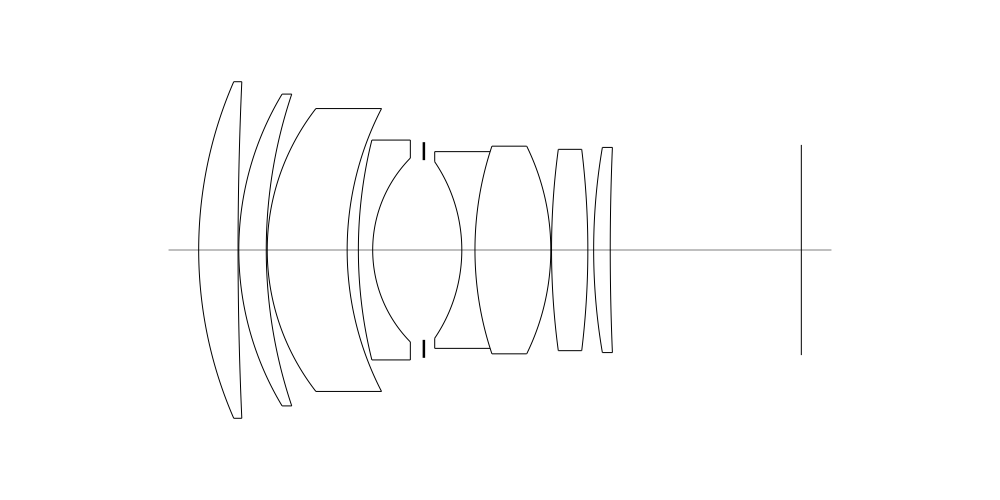
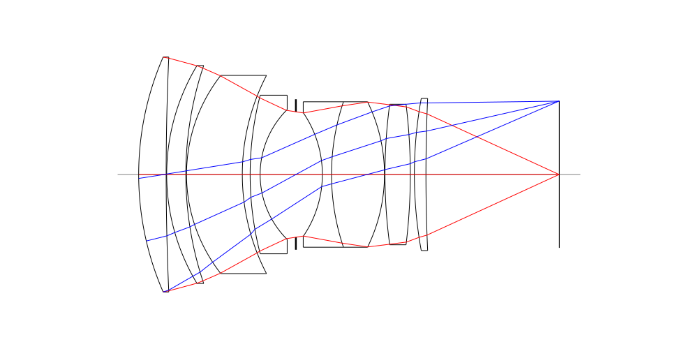
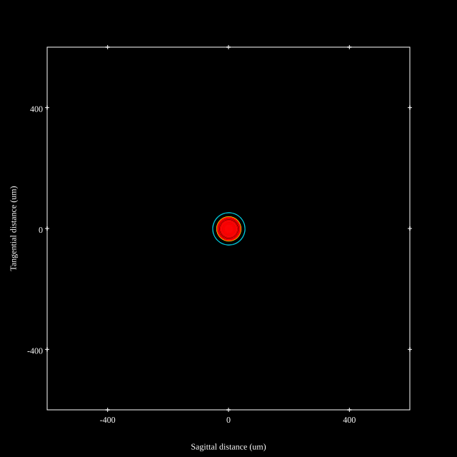
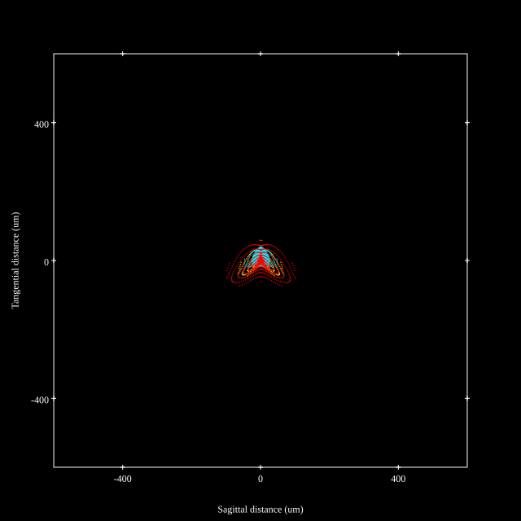
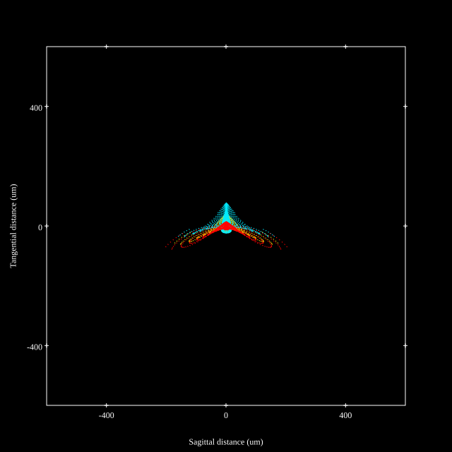
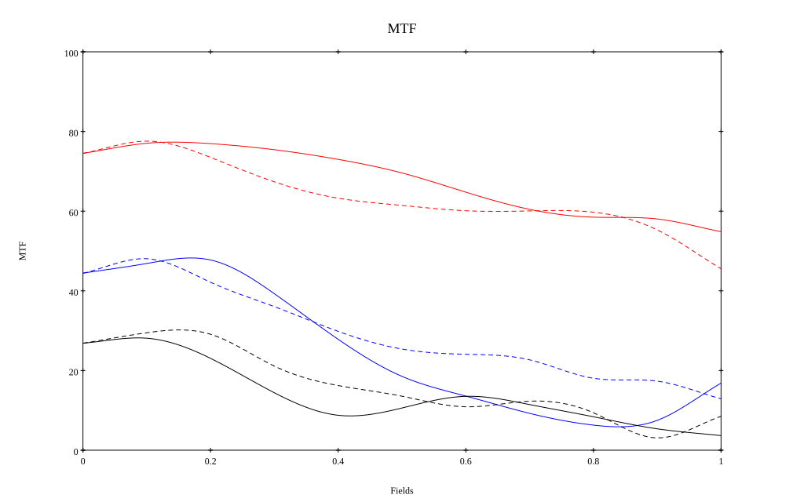
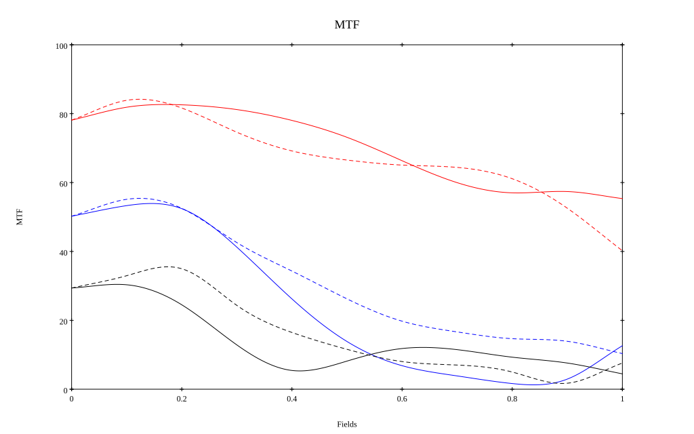

# Canon EF85mm f1.2L USM Prototype
## Patent Information
| Country | Patent Number | Example | Year of Application | Inventors | Organisation | Link |
| ---     | ---           | ---     | ---                 | ---       | ---          | ---  |
|JP | JP-H01-302311 | 4 | 1989 | Endo Hiroshi | Canon Inc | [link](https://www.j-platpat.inpit.go.jp/c1801/PU/JP-H01-302311/11/en) |
## Surface Data
Note that where glass types are shown the refractive index and abbe number is as per assigned glass type

| ID  | Radius | Thickness | Diameter | nd  | vd  | Glass Make | Glass |
| --- | ---    | ---       | ---      | --- | --- | ---        | ---   |
| 1 | 88.791 | 8.296 | 70.91 | 1.6968 | 55.46 | Hoya | LAC14 |
| 2 | 795.473 | 0.153 | 70.91 |  |  |  |
| 3 | 63.682 | 5.789 | 65.78 | 1.6516 | 58.55 | Ohara | S-LAL7 |
| 4 | 103.156 | 0.204 | 64.46 |  |  |  |
| 5 | 48.263 | 16.839 | 59.82 | 1.60311 | 60.69 | Hoya | BACD14 |
| 6 | 64.94 | 2.363 | 47.87 |  |  |  |
| 7 | 95.702 | 3.018 | 47.87 | 1.7552 | 27.53 | Hoya | E-FD4 |
| 8 | 27.617 | 10.787 | 39.2 |  |  |  |
| 9 | AS | 7.99 | 37.855 |  |  |  |
| 10 | -33.091 | 2.771 | 37.34 | 1.68893 | 31.16 | Hoya | E-FD8 |
| 11 | 68.774 | 15.98 | 43.9 | 1.804 | 46.58 | Ohara | LAH65 |
| 12 | -49.657 | 0.153 | 43.9 |  |  |  |
| 13 | 158.525 | 7.65 | 42.42 | 1.883 | 40.81 | Hoya | TAFD30 |
| 14 | -174.896 | 1.224 | 42.42 |  |  |  |
| 15 | 128.036 | 3.494 | 45.92 | 1.60311 | 60.69 | Hoya | BACD14 |
| 16 | 511.7 | 40.26 | 45.92 |  |  |  |
## Aspherical Data
| ID  | Type | k   | P1 | P2 | P3 | P4 |
| --- | --- | --- | --- | --- | --- | --- |
| 5| EVEN | 0.0 | 0.0 | -3.69E-8 | 2.563E-11 | -6.126E-14 |
## Layouts

## Spot Diagrams

## Paraxial Parameters
| parameter | value |
| ---       | ---   |
| effective_focal_length |85.013
| back_focal_length | 40.259
| optical_invariant | 9.225
| object_distance | 1.0E10
| image_distance | 40.259
| power | 0.012
| pp1_H | 75.311
| ppk_H' | -44.754
| ffl_F | -9.702
| fno | 1.2
| enp_dist_P | 71.651
| enp_radius | 35.415
| exp_dist_P' | -48.58
| exp_radius | 37.008
| m | -0
| red | -1.1762856267539608E8
| n_obj | 1
| n_img | 1
| img_ht | 22.144
| obj_ang | 14.6
| obj_na | 0
| img_na | -0.417|
## Spot Analysis
| Field | Spot Mean Radius (µm) | Spot Max Radius (µm) |
| ---   | ---              | ---             |
 | Field(x=0.0, y=0.0) | 18.333 | 53.165|
 | Field(x=0.0, y=0.1) | 17.363 | 52.263|
 | Field(x=0.0, y=0.2) | 19.248 | 67.306|
 | Field(x=0.0, y=0.3) | 22.29 | 91.729|
 | Field(x=0.0, y=0.4) | 24.751 | 102.173|
 | Field(x=0.0, y=0.5) | 25.995 | 102.655|
 | Field(x=0.0, y=0.6) | 26.712 | 104.85|
 | Field(x=0.0, y=0.7) | 27.778 | 117.696|
 | Field(x=0.0, y=0.8) | 31.227 | 140.35|
 | Field(x=0.0, y=0.9) | 37.383 | 178.42|
 | Field(x=0.0, y=1.0) | 46.795 | 218.08|
## Polychromatic Geometric MTF

* 10=red,30=blue,50=black cycles/mm
* Solid lines represent sagittal, dashed lines tangential
* To generate above, MTFs for wavelengths 587.5618(d), 486.1327(F), 656.2725(C) were calculated across 10 fields, and then averaged
## Polychromatic Geometric MTF (Weighted)

* 10=red,30=blue,50=black cycles/mm
* Solid lines represent sagittal, dashed lines tangential
* To generate above, MTFs for wavelengths 587.5618(d) wt(1.0), 656.2725(C) wt(0.475), 546.074(e) wt(0.98), 486.1327(F) wt(0.49), 435.8343(g) wt(0.15) were calculated across 10 fields, and then combined using weighted average
## Resources
* [OpticalBench Compatible Data File, tab delimited](./prescription.txt)
* [Zemax file](./JP1989-302311_Example04.zmx)

Generated from `JP1989-302311_Example04.txt`, status **TODO**

Report / Zemax file generated using [Beam42](https://github.com/BeamFour/Beam42) on 2026-11-16
