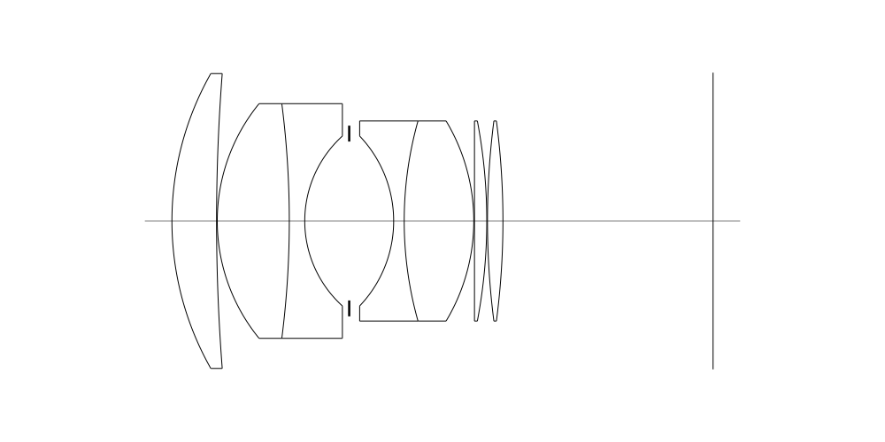
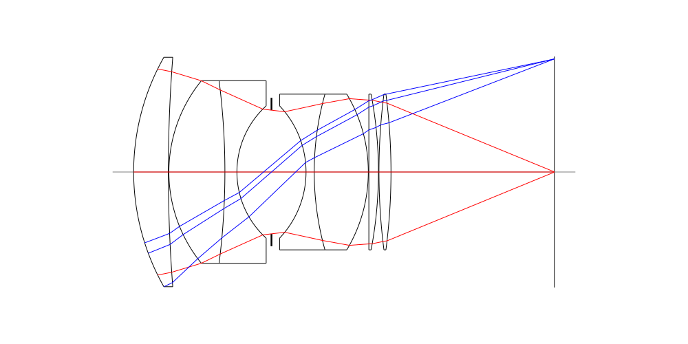
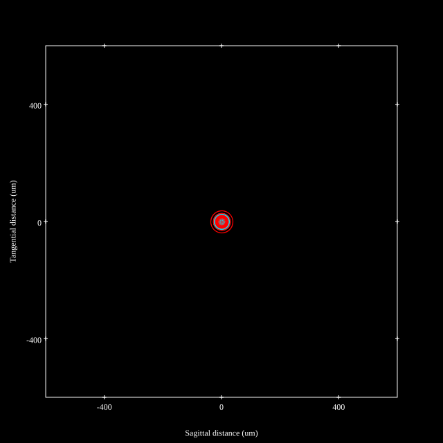
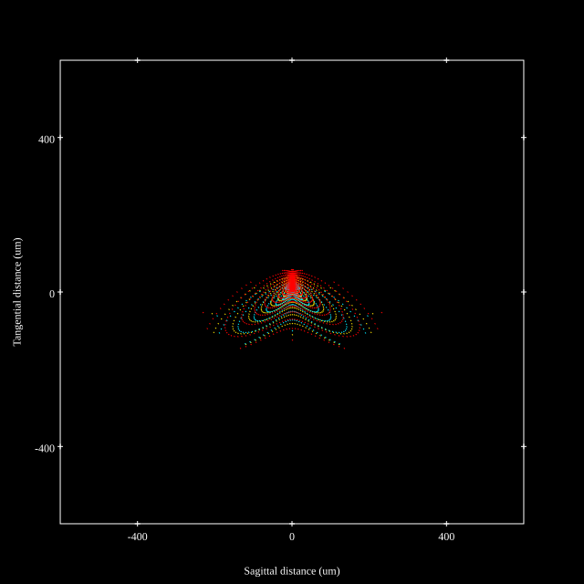
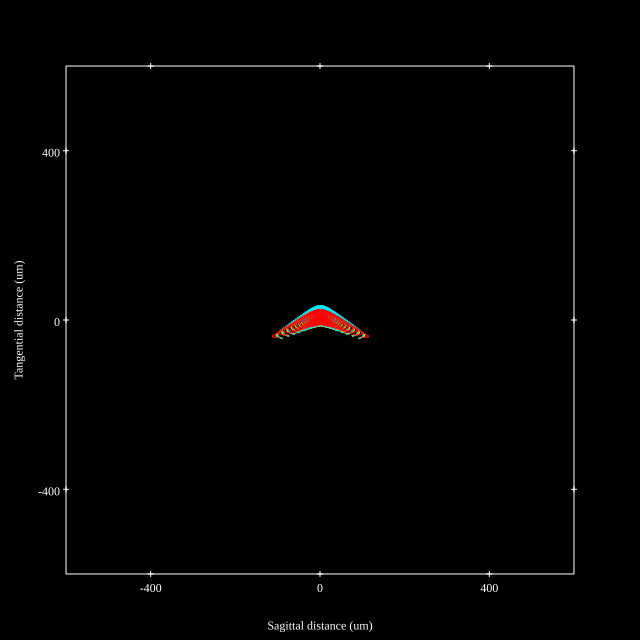
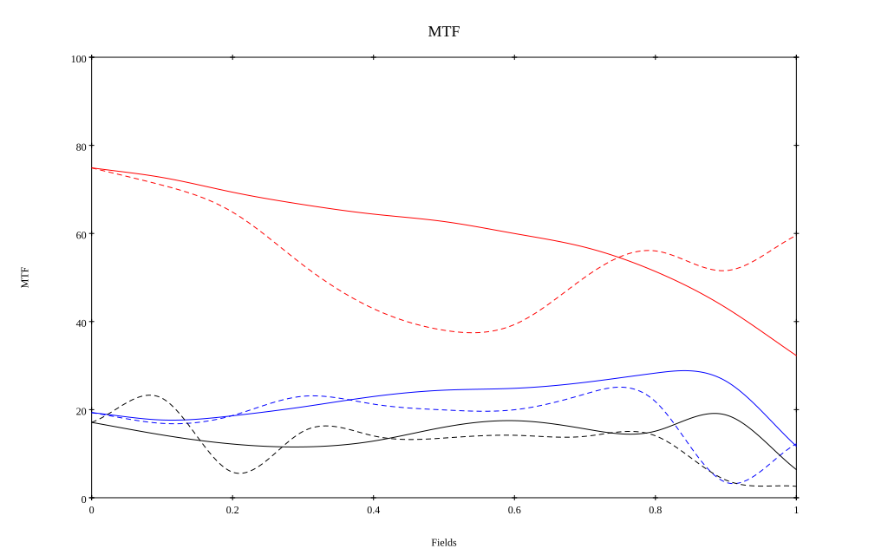
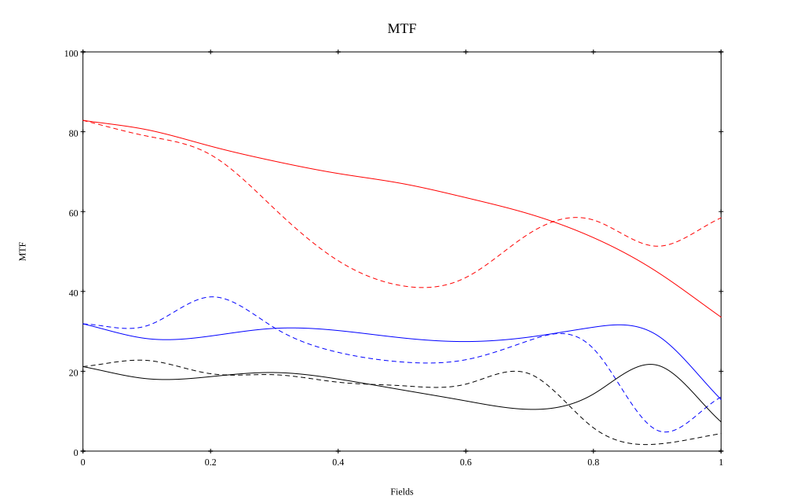

## Surface Data
Note that where glass types are shown the refractive index and abbe number is as per assigned glass type

| ID  | Radius | Thickness | Diameter | nd  | vd  | Glass Make | Glass |
| --- | ---    | ---       | ---      | --- | --- | ---        | ---   |
| 1 | 42.65 | 6.35 | 42.0 | 1.72342 | 37.99 | Hoya | BAFD8 |
| 2 | 273.15 | 0.1 | 42.0 |  |  |  |
| 3 | 26.45 | 10.25 | 33.43 | 1.66755 | 41.93 | Hoya | BAFD6 |
| 4 | -131.8 | 2.2 | 33.43 | 1.7552 | 27.53 | Hoya | E-FD4 |
| 5 | 16.35 | 6.325 | 24.2 |  |  |  |
| 6 | AS | 6.325 | 22.637 |  |  |  |
| 7 | -17.55 | 1.5 | 24.2 | 1.5927 | 35.45 | Hoya | FF5 |
| 8 | 52.75 | 9.9 | 28.5 | 1.713 | 53.94 | Hoya | LAC8 |
| 9 | -27.75 | 0.1 | 28.5 |  |  |  |
| 10 | 0.0 | 1.75 | 28.5 | 1.72 | 50.34 | Hoya | LAC10 |
| 11 | -76.4 | 0.1 | 28.5 |  |  |  |
| 12 | 112.05 | 2.2 | 28.5 | 1.744 | 44.9 | Hoya | LAF2 |
| 13 | -109.75 | 29.9 | 28.5 |  |  |  |
## Layouts

## Spot Diagrams

## Paraxial Parameters
| parameter | value |
| ---       | ---   |
| effective_focal_length |49.792
| back_focal_length | 30.032
| optical_invariant | 8.007
| object_distance | 1.0E10
| image_distance | 30.032
| power | 0.02
| pp1_H | 43.196
| ppk_H' | -19.759
| ffl_F | -6.596
| fno | 1.32
| enp_dist_P | 32.022
| enp_radius | 18.863
| exp_dist_P' | -34.034
| exp_radius | 24.321
| m | -0
| red | -2.0083685762591588E8
| n_obj | 1
| n_img | 1
| img_ht | 21.135
| obj_ang | 23
| obj_na | 0
| img_na | -0.379|
## Spot Analysis
| Field | Spot Mean Radius (µm) | Spot Max Radius (µm) |
| ---   | ---              | ---             |
 | Field(x=0.0, y=0.0) | 17.355 | 44.2|
 | Field(x=0.0, y=0.1) | 19.841 | 83.104|
 | Field(x=0.0, y=0.2) | 26.442 | 126.711|
 | Field(x=0.0, y=0.3) | 35.932 | 166.016|
 | Field(x=0.0, y=0.4) | 44.01 | 190.943|
 | Field(x=0.0, y=0.5) | 49.95 | 197.662|
 | Field(x=0.0, y=0.6) | 53.931 | 207.582|
 | Field(x=0.0, y=0.7) | 59.169 | 247.356|
 | Field(x=0.0, y=0.8) | 66.43 | 306.495|
 | Field(x=0.0, y=0.9) | 64.322 | 260.155|
 | Field(x=0.0, y=1.0) | 38.88 | 119.355|
## Polychromatic Geometric MTF

* 10=red,30=blue,50=black cycles/mm
* Solid lines represent sagittal, dashed lines tangential
* To generate above, MTFs for wavelengths 587.5618(d), 486.1327(F), 656.2725(C) were calculated across 10 fields, and then averaged
## Polychromatic Geometric MTF (Weighted)

* 10=red,30=blue,50=black cycles/mm
* Solid lines represent sagittal, dashed lines tangential
* To generate above, MTFs for wavelengths 587.5618(d) wt(1.0), 656.2725(C) wt(0.475), 546.074(e) wt(0.98), 486.1327(F) wt(0.49), 435.8343(g) wt(0.15) were calculated across 10 fields, and then combined using weighted average
## Resources
* [OpticalBench Compatible Data File, tab delimited](./prescription.txt)
* [Zemax file](./JP-S40-024553_Example01.zmx)

Generated from `JP-S40-024553_Example01.txt`, status **TODO**

Report / Zemax file generated using [Beam42](https://github.com/BeamFour/Beam42) on 2026-11-24
