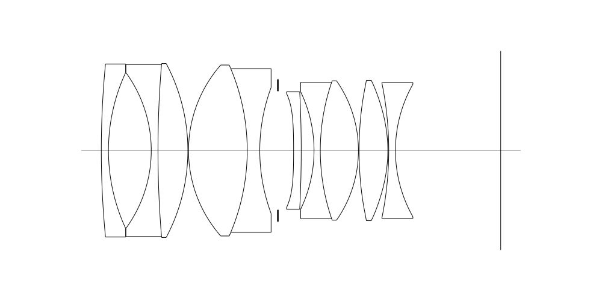
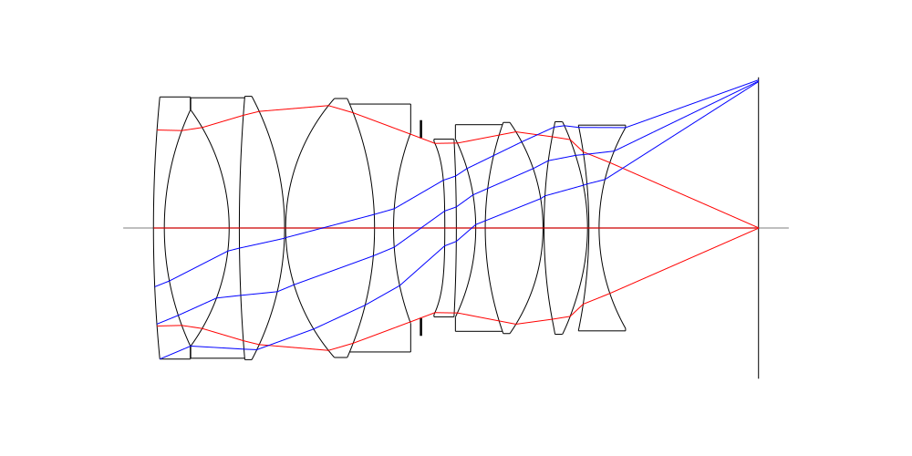
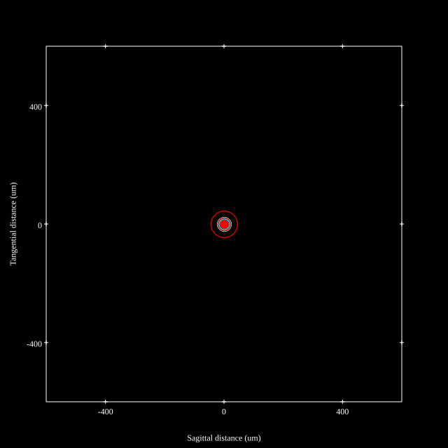
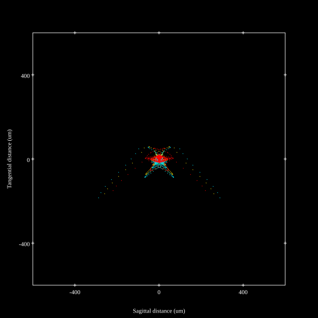
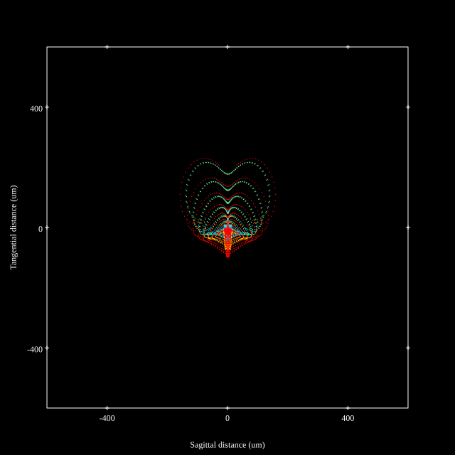
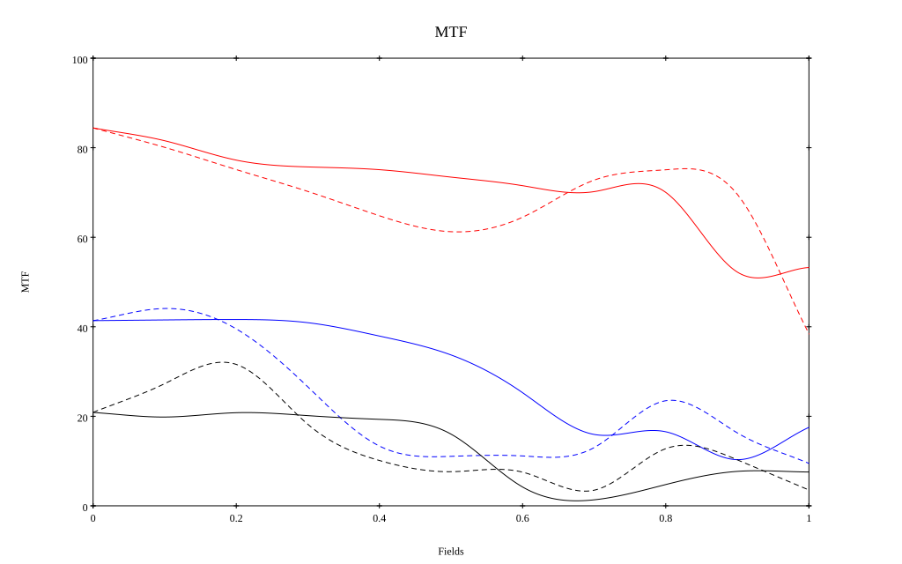
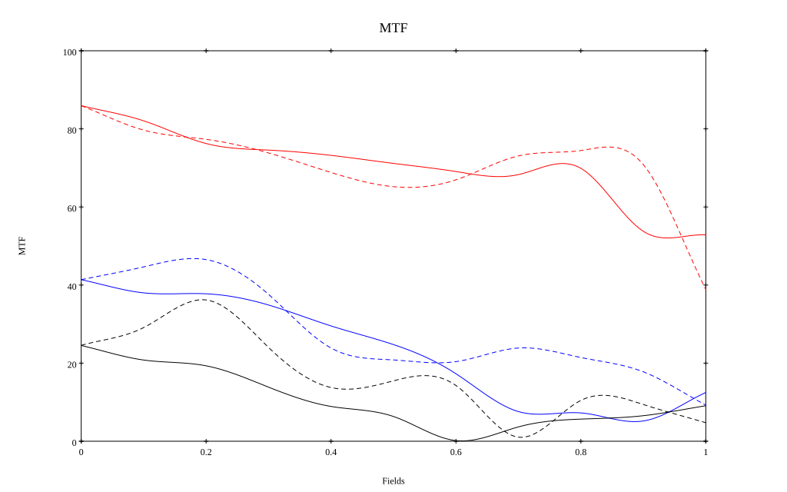

# Cosina Voigtlander Nokton 35mm F1.2 Aspherical I / II
## Patent Information
| Country | Patent Number | Example | Year of Application | Inventors | Organisation | Link |
| ---     | ---           | ---     | ---                 | ---       | ---          | ---  |
|JP | JP2004-101880 | EX 2 | 2002 | Yoshihisa Yomogida | Cosina Co Ltd | [link](https://patents.google.com/patent/JP2004101880A/en) |
## Surface Data
Note that where glass types are shown the refractive index and abbe number is as per assigned glass type

| ID  | Radius | Thickness | Diameter | nd  | vd  | Glass Make | Glass |
| --- | ---    | ---       | ---      | --- | --- | ---        | ---   |
| 1 | 200.0 | 1.6 | 38.6185 | 1.48749 | 70.44 | Hoya | FC5 |
| 2 | 41.361 | 9.55 | 34.82 |  |  |  |
| 3 | -29.539 | 1.5 | 34.8168 | 1.56732 | 42.84 | Hoya | E-FL6 |
| 4 | 233.985 | 6.67 | 38.374 | 1.8042 | 46.5 | Hoya | TAF3 |
| 5 | -41.35 | 0.15 | 38.8 |  |  |  |
| 6 | 28.934 | 13.1 | 38.1534 | 1.8042 | 46.5 | Hoya | TAF3 |
| 7 | -47.262 | 2.8 | 36.5287 | 1.64769 | 33.84 | Hoya | E-FD2 |
| 8 | 40.326 | 4.04 | 28.1009 |  |  |  |
| 9 | AS | 3.51 | 26.4814 |  |  |  |
| 10 | -200.0 | 1.7 | 25.5323 | 1.806 | 40.71 | SUMITA | LASFN1 |
| 11 | -254.022 | 2.86 | 26.1802 |  |  |  |
| 12 | -30.236 | 1.4 | 26.2477 | 1.80518 | 25.47 | Hoya | FD6 |
| 13 | 46.963 | 8.51 | 30.4456 | 1.8042 | 46.5 | Hoya | TAF3 |
| 14 | -27.172 | 0.15 | 31.1029 |  |  |  |
| 15 | 81.004 | 6.41 | 31.32 | 1.8061 | 40.73 | Hoya | M-NBFD130 |
| 16 | -31.428 | 0.2 | 31.32 |  |  |  |
| 17 | -75.075 | 1.5 | 30.3151 | 1.54814 | 45.82 | Hoya | E-FEL1 |
| 18 | 30.0 | 23.4914 | 29.58 |  |  |  |
## Aspherical Data
| ID  | Type | k   | P1 | P2 | P3 | P4 | P5 |
| --- | --- | --- | --- | --- | --- | --- | --- |
| 10| EVEN | 0.0 | 0.0 | -3.46513E-5 | -5.82425E-8 | -3.01558E-11 | 7.98551E-14 |
| 15| EVEN | 0.0 | 0.0 | 3.63823E-6 | -2.57284E-8 | 2.13341E-10 | -5.87072E-13 |
| 16| EVEN | 0.0 | 0.0 | 1.17867E-5 | -3.91138E-8 | 2.32768E-10 | -5.55678E-13 |
## Layouts

## Spot Diagrams

## Paraxial Parameters
| parameter | value |
| ---       | ---   |
| effective_focal_length |35.808
| back_focal_length | 23.51
| optical_invariant | 8.952
| object_distance | 1.0E10
| image_distance | 23.51
| power | 0.028
| pp1_H | 35.508
| ppk_H' | -12.298
| ffl_F | -0.3
| fno | 1.24
| enp_dist_P | 25.797
| enp_radius | 14.439
| exp_dist_P' | -25.605
| exp_radius | 19.812
| m | -0
| red | -2.7926608965468544E8
| n_obj | 1
| n_img | 1
| img_ht | 22.202
| obj_ang | 31.8
| obj_na | 0
| img_na | -0.403|
## Spot Analysis
| Field | Spot Mean Radius (µm) | Spot Max Radius (µm) |
| ---   | ---              | ---             |
 | Field(x=0.0, y=0.0) | 14.916 | 65.126|
 | Field(x=0.0, y=0.1) | 18.73 | 96.698|
 | Field(x=0.0, y=0.2) | 29.139 | 249.549|
 | Field(x=0.0, y=0.3) | 49.373 | 533.87|
 | Field(x=0.0, y=0.4) | 47.152 | 402.938|
 | Field(x=0.0, y=0.5) | 45.369 | 317.79|
 | Field(x=0.0, y=0.6) | 37.194 | 316.799|
 | Field(x=0.0, y=0.7) | 30.425 | 336.829|
 | Field(x=0.0, y=0.8) | 27.005 | 335.433|
 | Field(x=0.0, y=0.9) | 43.626 | 248.009|
 | Field(x=0.0, y=1.0) | 64.159 | 250.141|
## Polychromatic Geometric MTF

* 10=red,30=blue,50=black cycles/mm
* Solid lines represent sagittal, dashed lines tangential
* To generate above, MTFs for wavelengths 587.5618(d), 486.1327(F), 656.2725(C) were calculated across 10 fields, and then averaged
## Polychromatic Geometric MTF (Weighted)

* 10=red,30=blue,50=black cycles/mm
* Solid lines represent sagittal, dashed lines tangential
* To generate above, MTFs for wavelengths 587.5618(d) wt(1.0), 656.2725(C) wt(0.475), 546.074(e) wt(0.98), 486.1327(F) wt(0.49), 435.8343(g) wt(0.15) were calculated across 10 fields, and then combined using weighted average
## Resources
* [OpticalBench Compatible Data File, tab delimited](./prescription.txt)
* [Zemax file](./Cosina-35mm-f1.2.zmx)

Generated from `Cosina-35mm-f1.2.txt`, status **Candidate**

Report / Zemax file generated using [Beam42](https://github.com/BeamFour/Beam42) on 2026-10-26
