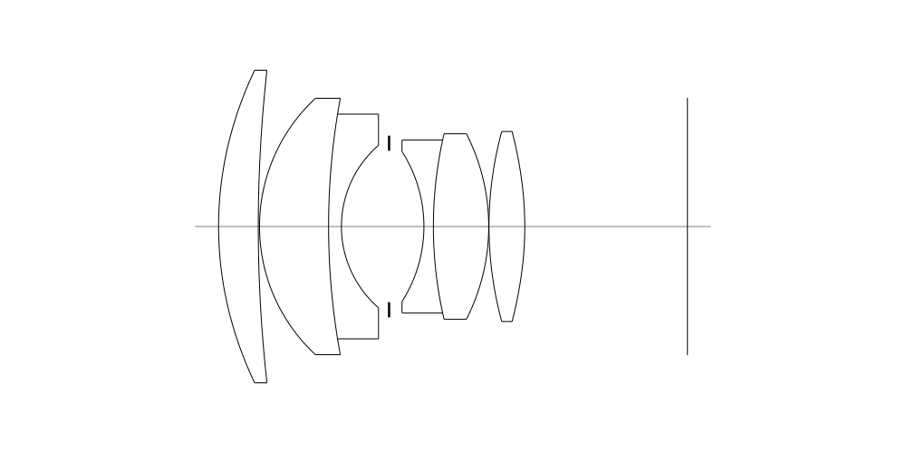
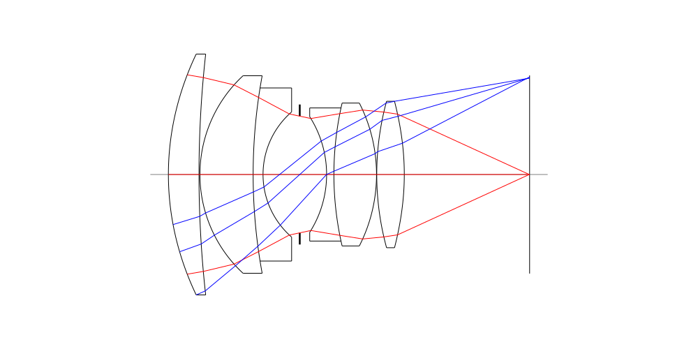
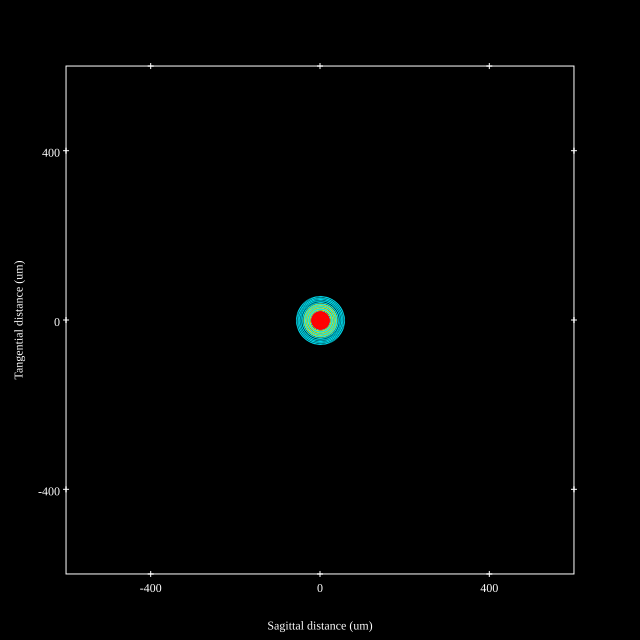
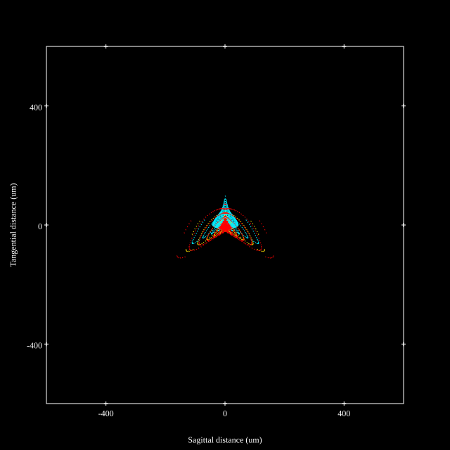
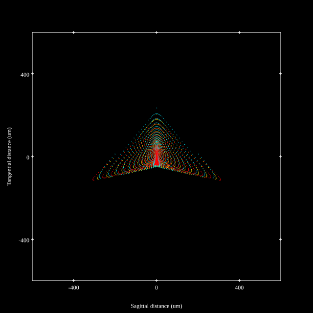
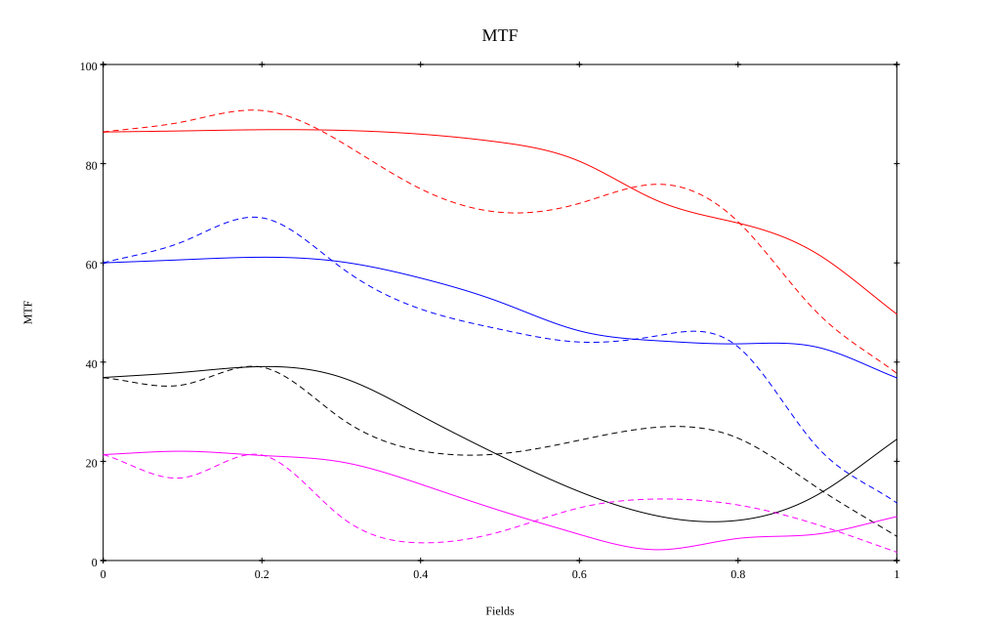
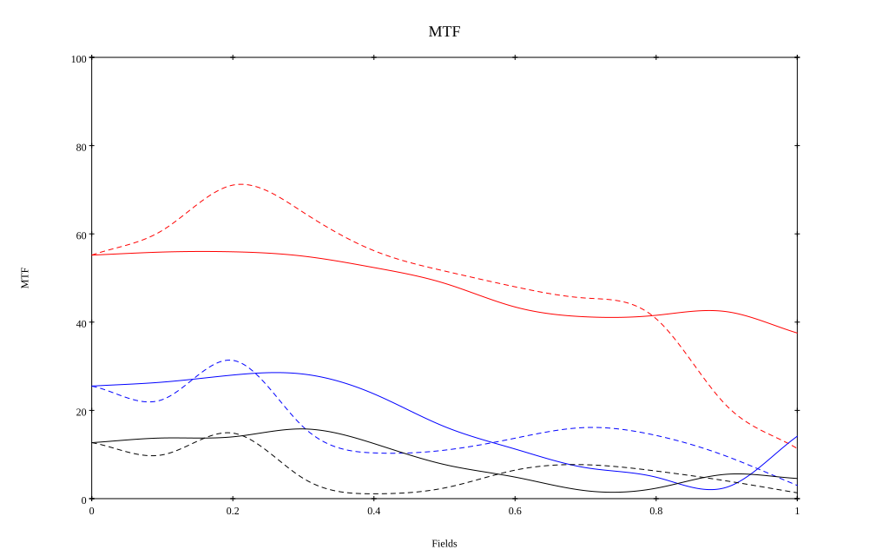

# Leica 50mm Noctilux f/1.2
## Patent Information
| Country | Patent Number | Example | Year of Application | Inventors | Organisation | Link |
| ---     | ---           | ---     | ---                 | ---       | ---          | ---  |
|US | US3459468 | EX 1 | 1965 | Helmut Marx,Paul Sindel | Ernst Leitz Wetzlar GmbH | [link](https://patents.google.com/patent/US12181644B2/en) |
## Surface Data
Note that where glass types are shown the refractive index and abbe number is as per assigned glass type

| ID  | Radius | Thickness | Diameter | nd  | vd  | Glass Make | Glass |
| --- | ---    | ---       | ---      | --- | --- | ---        | ---   |
| 1 | 59.448600013881325 | 6.76 | 53.2 | 1.8155 | 44.54 | Hoya | TAFD10 |
| 2 | 240.6693627814712 | 0.208 | 51.9048 |  |  |  |
| 3 | 29.757977779320424 | 11.752 | 43.6267 | 1.883 | 40.77 | Ohara | S-LAH58 |
| 4 | 120.4874247093572 | 2.184 | 38.2344 | 1.7847 | 26.1 | Schott | N-SF56 |
| 5 | 18.28898048773404 | 8.112 | 27.646 |  |  |  |
| 6 | AS | 5.928 | 25.7705 |  |  |  |
| 7 | -23.706884106422095 | 1.612 | 25.5291 | 1.83641 | 30.21 | CORNING | E37-30 |
| 8 | 69.58152646483903 | 9.412 | 29.4029 | 1.883 | 40.77 | Ohara | S-LAH58 |
| 9 | -34.70562872739388 | 0.052 | 31.5575 |  |  |  |
| 10 | 61.40297549638937 | 6.084 | 32.34 | 1.691 | 54.84 | Ohara | LAL9 |
| 11 | -57.78936682453837 | 27.68 | 32.34 |  |  |  |
## Aspherical Data
| ID  | Type | k   | P1 | P2 | P3 | P4 | P5 |
| --- | --- | --- | --- | --- | --- | --- | --- |
| 1| EVEN | -0.08751989251541603 | 0.0 | -1.6621491530904772E-7 | -8.423204937605217E-11 | -1.2379359913309799E-13 | 1.9622754248879732E-16 |
| 11| EVEN | -2.541488358769588 | 0.0 | 7.437459051898021E-7 | -6.989852139604381E-10 | -2.3051166704365135E-13 | 2.1969463246493716E-15 |
## Layouts

## Spot Diagrams

## Paraxial Parameters
| parameter | value |
| ---       | ---   |
| effective_focal_length |52.831
| back_focal_length | 27.81
| optical_invariant | 9.118
| object_distance | 1.0E10
| image_distance | 27.81
| power | 0.019
| pp1_H | 41.074
| ppk_H' | -25.021
| ffl_F | -11.757
| fno | 1.2
| enp_dist_P | 37.321
| enp_radius | 22.013
| exp_dist_P' | -28.931
| exp_radius | 23.696
| m | -0
| red | -1.892836731757472E8
| n_obj | 1
| n_img | 1
| img_ht | 21.883
| obj_ang | 22.5
| obj_na | 0
| img_na | -0.417|
## Spot Analysis
| Field | Spot Mean Radius (µm) | Spot Max Radius (µm) |
| ---   | ---              | ---             |
 | Field(x=0.0, y=0.0) | 24.839 | 56.277|
 | Field(x=0.0, y=0.1) | 23.682 | 56.321|
 | Field(x=0.0, y=0.2) | 22.271 | 53.286|
 | Field(x=0.0, y=0.3) | 25.994 | 101.034|
 | Field(x=0.0, y=0.4) | 32.591 | 142.19|
 | Field(x=0.0, y=0.5) | 35.978 | 147.145|
 | Field(x=0.0, y=0.6) | 35.19 | 142.87|
 | Field(x=0.0, y=0.7) | 39.334 | 192.66|
 | Field(x=0.0, y=0.8) | 56.728 | 282.76|
 | Field(x=0.0, y=0.9) | 78.498 | 333.438|
 | Field(x=0.0, y=1.0) | 95.324 | 328.806|
## Polychromatic Geometric MTF

* 5=red,10=blue,20=black,40=magenta cycles/mm
* Solid lines represent sagittal, dashed lines tangential
* To generate above, MTFs for wavelengths 587.5618(d), 486.1327(F), 656.2725(C) were calculated across 10 fields, and then averaged
## Polychromatic Geometric MTF (Weighted)

* 5=red,10=blue,20=black,40=magenta cycles/mm
* Solid lines represent sagittal, dashed lines tangential
* To generate above, MTFs for wavelengths 587.5618(d) wt(1.0), 656.2725(C) wt(0.475), 546.074(e) wt(0.98), 486.1327(F) wt(0.49), 435.8343(g) wt(0.15) were calculated across 10 fields, and then combined using weighted average
## Resources
* [OpticalBench Compatible Data File, tab delimited](./prescription.txt)
* [Zemax file](./US003459468_Example01-trial3.zmx)

Generated from `US003459468_Example01-trial3.txt`, status **TODO**

Report / Zemax file generated using [Beam42](https://github.com/BeamFour/Beam42) on 2026-11-01
