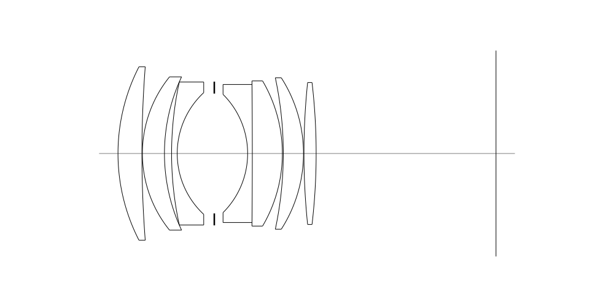
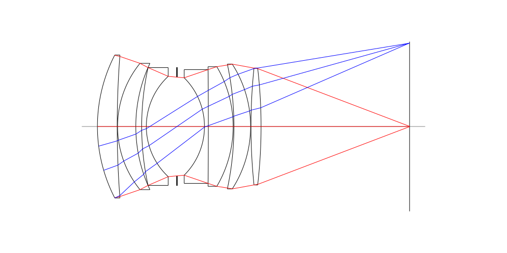
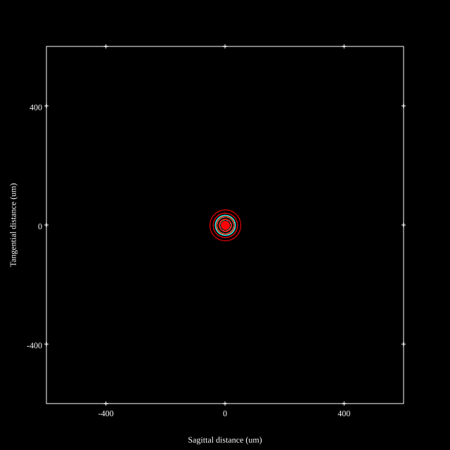
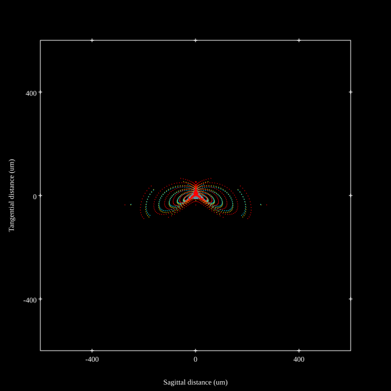
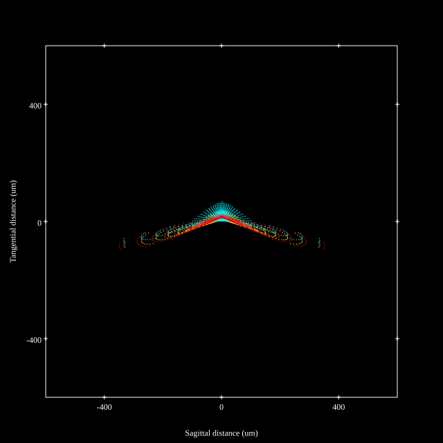
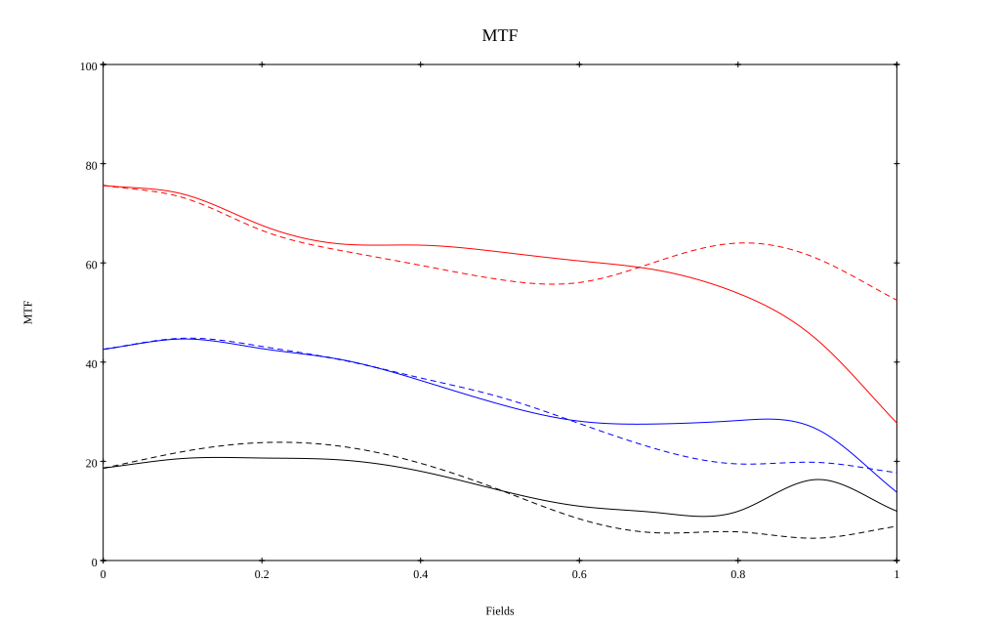
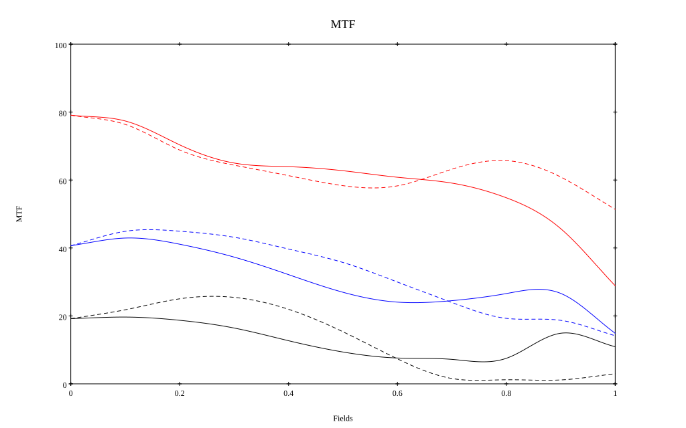

# AF Nikkor 50mm f1.4D / 50mm f1.4 AIS
## Patent Information
| Country | Patent Number | Example | Year of Application | Inventors | Organisation | Link |
| ---     | ---           | ---     | ---                 | ---       | ---          | ---  |
|US | US4448497 | EX 1 | 1981 | Koichi Wakamiya | Nikon Corp | [link](https://patents.google.com/patent/US4448497) |
## Surface Data
Note that where glass types are shown the refractive index and abbe number is as per assigned glass type

| ID  | Radius | Thickness | Diameter | nd  | vd  | Glass Make | Glass |
| --- | ---    | ---       | ---      | --- | --- | ---        | ---   |
| 1 | 40.43 | 5.1 | 36.95 | 1.7945 | 45.39 | Hoya | TAF2 |
| 2 | 242.25 | 0.1 | 36.3133 |  |  |  |
| 3 | 25.95 | 4.7 | 32.6589 | 1.7725 | 49.62 | Hoya | TAF1 |
| 4 | 38.38 | 1.52 | 30.4711 |  |  |  |
| 5 | 71.28 | 1.2 | 30.4563 | 1.6727 | 32.21 | Schott | SF5 |
| 6 | 17.71 | 7.9 | 25.9282 |  |  |  |
| 7 | AS | 7.1 | 25.5198 |  |  |  |
| 8 | -17.75 | 1.0 | 25.1828 | 1.74 | 28.28 | Ohara | PBH3 |
| 9 | -1500.0 | 6.4 | 29.41 | 1.7725 | 49.62 | Hoya | TAF1 |
| 10 | -30.47 | 0.2 | 30.9263 |  |  |  |
| 11 | -77.41 | 4.3 | 31.8038 | 1.788 | 47.49 | Hoya | TAF4 |
| 12 | -29.87 | 0.1 | 32.25 |  |  |  |
| 13 | 146.87 | 2.6 | 30.24 | 1.788 | 47.49 | Hoya | TAF4 |
| 14 | -130.66 | 38.32 | 30.24 |  |  |  |
## Layouts

## Spot Diagrams

## Paraxial Parameters
| parameter | value |
| ---       | ---   |
| effective_focal_length |51.66
| back_focal_length | 38.385
| optical_invariant | 7.832
| object_distance | 1.0E10
| image_distance | 38.385
| power | 0.019
| pp1_H | 38.385
| ppk_H' | -13.275
| ffl_F | -13.275
| fno | 1.4
| enp_dist_P | 24.959
| enp_radius | 18.45
| exp_dist_P' | -31.35
| exp_radius | 24.928
| m | -0
| red | -1.9357422773784596E8
| n_obj | 1
| n_img | 1
| img_ht | 21.928
| obj_ang | 23
| obj_na | 0
| img_na | -0.357|
## Spot Analysis
| Field | Spot Mean Radius (µm) | Spot Max Radius (µm) |
| ---   | ---              | ---             |
 | Field(x=0.0, y=0.0) | 18.736 | 57.004|
 | Field(x=0.0, y=0.1) | 20.907 | 76.195|
 | Field(x=0.0, y=0.2) | 27.717 | 113.536|
 | Field(x=0.0, y=0.3) | 34.541 | 130.604|
 | Field(x=0.0, y=0.4) | 39.408 | 138.768|
 | Field(x=0.0, y=0.5) | 42.985 | 180.975|
 | Field(x=0.0, y=0.6) | 46.606 | 229.44|
 | Field(x=0.0, y=0.7) | 52.573 | 280.021|
 | Field(x=0.0, y=0.8) | 61.058 | 326.405|
 | Field(x=0.0, y=0.9) | 71.556 | 359.489|
 | Field(x=0.0, y=1.0) | 83.072 | 360.056|
## Polychromatic Geometric MTF

* 10=red,30=blue,50=black cycles/mm
* Solid lines represent sagittal, dashed lines tangential
* To generate above, MTFs for wavelengths 587.5618(d), 486.1327(F), 656.2725(C) were calculated across 10 fields, and then averaged
## Polychromatic Geometric MTF (Weighted)

* 10=red,30=blue,50=black cycles/mm
* Solid lines represent sagittal, dashed lines tangential
* To generate above, MTFs for wavelengths 587.5618(d) wt(1.0), 656.2725(C) wt(0.475), 546.074(e) wt(0.98), 486.1327(F) wt(0.49), 435.8343(g) wt(0.15) were calculated across 10 fields, and then combined using weighted average
## Resources
* [OpticalBench Compatible Data File, tab delimited](./prescription.txt)
* [Zemax file](./US004448497_Example01a.zmx)

Generated from `US004448497_Example01a.txt`, status **TODO**

Report / Zemax file generated using [Beam42](https://github.com/BeamFour/Beam42) on 2026-10-16
