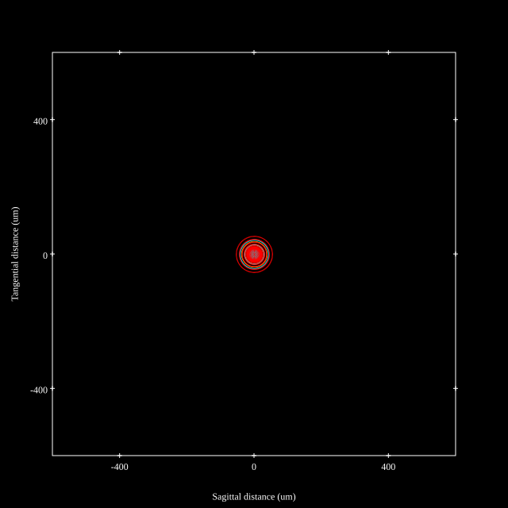
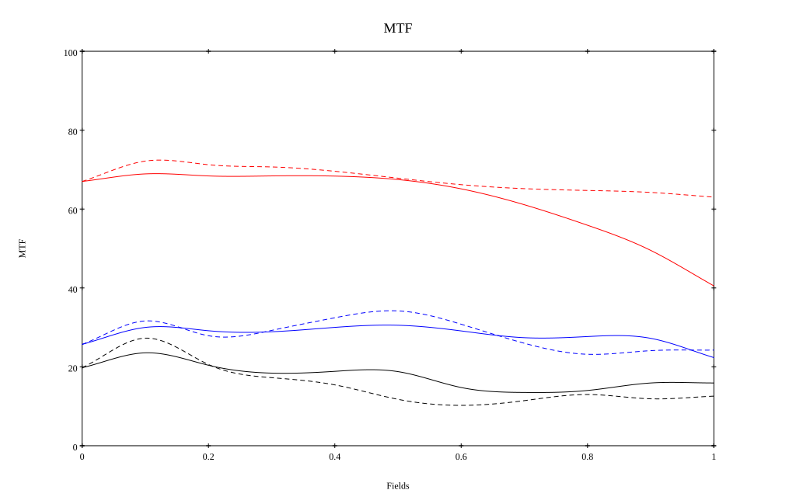

## Surface Data
Note that where glass types are shown the refractive index and abbe number is as per assigned glass type

| ID  | Radius | Thickness | Diameter | nd  | vd  | Glass Make | Glass |
| --- | ---    | ---       | ---      | --- | --- | ---        | ---   |
| 1 | 66.436 | 7.497 | 60.79 | 1.77279 | 49.4 |  |
| 2 | 346.596 | 1.496 | 60.79 |  |  |  |
| 3 | 37.128 | 9.6985 | 52.91 | 1.6968 | 55.53 | Ohara | LAL14 |
| 4 | 96.5005 | 1.496 | 51.06 |  |  |  |
| 5 | 167.28 | 6.5025 | 51.06 | 1.7847 | 26.1 | Hoya | FDS30 |
| 6 | -120.003 | 2.7965 | 51.06 | 1.7552 | 27.53 | Hoya | E-FD4 |
| 7 | 23.6385 | 11.799 | 36.26 |  |  |  |
| 8 | AS | 7.7 | 34.244 |  |  |  |
| 9 | -31.4075 | 1.496 | 35.14 | 1.58144 | 40.89 | Hoya | E-FL5 |
| 10 | 79.8065 | 8.704 | 38.8 | 1.74443 | 49.4 |  |
| 11 | -39.8055 | 0.3995 | 38.8 |  |  |  |
| 12 | 106.0035 | 4.8025 | 34.04 | 1.74443 | 49.4 |  |
| 13 | -322.405 | 42.5345 | 32.9 |  |  |  |
## Layouts

## Spot Diagrams

## Paraxial Parameters
| parameter | value |
| ---       | ---   |
| effective_focal_length |85.013
| back_focal_length | 42.652
| optical_invariant | 7.709
| object_distance | 1.0E10
| image_distance | 42.652
| power | 0.012
| pp1_H | 37.971
| ppk_H' | -42.361
| ffl_F | -47.042
| fno | 1.4
| enp_dist_P | 62.108
| enp_radius | 30.355
| exp_dist_P' | -23.445
| exp_radius | 23.642
| m | -0
| red | -1.1762897322928151E8
| n_obj | 1
| n_img | 1
| img_ht | 21.591
| obj_ang | 14.25
| obj_na | 0
| img_na | -0.357|
## Spot Analysis
| Field | Spot Mean Radius (µm) | Spot Max Radius (µm) |
| ---   | ---              | ---             |
 | Field(x=0.0, y=0.0) | 23.244 | 60.891|
 | Field(x=0.0, y=0.1) | 24.13 | 93.68|
 | Field(x=0.0, y=0.2) | 26.804 | 110.139|
 | Field(x=0.0, y=0.3) | 28.374 | 122.583|
 | Field(x=0.0, y=0.4) | 29.141 | 122.646|
 | Field(x=0.0, y=0.5) | 30.389 | 129.657|
 | Field(x=0.0, y=0.6) | 32.416 | 142.823|
 | Field(x=0.0, y=0.7) | 35.059 | 161.058|
 | Field(x=0.0, y=0.8) | 39.88 | 187.67|
 | Field(x=0.0, y=0.9) | 47.07 | 217.407|
 | Field(x=0.0, y=1.0) | 56.94 | 248.449|
## Polychromatic Geometric MTF

* 10=red,30=blue,50=black cycles/mm
* Solid lines represent sagittal, dashed lines tangential
* To generate above, MTFs for wavelengths 587.5618(d), 486.1327(F), 656.2725(C) were calculated across 10 fields, and then averaged
## Polychromatic Geometric MTF (Weighted)

* 10=red,30=blue,50=black cycles/mm
* Solid lines represent sagittal, dashed lines tangential
* To generate above, MTFs for wavelengths 587.5618(d) wt(1.0), 656.2725(C) wt(0.475), 546.074(e) wt(0.98), 486.1327(F) wt(0.49), 435.8343(g) wt(0.15) were calculated across 10 fields, and then combined using weighted average
## Resources
* [OpticalBench Compatible Data File, tab delimited](./prescription.txt)
* [Zemax file](./US004396256_Example01.zmx)

Generated from `US004396256_Example01.txt`, status **TODO**

Report / Zemax file generated using [Beam42](https://github.com/BeamFour/Beam42) on 2026-11-16
