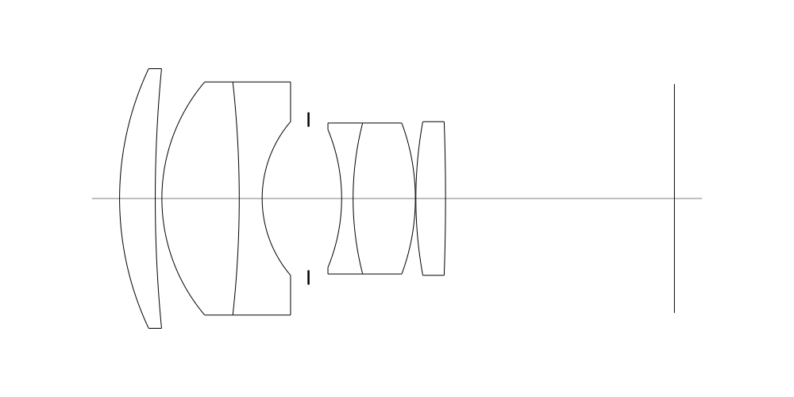
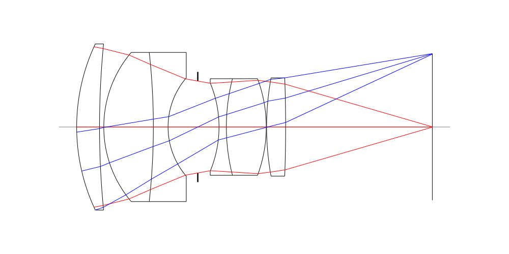
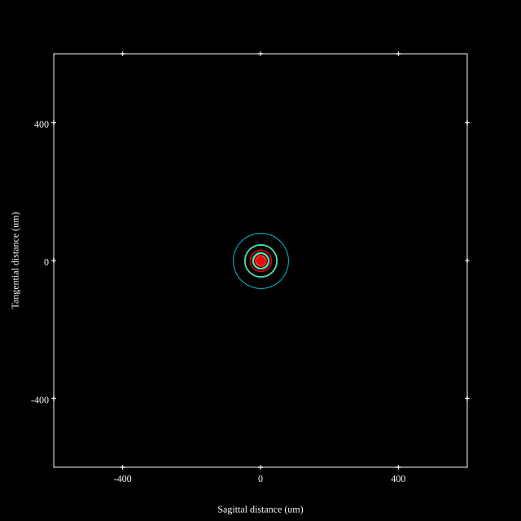
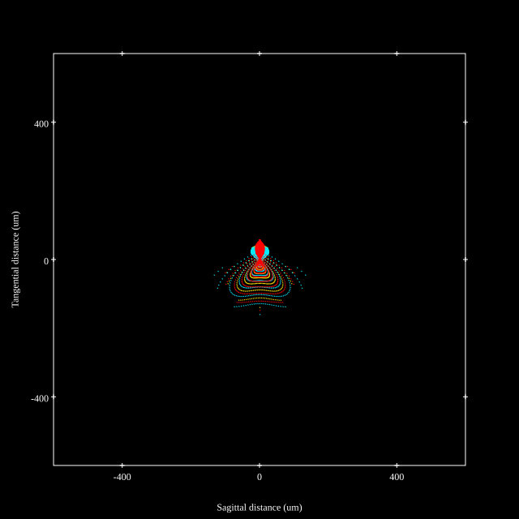
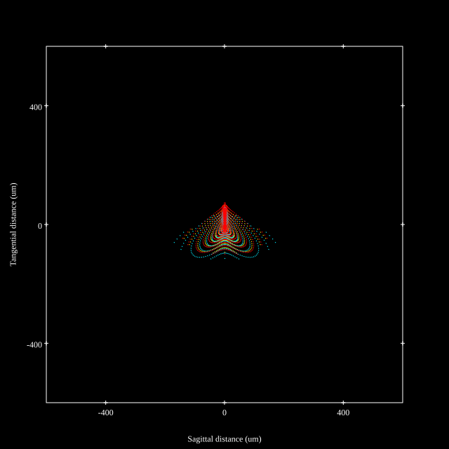
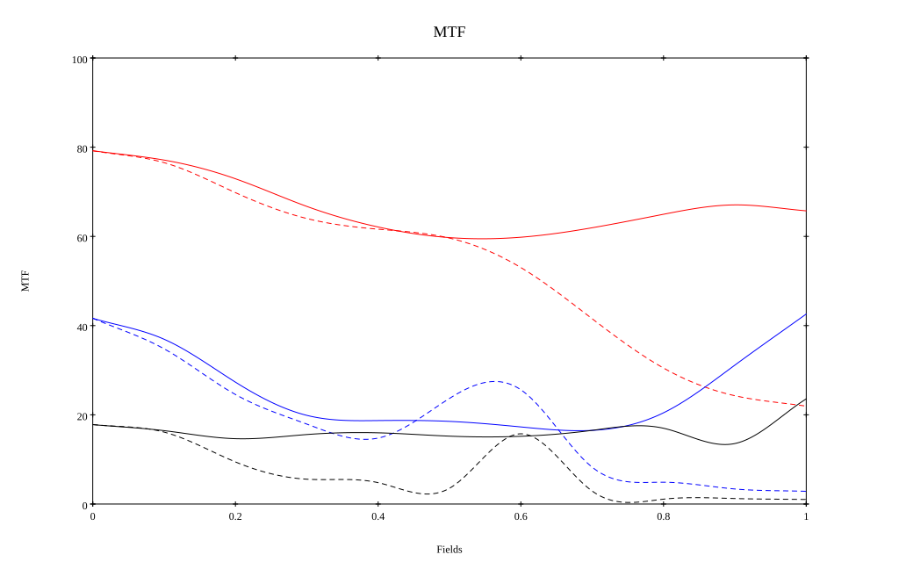
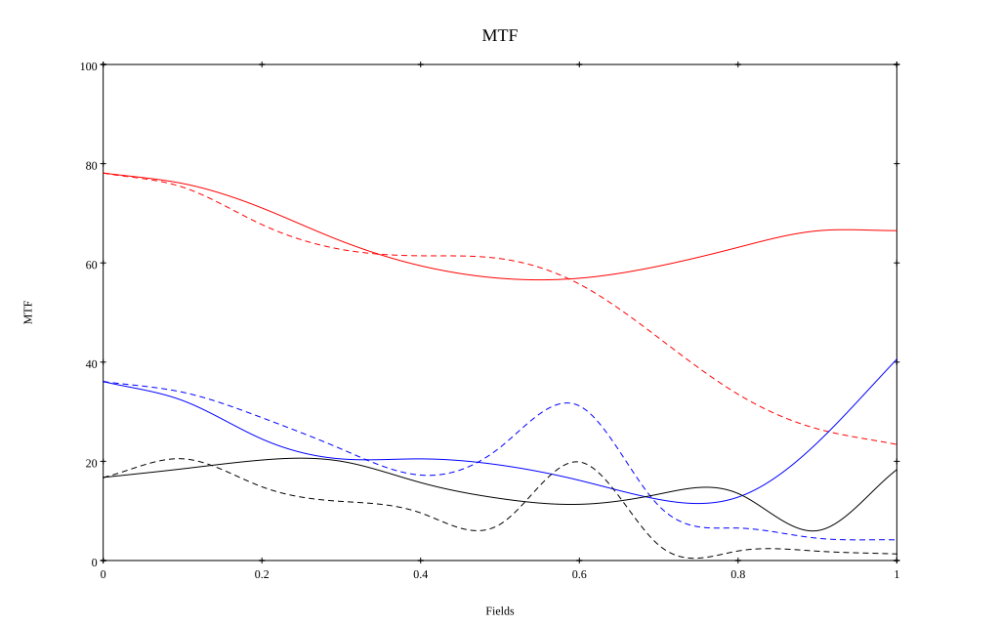

# Nikkor AI 85mm f1.8 Reverse Engineered by Zhongfu/Augusta
## Surface Data
Note that where glass types are shown the refractive index and abbe number is as per assigned glass type

| ID  | Radius | Thickness | Diameter | nd  | vd  | Glass Make | Glass |
| --- | ---    | ---       | ---      | --- | --- | ---        | ---   |
| 1 | 57.4721 | 6.733 | 49.0 | 1.717 | 47.96 | Schott | LAF3 |
| 2 | 253.2811 | 1.25 | 48.0 |  |  |  |
| 3 | 34.0 | 14.6 | 44.0 | 1.60729 | 59.46 | Schott | SK7 |
| 4 | -200.0 | 4.328 | 44.0 | 1.6727 | 32.1 | Ohara | S-TIM25 |
| 5 | 22.29755 | 8.75 | 29.0 |  |  |  |
| 6 | AS | 6.25 | 27.1005 |  |  |  |
| 7 | -33.99058 | 2.164 | 26.0 | 1.66755 | 41.93 | Schott | BASF6 |
| 8 | 57.26 | 11.75 | 28.5 | 1.65844 | 50.85 | Hoya | BACED5 |
| 9 | -40.82775 | 0.1 | 28.5 |  |  |  |
| 10 | 81.04756 | 5.6 | 29.0 | 1.744 | 44.72 | Schott | LAF2 |
| 11 | -400.0 | 43.2 | 29.0 |  |  |  |
## Layouts

## Spot Diagrams

## Paraxial Parameters
| parameter | value |
| ---       | ---   |
| effective_focal_length |85.044
| back_focal_length | 43.282
| optical_invariant | 6.006
| object_distance | 1.0E10
| image_distance | 43.282
| power | 0.012
| pp1_H | 30.678
| ppk_H' | -41.761
| ffl_F | -54.366
| fno | 1.798
| enp_dist_P | 49.865
| enp_radius | 23.649
| exp_dist_P' | -26.024
| exp_radius | 19.296
| m | -0
| red | -1.1758634971031946E8
| n_obj | 1
| n_img | 1
| img_ht | 21.598
| obj_ang | 14.25
| obj_na | 0
| img_na | -0.278|
## Spot Analysis
| Field | Spot Mean Radius (µm) | Spot Max Radius (µm) |
| ---   | ---              | ---             |
 | Field(x=0.0, y=0.0) | 19.167 | 80.115|
 | Field(x=0.0, y=0.1) | 22.992 | 121.676|
 | Field(x=0.0, y=0.2) | 26.522 | 134.719|
 | Field(x=0.0, y=0.3) | 31.796 | 147.028|
 | Field(x=0.0, y=0.4) | 35.768 | 156.994|
 | Field(x=0.0, y=0.5) | 39.31 | 162.867|
 | Field(x=0.0, y=0.6) | 42.456 | 163.703|
 | Field(x=0.0, y=0.7) | 45.067 | 158.914|
 | Field(x=0.0, y=0.8) | 46.868 | 158.995|
 | Field(x=0.0, y=0.9) | 47.694 | 172.178|
 | Field(x=0.0, y=1.0) | 47.511 | 186.299|
## Polychromatic Geometric MTF

* 10=red,30=blue,50=black cycles/mm
* Solid lines represent sagittal, dashed lines tangential
* To generate above, MTFs for wavelengths 587.5618(d), 486.1327(F), 656.2725(C) were calculated across 10 fields, and then averaged
## Polychromatic Geometric MTF (Weighted)

* 10=red,30=blue,50=black cycles/mm
* Solid lines represent sagittal, dashed lines tangential
* To generate above, MTFs for wavelengths 587.5618(d) wt(1.0), 656.2725(C) wt(0.475), 546.074(e) wt(0.98), 486.1327(F) wt(0.49), 435.8343(g) wt(0.15) were calculated across 10 fields, and then combined using weighted average
## Resources
* [OpticalBench Compatible Data File, tab delimited](./prescription.txt)
* [Zemax file](./specs.zmx)

Generated from `specs.txt`, status **TODO**

Report / Zemax file generated using [Beam42](https://github.com/BeamFour/Beam42) on 2026-11-25
