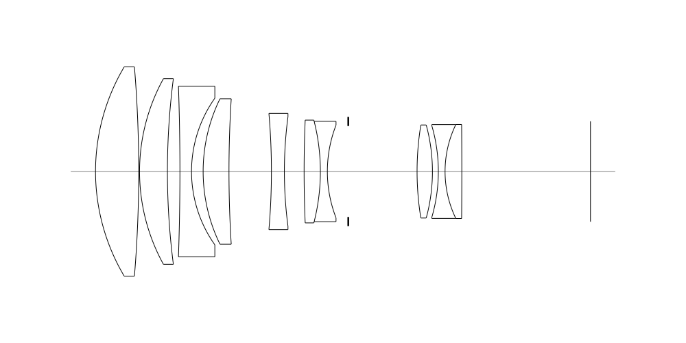
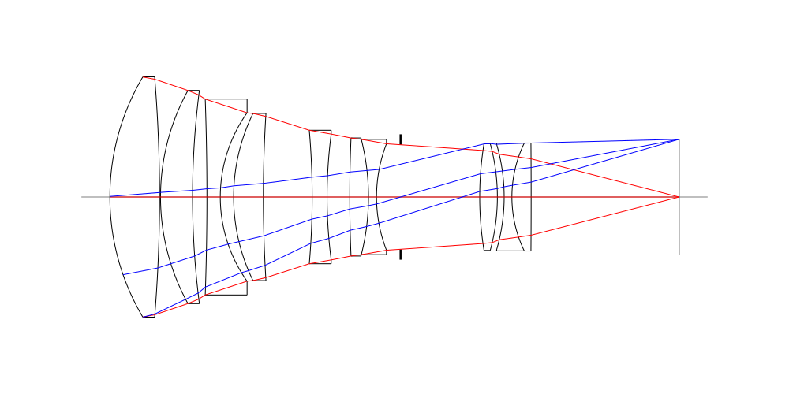
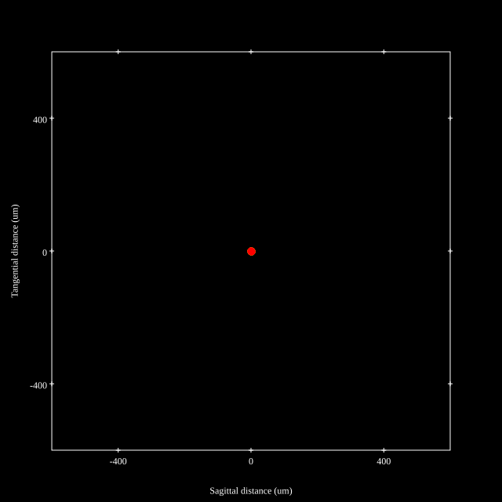
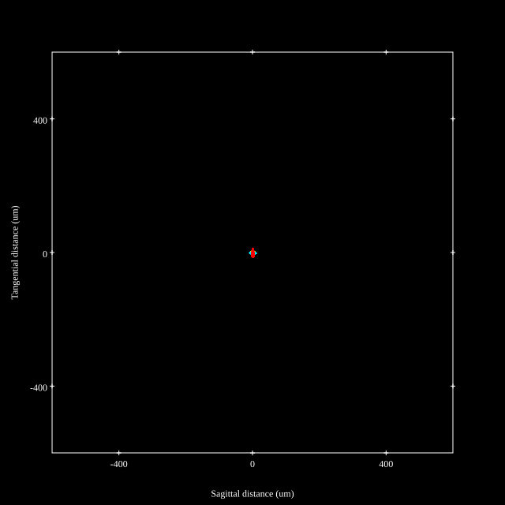
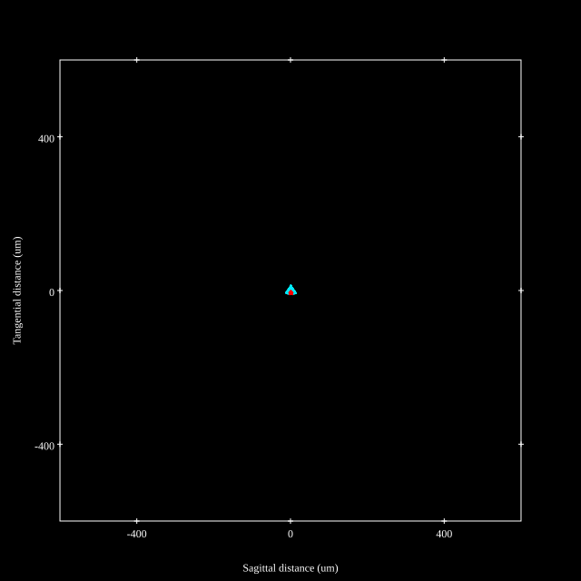
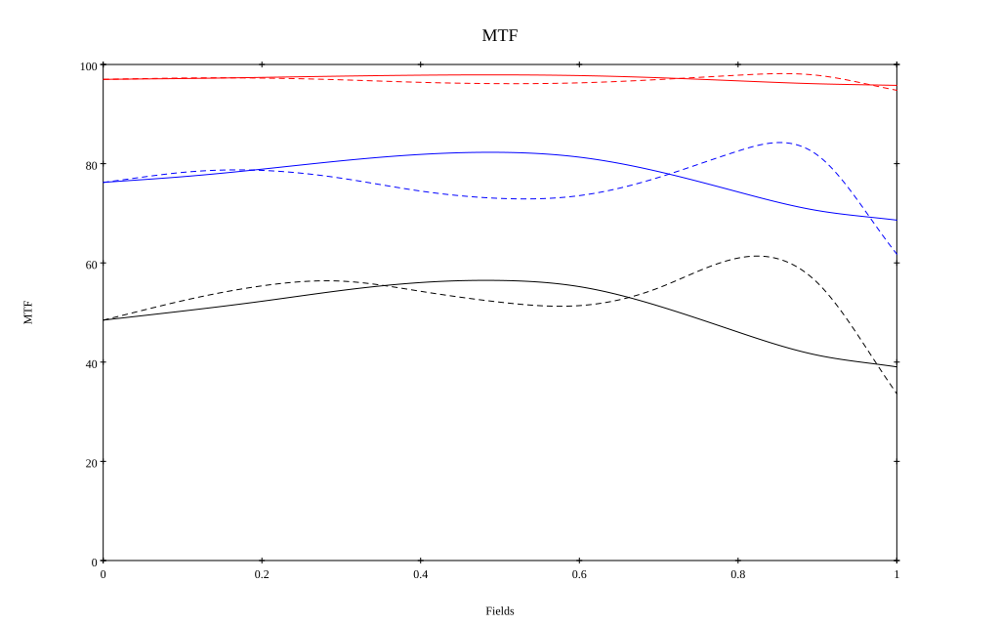
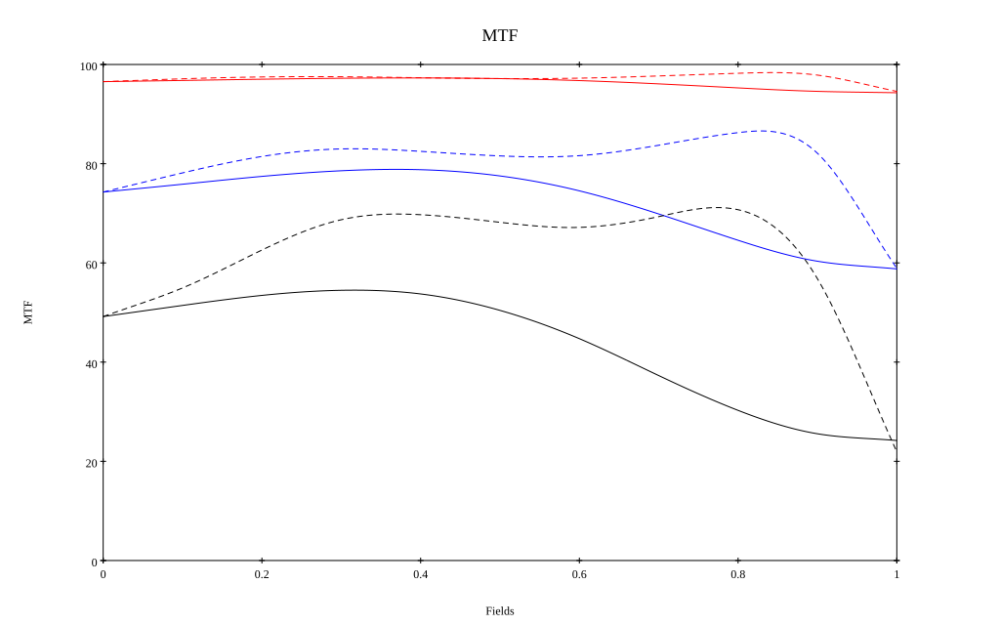

# Olympus Zuiko Auto-T 180mm F2
## Patent Information
| Country | Patent Number | Example | Year of Application | Inventors | Organisation | Link |
| ---     | ---           | ---     | ---                 | ---       | ---          | ---  |
|JP | JP,59-176717,A(1984) | 1 | 1983 | IMAIZUMI MASAKI | Olympus Optical Co Ltd | [link](https://www.j-platpat.inpit.go.jp/c1801/PU/JP-S59-176717/11/en) |
## Surface Data
Note that where glass types are shown the refractive index and abbe number is as per assigned glass type

| ID  | Radius | Thickness | Diameter | nd  | vd  | Glass Make | Glass |
| --- | ---    | ---       | ---      | --- | --- | ---        | ---   |
| 1 | 88.299 | 18.59 | 90.03 | 1.497 | 81.61 | Hoya | FCD1 |
| 2 | -549.108 | 0.36 | 88.3282 |  |  |  |
| 3 | 82.825 | 11.99 | 79.8908 | 1.617 | 62.8 | Ohara | S-PHM51 |
| 4 | 313.58 | 5.38 | 76.5029 |  |  |  |
| 5 | -1059.646 | 4.99 | 73.4026 | 1.65412 | 39.7 | Schott | N-KZFS5 |
| 6 | 54.621 | 5.0 | 63.1026 |  |  |  |
| 7 | 71.24 | 11.12 | 62.6204 | 1.497 | 81.61 | Hoya | FCD1 |
| 8 | 503.651 | 18.2626 | 60.4224 |  |  |  |
| 9 | -289.939 | 5.58 | 50.0046 | 1.50378 | 66.81 | Ohara | BSL21 |
| 10 | 180.621 | 8.4897 | 47.1417 |  |  |  |
| 11 | 522.949 | 7.0 | 44.2313 | 1.68893 | 31.08 | Ohara | S-TIM28 |
| 12 | -88.452 | 3.01 | 43.2097 | 1.5263 | 51.05 | Hoya | CF2 |
| 13 | 55.249 | 9.0 | 39.889 |  |  |  |
| 14 | AS | 29.6037 | 39.1552 |  |  |  |
| 15 | 124.349 | 6.61 | 40.04 | 1.788 | 47.41 | CORNING | D88-47 |
| 16 | -76.223 | 2.54 | 40.04 |  |  |  |
| 17 | -70.63 | 2.9 | 39.5071 | 1.60342 | 38.01 | Hoya | F5 |
| 18 | 46.449 | 7.2 | 40.3676 | 1.6779 | 55.34 | Ohara | S-LAL12 |
| 19 | -2749.059 | 55.3749 | 40.4581 |  |  |  |
## Layouts

## Spot Diagrams

## Paraxial Parameters
| parameter | value |
| ---       | ---   |
| effective_focal_length |179.858
| back_focal_length | 55.436
| optical_invariant | 5.402
| object_distance | 1.0E10
| image_distance | 55.436
| power | 0.006
| pp1_H | 124.269
| ppk_H' | -124.422
| ffl_F | -55.59
| fno | 2
| enp_dist_P | 237.996
| enp_radius | 44.965
| exp_dist_P' | -54.688
| exp_radius | 27.547
| m | -0
| red | -5.559926288259786E7
| n_obj | 1
| n_img | 1
| img_ht | 21.606
| obj_ang | 6.85
| obj_na | 0
| img_na | -0.25|
## Spot Analysis
| Field | Spot Mean Radius (µm) | Spot Max Radius (µm) |
| ---   | ---              | ---             |
 | Field(x=0.0, y=0.0) | 5.51 | 10.278|
 | Field(x=0.0, y=0.1) | 5.325 | 10.262|
 | Field(x=0.0, y=0.2) | 5.226 | 10.237|
 | Field(x=0.0, y=0.3) | 5.292 | 12.888|
 | Field(x=0.0, y=0.4) | 5.458 | 16.263|
 | Field(x=0.0, y=0.5) | 5.569 | 17.17|
 | Field(x=0.0, y=0.6) | 5.567 | 16.344|
 | Field(x=0.0, y=0.7) | 5.444 | 13.959|
 | Field(x=0.0, y=0.8) | 5.321 | 10.894|
 | Field(x=0.0, y=0.9) | 5.611 | 12.245|
 | Field(x=0.0, y=1.0) | 6.982 | 15.407|
## Polychromatic Geometric MTF

* 10=red,30=blue,50=black cycles/mm
* Solid lines represent sagittal, dashed lines tangential
* To generate above, MTFs for wavelengths 587.5618(d), 486.1327(F), 656.2725(C) were calculated across 10 fields, and then averaged
## Polychromatic Geometric MTF (Weighted)

* 10=red,30=blue,50=black cycles/mm
* Solid lines represent sagittal, dashed lines tangential
* To generate above, MTFs for wavelengths 587.5618(d) wt(1.0), 656.2725(C) wt(0.475), 546.074(e) wt(0.98), 486.1327(F) wt(0.49), 435.8343(g) wt(0.15) were calculated across 10 fields, and then combined using weighted average
## Resources
* [OpticalBench Compatible Data File, tab delimited](./prescription.txt)
* [Zemax file](./JP1984-176717_Example01P.zmx)

Generated from `JP1984-176717_Example01P.txt`, status **Accepted**

Report / Zemax file generated using [Beam42](https://github.com/BeamFour/Beam42) on 2026-10-19
