# Panasonic Lumix S Pro 70-200mm F2.8 OIS
## Patent Information
| Country | Patent Number | Example | Year of Application | Inventors | Organisation | Link |
| ---     | ---           | ---     | ---                 | ---       | ---          | ---  |
|US | US 2021/0132345 | 3 | 2020 | Takehiro Nishioka, Hisayuki Ii | Panasonic Intellectual Property Management Co Ltd | [link](https://patents.google.com/patent/US20210132345A1/en) |
## Surface Data
Note that where glass types are shown the refractive index and abbe number is as per assigned glass type

| ID  | Radius | Thickness | Diameter | nd  | vd  | Glass Make | Glass |
| --- | ---    | ---       | ---      | --- | --- | ---        | ---   |
| 1 | 131.2282 | 2.4 | 73.55 | 1.90366 | 31.32 | Hoya | TAFD25 |
| 2 | 79.0397 | 1.4 | 72.57 |  |  |  |
| 3 | 80.37 | 9.5 | 71.94 | 1.497 | 81.61 | Hoya | FCD1 |
| 4 | 0.0 | 0.2 | 71.94 |  |  |  |
| 5 | 76.8358 | 8.9 | 67.19 | 1.437 | 95.1 | Hoya | FCD100 |
| 6 | 1898.6547 | d6 | 67.19 |  |  |  |
| 7 | 487.4325 | 3.8 | 49.52 | 1.60562 | 43.71 | Ohara | S-BAM4 |
| 8 | -192.0274 | 0.2 | 49.52 |  |  |  |
| 9 | 856.4336 | 1.5 | 45.44 | 1.6968 | 55.46 | Hoya | LAC14 |
| 10 | 40.435 | 9.625 | 40.02 |  |  |  |
| 11 | -84.6589 | 1.5 | 40.18 | 1.48749 | 70.44 | Hoya | FC5 |
| 12 | 47.1828 | 0.01 | 40.18 | 1.56732 | 42.84 | Hoya | E-FL6 |
| 13 | 47.1828 | 6.2 | 40.18 | 1.90366 | 31.32 | Hoya | TAFD25 |
| 14 | -305.2809 | 3.4131 | 40.18 |  |  |  |
| 15 | -53.2587 | 1.5 | 40.18 | 1.60311 | 60.69 | Hoya | BACD14 |
| 16 | 319.5297 | d16 | 44.99 |  |  |  |
| 17 | 64.0495 | 6.4 | 41.86 | 1.8045 | 39.64 | Hoya | NBFD3 |
| 18 | -141.7141 | d18 | 41.86 |  |  |  |
| 19 | 60.124 | 3.5 | 38.36 | 1.497 | 81.61 | Hoya | FCD1 |
| 20 | 171.5708 | 2.7 | 38.36 |  |  |  |
| 21 | AS | 3.0 | 33.141 |  |  |  |
| 22 | -173.7603 | 3.79 | 35.43 | 1.437 | 95.1 | Hoya | FCD100 |
| 23 | -44.7702 | 0.01 | 35.43 | 1.56732 | 42.84 | Hoya | E-FL6 |
| 24 | -44.7702 | 1.2 | 35.43 | 1.84666 | 23.78 | Hoya | FDS90 |
| 25 | 50.1478 | 2.4 | 31.88 |  |  |  |
| 26 | 35.4374 | 1.5 | 33.21 | 1.84666 | 23.78 | Hoya | FDS90 |
| 27 | 27.2542 | 0.01 | 33.21 | 1.56732 | 42.84 | Hoya | E-FL6 |
| 28 | 27.2542 | 6.0 | 33.21 | 1.497 | 81.61 | Hoya | FCD1 |
| 29 | 342.129 | 0.3 | 33.21 |  |  |  |
| 30 | 82.9525 | 5.4 | 31.12 | 1.58578 | 59.5 |  |
| 31 | -60.736 | 3.0 | 31.12 |  |  |  |
| 32 | -43.7303 | 1.4 | 30.46 | 1.6935 | 53.2 | Hoya | M-LAC130 |
| 33 | -320.3249 | 0.01 | 32.52 | 1.56732 | 42.84 | Hoya | E-FL6 |
| 34 | -320.3249 | 3.7 | 32.52 | 1.85883 | 30.0 | Hoya | NBFD30 |
| 35 | -43.1887 | d35 | 32.52 |  |  |  |
| 36 | 0.0 | 3.3 | 29.5 | 1.86966 | 20.02 | Hoya | FDS20-W |
| 37 | -46.4584 | 0.01 | 29.5 | 1.56732 | 42.84 | Hoya | E-FL6 |
| 38 | -46.4584 | 0.7 | 29.5 | 1.70154 | 41.15 | Hoya | BAFD7 |
| 39 | 35.1327 | d39 | 29.5 |  |  |  |
| 40 | 491.7514 | 4.2 | 37.42 | 1.84666 | 23.78 | Hoya | FDS90 |
| 41 | -61.6507 | d41 | 37.42 |  |  |  |
| 42 | -46.9831 | 1.4 | 34.63 | 1.84666 | 23.78 | Hoya | FDS90 |
| 43 | 117.6471 | 0.2 | 38.15 |  |  |  |
| 44 | 49.6263 | 5.0 | 41.06 | 1.717 | 47.98 | Hoya | LAF3 |
| 45 | 464.3283 | 31.0 | 41.06 |  |  |  |
| 46 | CG | 2.1 | 44.22 | 1.5168 | 64.2 | Hoya | BSC7 |
| 47 | CG | 1.09 | 44.22 |  |  |  |
## Aspherical Data
| ID  | Type | k   | P1 | P2 | P3 | P4 | P5 | P6 | P7 |
| --- | --- | --- | --- | --- | --- | --- | --- | --- | --- |
| 30| EVEN | 9.97221 | 0.0 | -3.94139E-6 | -6.42008E-9 | 9.84655E-11 | -2.27304E-13 | -2.10054E-17 | 2.3109E-18 |
| 31| EVEN | -5.11777 | 0.0 | 9.64E-7 | -3.12961E-9 | 9.40918E-11 | -1.49427E-13 | -4.27405E-16 | 3.25178E-18 |
## Variables
| Variable | 70mm f2.8 | 200mm f2.8 |
| --- | --- | --- |
| Focal length |72.4497 |193.0002 |
| F-Number |2.8324 |2.9282 |
| Angle of View |33.6612 |12.597 |
| d6 | 1.0 | 44.9034 |
| d16 | 47.7393 | 1.0 |
| d18 | 1.0 | 3.8358 |
| d35 | 2.4 | 3.0651 |
| d39 | 20.1578 | 26.0482 |
| d41 | 9.2347 | 2.6792 |
# 70mm f2.8
## Layouts
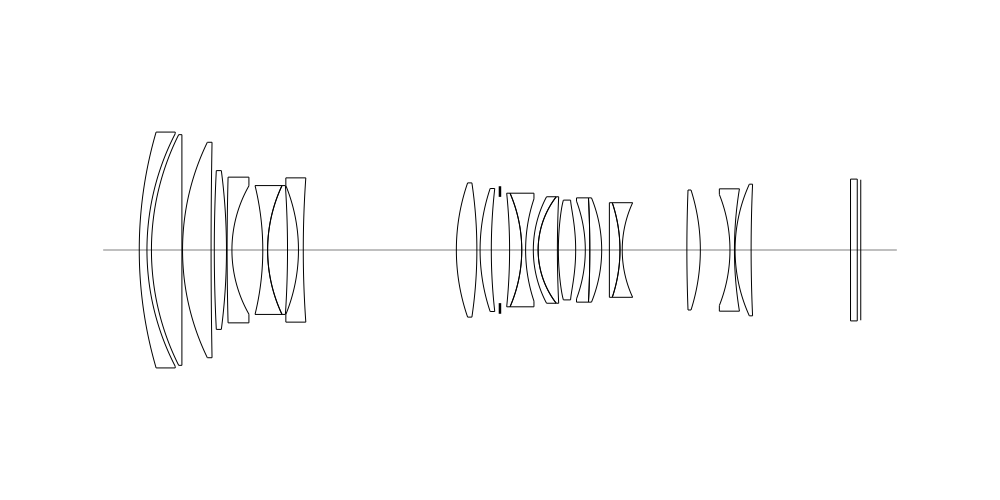
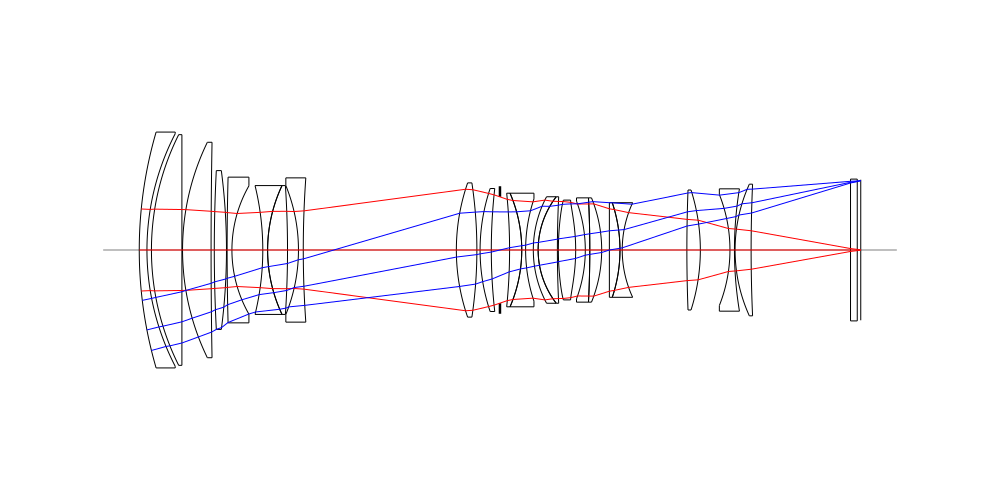
## Spot Diagrams
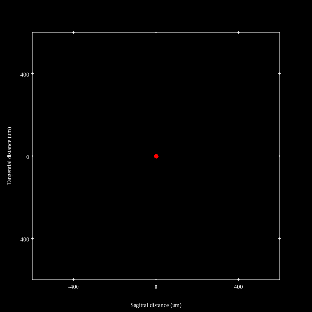
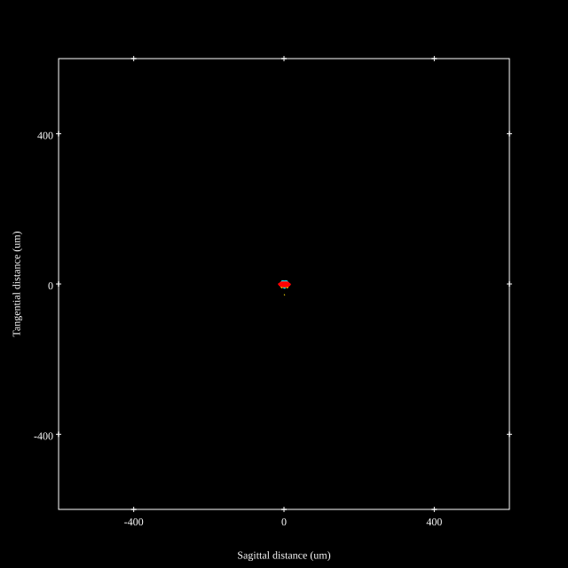
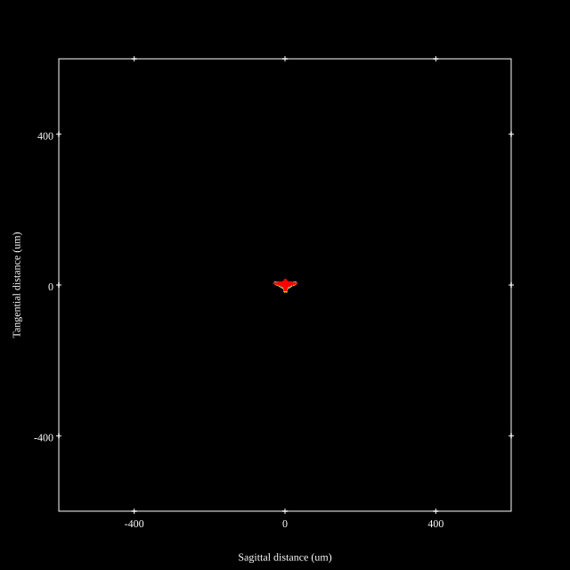
## Paraxial Parameters
| parameter | value |
| ---       | ---   |
| effective_focal_length |72.449
| back_focal_length | 1.094
| optical_invariant | 3.869
| object_distance | 1.0E10
| image_distance | 1.094
| power | 0.014
| pp1_H | 98.017
| ppk_H' | -71.354
| ffl_F | 25.568
| fno | 2.832
| enp_dist_P | 82.313
| enp_radius | 12.79
| exp_dist_P' | -91.4
| exp_radius | 16.33
| m | -0
| red | -1.380286134901198E8
| n_obj | 1
| n_img | 1
| img_ht | 21.916
| obj_ang | 16.831
| obj_na | 0
| img_na | -0.177|
## Spot Analysis
| Field | Spot Mean Radius (µm) | Spot Max Radius (µm) |
| ---   | ---              | ---             |
 | Field(x=0.0, y=0.0) | 3.214 | 10.498|
 | Field(x=0.0, y=0.1) | 3.2 | 12.182|
 | Field(x=0.0, y=0.2) | 3.397 | 15.861|
 | Field(x=0.0, y=0.3) | 3.665 | 24.709|
 | Field(x=0.0, y=0.4) | 4.164 | 33.109|
 | Field(x=0.0, y=0.5) | 4.925 | 41.009|
 | Field(x=0.0, y=0.6) | 5.352 | 43.389|
 | Field(x=0.0, y=0.7) | 4.96 | 38.787|
 | Field(x=0.0, y=0.8) | 5.139 | 39.782|
 | Field(x=0.0, y=0.9) | 6.114 | 27.224|
 | Field(x=0.0, y=1.0) | 10.053 | 32.954|
## Polychromatic Geometric MTF
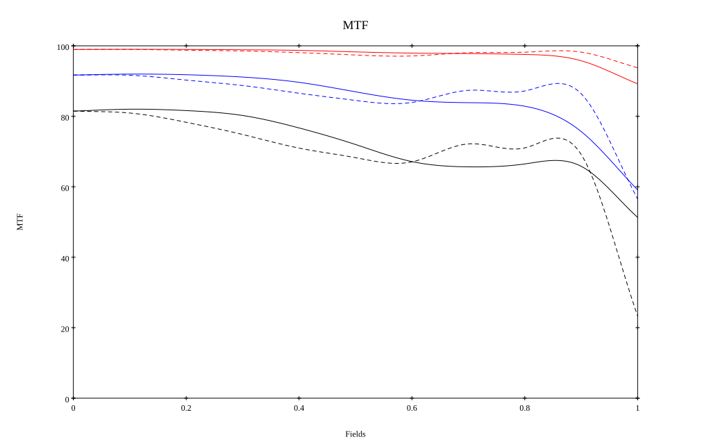
* 10=red,30=blue,50=black cycles/mm
* Solid lines represent sagittal, dashed lines tangential
* To generate above, MTFs for wavelengths 587.5618(d), 486.1327(F), 656.2725(C) were calculated across 10 fields, and then averaged
## Polychromatic Geometric MTF (Weighted)
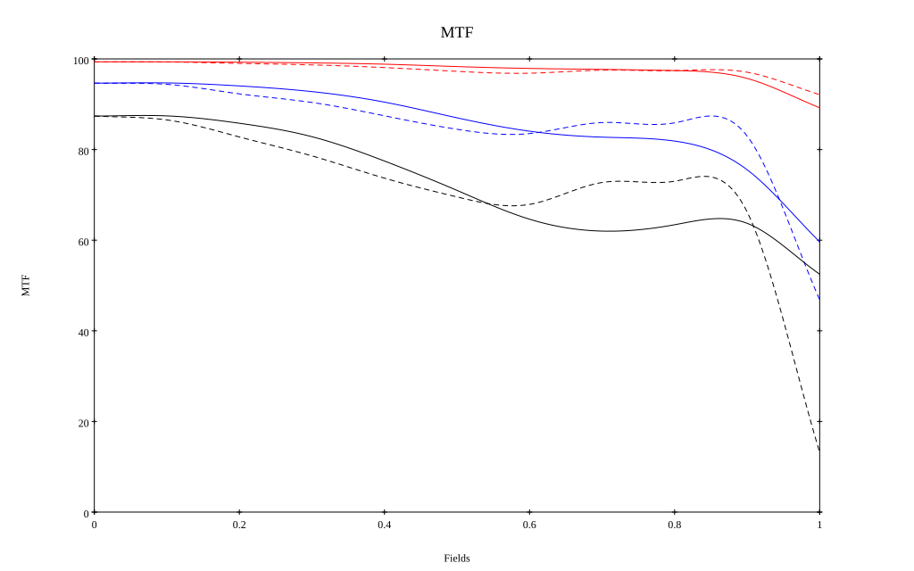
* 10=red,30=blue,50=black cycles/mm
* Solid lines represent sagittal, dashed lines tangential
* To generate above, MTFs for wavelengths 587.5618(d) wt(1.0), 656.2725(C) wt(0.475), 546.074(e) wt(0.98), 486.1327(F) wt(0.49), 435.8343(g) wt(0.15) were calculated across 10 fields, and then combined using weighted average
# 200mm f2.8
## Layouts
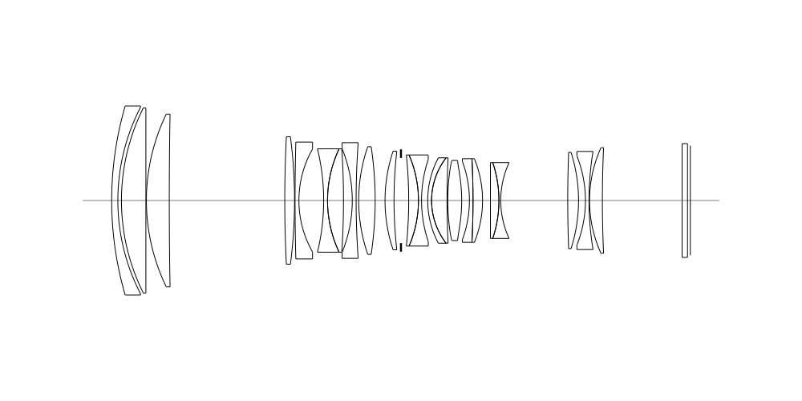
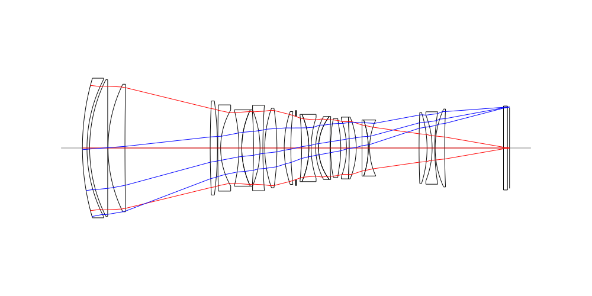
## Spot Diagrams
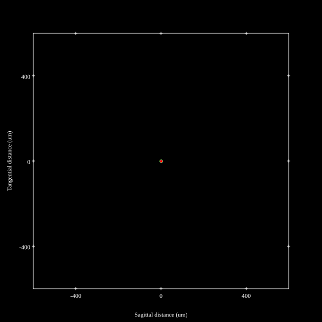
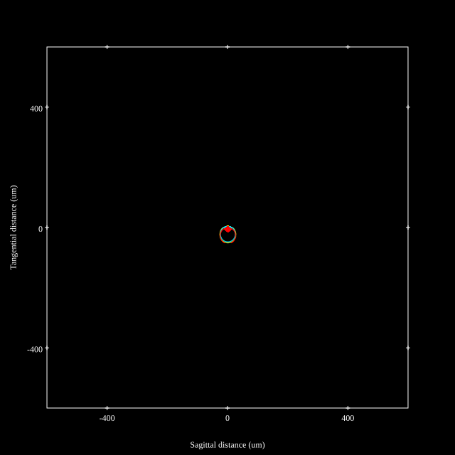
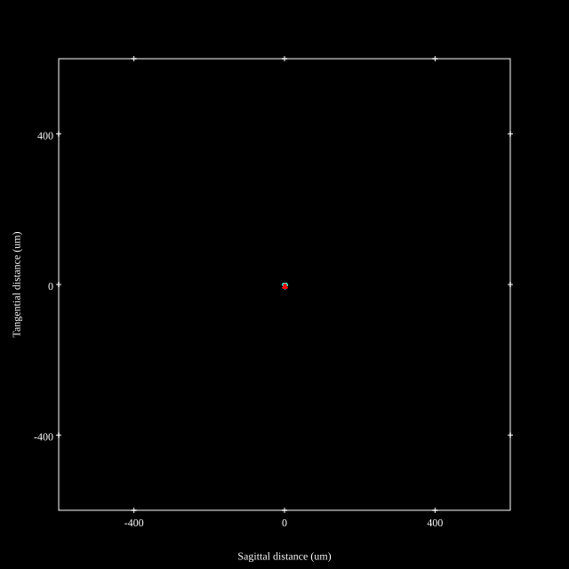
## Paraxial Parameters
| parameter | value |
| ---       | ---   |
| effective_focal_length |192.995
| back_focal_length | 1.069
| optical_invariant | 3.641
| object_distance | 1.0E10
| image_distance | 1.069
| power | 0.005
| pp1_H | 20.888
| ppk_H' | -191.926
| ffl_F | -172.108
| fno | 2.925
| enp_dist_P | 199.605
| enp_radius | 32.988
| exp_dist_P' | -99.156
| exp_radius | 17.128
| m | -0
| red | -5.181477534581335E7
| n_obj | 1
| n_img | 1
| img_ht | 21.302
| obj_ang | 6.298
| obj_na | 0
| img_na | -0.171|
## Spot Analysis
| Field | Spot Mean Radius (µm) | Spot Max Radius (µm) |
| ---   | ---              | ---             |
 | Field(x=0.0, y=0.0) | 1.957 | 5.352|
 | Field(x=0.0, y=0.1) | 2.402 | 12.527|
 | Field(x=0.0, y=0.2) | 3.472 | 24.121|
 | Field(x=0.0, y=0.3) | 4.781 | 32.871|
 | Field(x=0.0, y=0.4) | 5.682 | 38.418|
 | Field(x=0.0, y=0.5) | 6.355 | 44.035|
 | Field(x=0.0, y=0.6) | 7.168 | 49.663|
 | Field(x=0.0, y=0.7) | 7.367 | 51.778|
 | Field(x=0.0, y=0.8) | 6.677 | 43.612|
 | Field(x=0.0, y=0.9) | 5.514 | 24.214|
 | Field(x=0.0, y=1.0) | 4.536 | 10.041|
## Polychromatic Geometric MTF
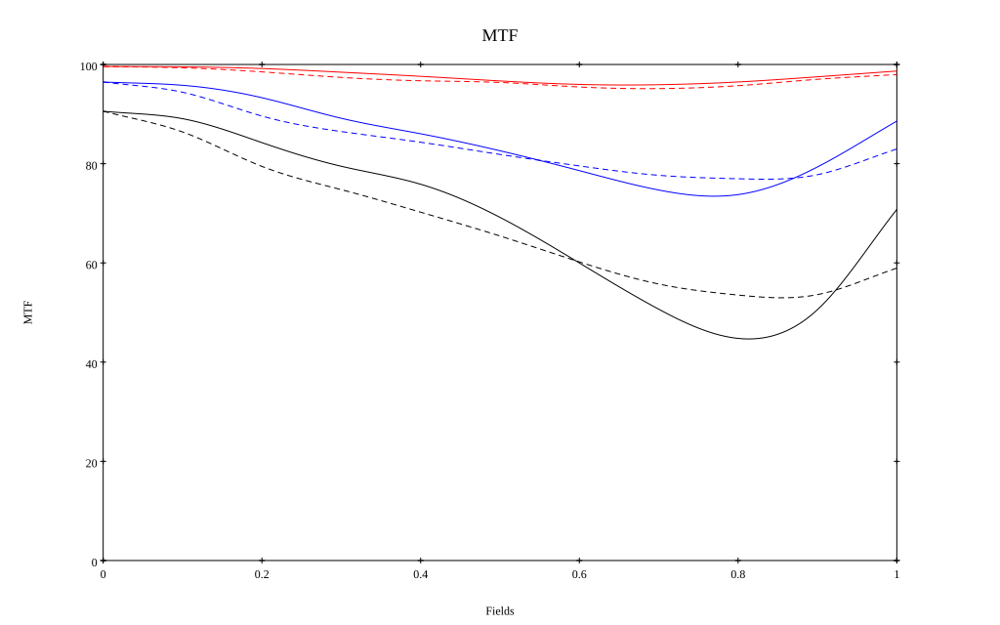
* 10=red,30=blue,50=black cycles/mm
* Solid lines represent sagittal, dashed lines tangential
* To generate above, MTFs for wavelengths 587.5618(d), 486.1327(F), 656.2725(C) were calculated across 10 fields, and then averaged
## Polychromatic Geometric MTF (Weighted)
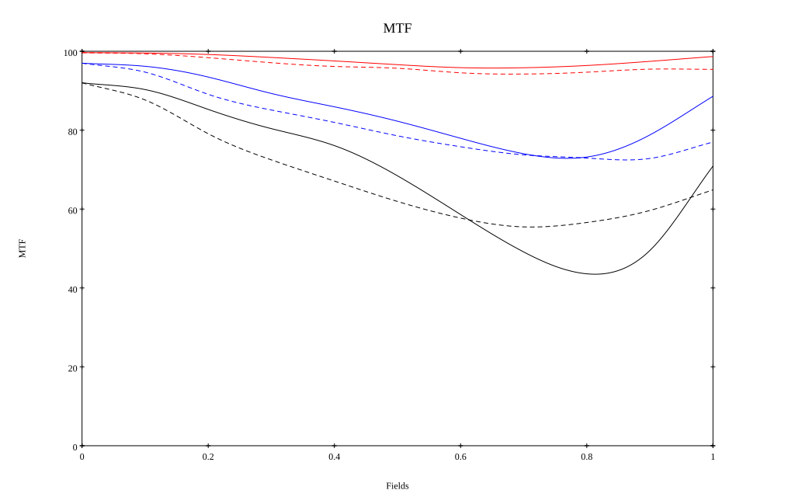
* 10=red,30=blue,50=black cycles/mm
* Solid lines represent sagittal, dashed lines tangential
* To generate above, MTFs for wavelengths 587.5618(d) wt(1.0), 656.2725(C) wt(0.475), 546.074(e) wt(0.98), 486.1327(F) wt(0.49), 435.8343(g) wt(0.15) were calculated across 10 fields, and then combined using weighted average
## Resources
* [OpticalBench Compatible Data File, tab delimited](./prescription.txt)
* [Zemax file](./US20210132345_Example03P.zmx)

Generated from `US20210132345_Example03P.txt`, status **TODO**

Report / Zemax file generated using [Beam42](https://github.com/BeamFour/Beam42) on 2026-11-09
