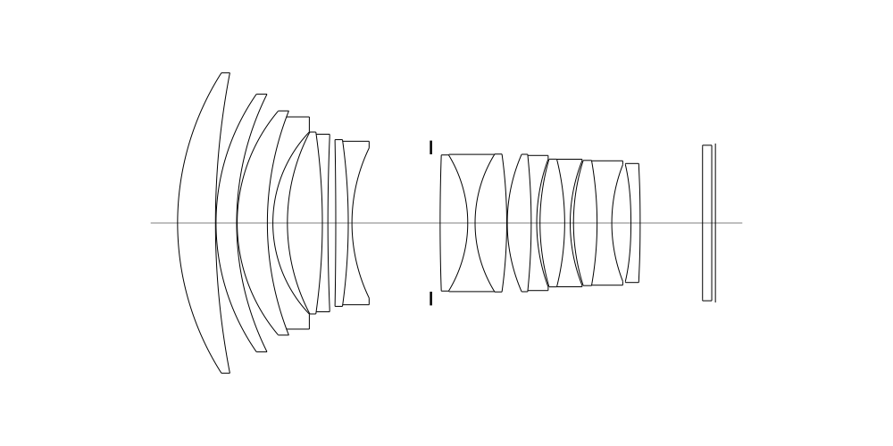
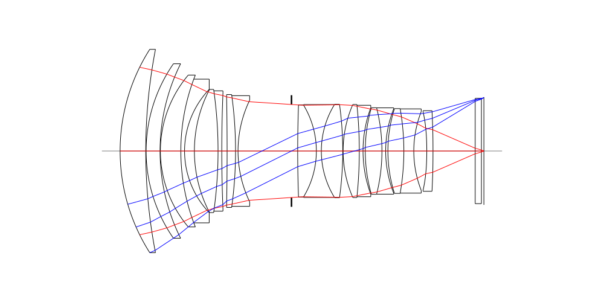
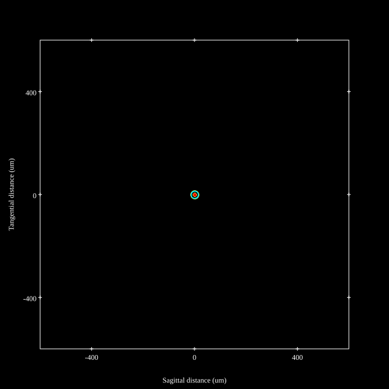
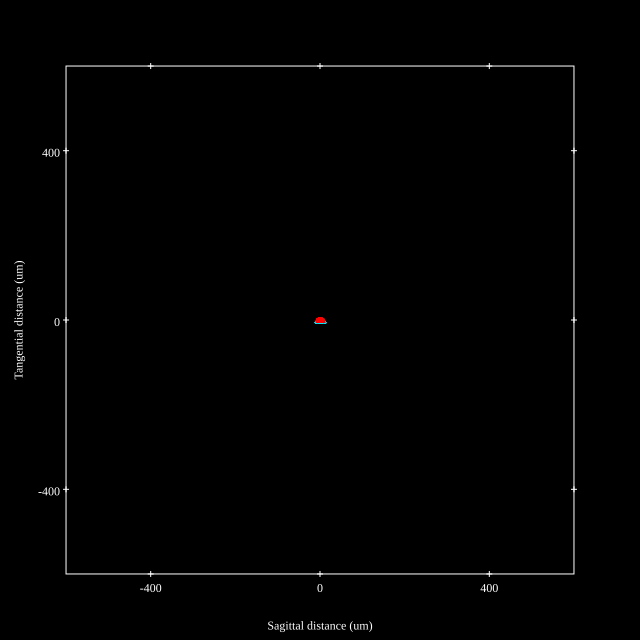
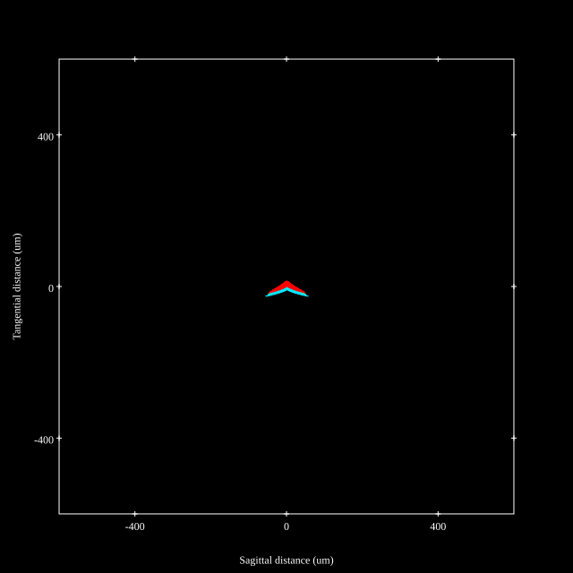
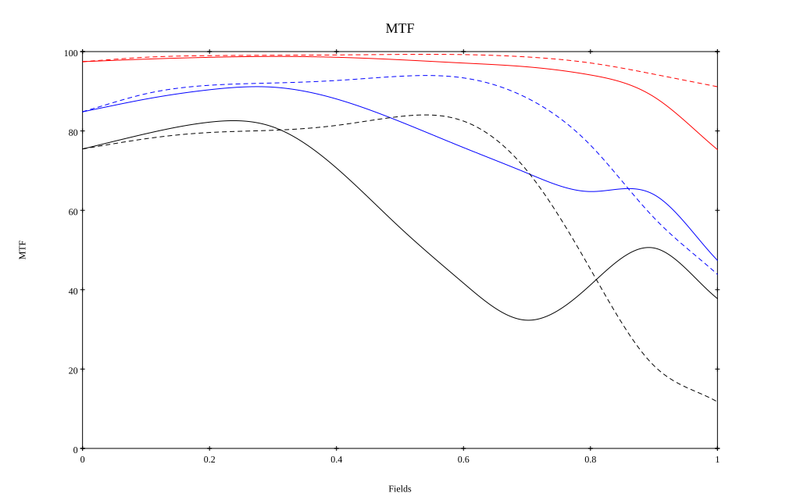
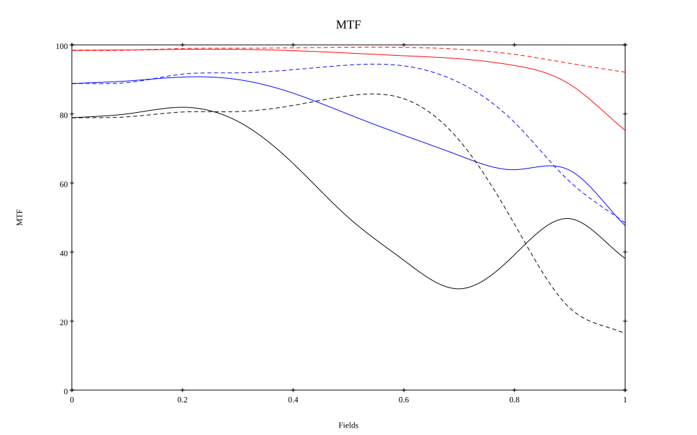

## Surface Data
Note that where glass types are shown the refractive index and abbe number is as per assigned glass type

| ID  | Radius | Thickness | Diameter | nd  | vd  | Glass Make | Glass |
| --- | ---    | ---       | ---      | --- | --- | ---        | ---   |
| 1 | 76.011 | 10.3 | 83.0 | 1.84666 | 23.78 | CDGM | H-ZF52 |
| 2 | 215.365 | 0.15 | 81.64 |  |  |  |
| 3 | 61.477 | 5.6 | 70.54 | 1.59216 | 68.28 | CDGM | D-ZPK5-25 |
| 4 | 78.556 | 0.15 | 67.82 |  |  |  |
| 5 | 47.222 | 8.2 | 61.0 | 1.59216 | 68.28 | CDGM | D-ZPK5-25 |
| 6 | 82.8 | 1.5 | 61.0 | 1.85451 | 25.15 | Hoya | NBFD25 |
| 7 | 35.941 | 3.946 | 49.55 |  |  |  |
| 8 | 53.336 | 9.5 | 49.5 | 1.59216 | 68.28 | CDGM | D-ZPK5-25 |
| 9 | -174.338 | 1.5 | 49.5 | 2.00069 | 25.46 | Hoya | TAFD40-W |
| 10 | 568.322 | 2.138 | 49.5 |  |  |  |
| 11 | -1204.786 | 3.4 | 45.76 | 1.92286 | 20.88 | Hoya | E-FDS1-W |
| 12 | -163.974 | 1.0 | 45.76 | 1.6968 | 55.53 | CDGM | H-LAK51A |
| 13 | 46.971 | 21.473 | 42.81 |  |  |  |
| 14 | AS | 2.489 | 38.145 |  |  |  |
| 15 | 533.957 | 7.5 | 38.35 | 1.59216 | 68.28 | CDGM | D-ZPK5-25 |
| 16 | -35.626 | 2.0 | 38.35 | 1.77047 | 29.74 | Hoya | NBFD29 |
| 17 | 35.626 | 8.6 | 38.35 | 1.72916 | 54.68 | CDGM | H-LAK52 |
| 18 | -135.604 | 0.15 | 38.35 |  |  |  |
| 19 | 46.752 | 6.5 | 37.65 | 1.72916 | 54.68 | CDGM | H-LAK52 |
| 20 | -181.209 | 1.5 | 37.65 | 1.77047 | 29.74 | Hoya | NBFD29 |
| 21 | 50.08 | 0.893 | 34.76 |  |  |  |
| 22 | 62.431 | 6.7 | 34.76 | 2.001 | 29.13 | Hoya | TAFD55-W |
| 23 | -71.562 | 1.5 | 34.76 | 1.62005 | 36.35 | CDGM | H-F4 |
| 24 | 46.084 | 0.903 | 34.76 |  |  |  |
| 25 | 56.199 | 6.4 | 34.06 | 2.00069 | 25.46 | Hoya | TAFD40-W |
| 26 | -97.979 | 4.0 | 34.06 | 1.48749 | 70.44 | CDGM | H-QK3LGTI |
| 27 | 43.506 | 5.208 | 32.86 |  |  |  |
| 28 | -119.605 | 2.5 | 32.86 | 1.8061 | 40.73 | Hoya | M-NBFD130 |
| 29 | -500.0 | 16.956 | 33.38 |  |  |  |
| 30 | CG | 2.5 | 42.3 | 1.5168 | 64.2 | CDGM | H-K9L |
| 31 | CG | 1.0 | 42.3 |  |  |  |
## Aspherical Data
| ID  | Type | k   | P1 | P2 | P3 | P4 | P5 | P6 |
| --- | --- | --- | --- | --- | --- | --- | --- | --- |
| 28| EVEN | 0.0 | 0.0 | -9.74182E-6 | 1.27066E-8 | -9.6825E-12 | -8.09107E-15 | 5.01459E-17 |
| 29| EVEN | 0.0 | 0.0 | -5.08406E-6 | 1.21233E-8 | 7.62564E-12 | -3.92426E-14 | 7.66722E-17 |
## Layouts

## Spot Diagrams

## Paraxial Parameters
| parameter | value |
| ---       | ---   |
| effective_focal_length |84.116
| back_focal_length | 0.995
| optical_invariant | 8.822
| object_distance | 1.0E10
| image_distance | 0.995
| power | 0.012
| pp1_H | 77.496
| ppk_H' | -83.122
| ffl_F | -6.62
| fno | 1.226
| enp_dist_P | 120.477
| enp_radius | 34.308
| exp_dist_P' | -54.681
| exp_radius | 22.706
| m | -0
| red | -1.1888309363016051E8
| n_obj | 1
| n_img | 1
| img_ht | 21.629
| obj_ang | 14.42
| obj_na | 0
| img_na | -0.408|
## Spot Analysis
| Field | Spot Mean Radius (µm) | Spot Max Radius (µm) |
| ---   | ---              | ---             |
 | Field(x=0.0, y=0.0) | 5.194 | 21.224|
 | Field(x=0.0, y=0.1) | 4.167 | 21.823|
 | Field(x=0.0, y=0.2) | 3.558 | 22.056|
 | Field(x=0.0, y=0.3) | 3.317 | 20.442|
 | Field(x=0.0, y=0.4) | 3.382 | 16.964|
 | Field(x=0.0, y=0.5) | 3.736 | 11.678|
 | Field(x=0.0, y=0.6) | 4.295 | 9.686|
 | Field(x=0.0, y=0.7) | 5.144 | 13.557|
 | Field(x=0.0, y=0.8) | 6.795 | 26.876|
 | Field(x=0.0, y=0.9) | 9.908 | 43.65|
 | Field(x=0.0, y=1.0) | 14.799 | 60.107|
## Polychromatic Geometric MTF

* 10=red,30=blue,50=black cycles/mm
* Solid lines represent sagittal, dashed lines tangential
* To generate above, MTFs for wavelengths 587.5618(d), 486.1327(F), 656.2725(C) were calculated across 10 fields, and then averaged
## Polychromatic Geometric MTF (Weighted)

* 10=red,30=blue,50=black cycles/mm
* Solid lines represent sagittal, dashed lines tangential
* To generate above, MTFs for wavelengths 587.5618(d) wt(1.0), 656.2725(C) wt(0.475), 546.074(e) wt(0.98), 486.1327(F) wt(0.49), 435.8343(g) wt(0.15) were calculated across 10 fields, and then combined using weighted average
## Resources
* [OpticalBench Compatible Data File, tab delimited](./prescription.txt)
* [Zemax file](./CN119667909_Example01.zmx)

Generated from `CN119667909_Example01.txt`, status **TODO**

Report / Zemax file generated using [Beam42](https://github.com/BeamFour/Beam42) on 2026-11-10
