# Sony FE 70-200mm F2.8 GM OSS II
## Patent Information
| Country | Patent Number | Example | Year of Application | Inventors | Organisation | Link |
| ---     | ---           | ---     | ---                 | ---       | ---          | ---  |
|JP | JP2023-039817 | 2 | 2021 | Naoki Miyagawa, Shugo Takahashi | Sony Group Corp | [link](https://patents.google.com/patent/JP2023039817A/en) |
## Surface Data
Note that where glass types are shown the refractive index and abbe number is as per assigned glass type

| ID  | Radius | Thickness | Diameter | nd  | vd  | Glass Make | Glass |
| --- | ---    | ---       | ---      | --- | --- | ---        | ---   |
| 1 | 116.681 | 2.82 | 67.36 | 1.77047 | 29.74 | Hoya | NBFD29 |
| 2 | 83.814 | 0.29 | 66.15 |  |  |  |
| 3 | 87.118 | 8.34 | 66.15 | 1.437 | 95.1 | Hoya | FCD100 |
| 4 | -9920.911 | 0.2 | 65.95 |  |  |  |
| 5 | 78.201 | 8.43 | 64.74 | 1.437 | 95.1 | Hoya | FCD100 |
| 6 | 1122.581 | d6 | 64.02 |  |  |  |
| 7 | 481.705 | 1.4 | 37.16 | 1.7725 | 49.62 | Hoya | TAF1 |
| 8 | 43.542 | d8 | 35.56 |  |  |  |
| 9 | -76.229 | 1.4 | 36.41 | 1.497 | 81.61 | Hoya | FCD1 |
| 10 | 63.489 | 4.55 | 37.87 | 1.85478 | 24.8 | Ohara | S-NBH56 |
| 11 | 226.428 | d11 | 38.01 |  |  |  |
| 12 | 66.789 | 2.61 | 38.79 | 1.78472 | 25.72 | Hoya | FD110 |
| 13 | 116.801 | d13 | 38.62 |  |  |  |
| 14 | 47.448 | 8.26 | 38.74 | 1.4971 | 81.56 | Hoya | FCD1B |
| 15 | -96.798 | 6.89 | 37.96 |  |  |  |
| 16 | AS | 3.3 | 34.14 |  |  |  |
| 17 | -192.404 | 1.37 | 33.01 | 1.85478 | 24.8 | Ohara | S-NBH56 |
| 18 | 52.285 | 2.08 | 32.33 |  |  |  |
| 19 | 45.043 | 1.0 | 33.11 | 1.85478 | 24.8 | Ohara | S-NBH56 |
| 20 | 32.823 | 7.88 | 32.65 | 1.58313 | 59.46 | Hoya | BACD12 |
| 21 | -79.003 | 0.7 | 32.54 |  |  |  |
| 22 | 325.773 | 4.52 | 31.83 | 1.58313 | 59.46 | Hoya | BACD12 |
| 23 | -95.07 | d23 | 31.22 |  |  |  |
| 24 | 0.0 | 3.12 | 27.24 | 1.92286 | 20.88 | Hoya | E-FDS1 |
| 25 | -54.73 | 1.0 | 26.75 | 1.65412 | 39.62 | Hoya | E-ADF50 |
| 26 | 30.625 | d26 | 24.22 |  |  |  |
| 27 | 53.755 | 6.52 | 32.57 | 1.6134 | 44.29 | Hoya | ADF40 |
| 28 | -70.637 | d28 | 32.58 |  |  |  |
| 29 | -321.338 | 1.25 | 31.06 | 1.497 | 81.61 | Hoya | FCD1 |
| 30 | 62.501 | 5.22 | 30.5 |  |  |  |
| 31 | -44.639 | 1.3 | 30.5 | 2.001 | 29.13 | Hoya | TAFD55 |
| 32 | -95.059 | d32 | 31.47 |  |  |  |
## Aspherical Data
| ID  | Type | k   | P1 | P2 | P3 | P4 | P5 | P6 | P7 |
| --- | --- | --- | --- | --- | --- | --- | --- | --- | --- |
| 14| EVEN | 0.0 | 0.0 | -1.54432E-7 | 5.58124E-10 | 4.63363E-13 | 0.0 | 0.0 | 0  |
| 15| EVEN | 0.0 | 0.0 | 5.42944E-6 | -4.00709E-9 | 1.18539E-11 | -4.01118E-14 | 7.61194E-17 | -5.77873E-20 |
| 21| EVEN | 0.0 | 0.0 | 2.77126E-6 | 1.11872E-8 | -1.24574E-10 | 6.42677E-13 | -1.62172E-15 | 1.60781E-18 |
| 22| EVEN | 0.0 | 0.0 | 6.52518E-6 | 2.3838E-10 | -4.201E-11 | 1.79781E-13 | -2.30019E-16 | 5.26712E-20 |
| 23| EVEN | 0.0 | 0.0 | 3.54582E-6 | -7.39037E-9 | 6.16827E-11 | -3.49819E-13 | 1.13261E-15 | -1.35854E-18 |
## Variables
| Variable | 70mm f2.8 | 200mm f2.8 |
| --- | --- | --- |
| Focal length |72.14 |193.95 |
| F-Number |2.88 |2.88 |
| Angle of View |33.4 |12.73 |
| d6 | 1.50336738832 | 50.1354045579 |
| d8 | 22.6376950048 | 15.2045578779 |
| d11 | 25.4064537904 | 0.800999373979 |
| d13 | 18.0124838165 | 1.41903819018 |
| d23 | 6.56007812666 | 2.34101808195 |
| d26 | 19.804540072 | 28.2084140292 |
| d28 | 7.91538180135 | 3.73056788888 |
| d32 | 28.79 | 28.79 |
# 70mm f2.8
## Layouts
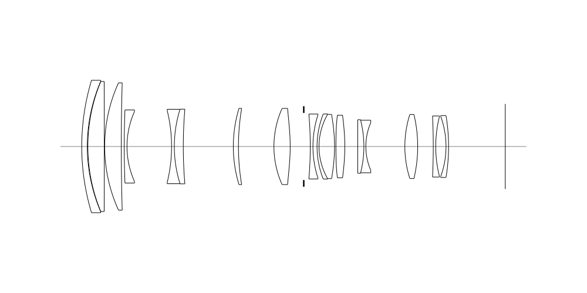
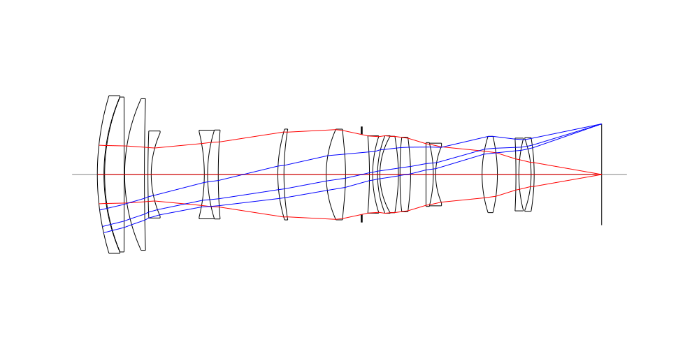
## Spot Diagrams
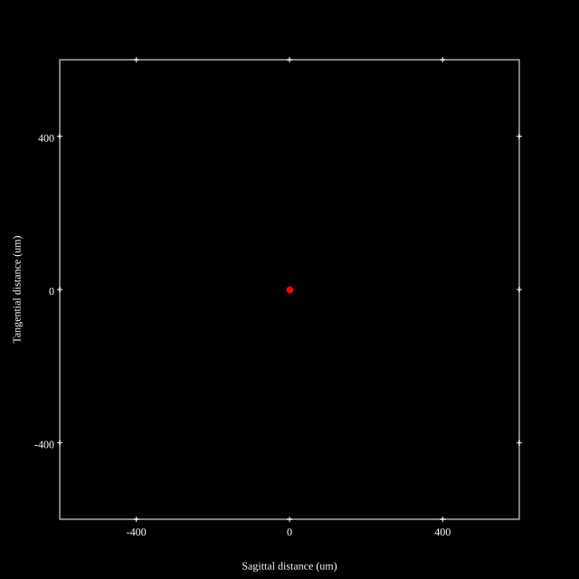
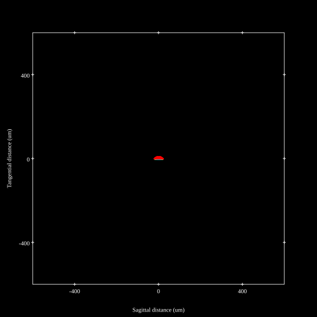
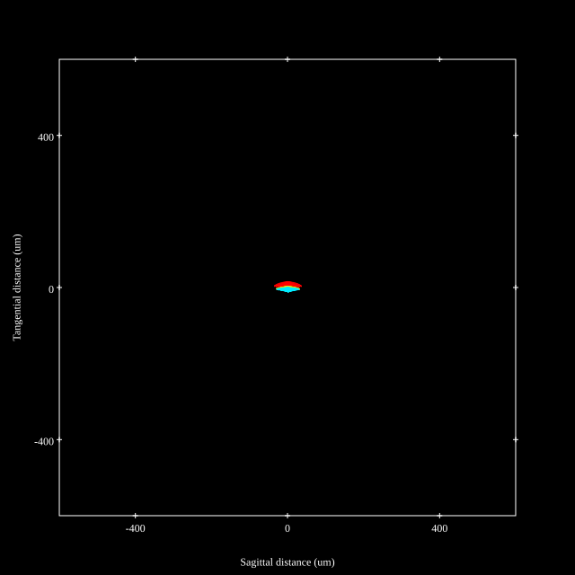
## Paraxial Parameters
| parameter | value |
| ---       | ---   |
| effective_focal_length |72.124
| back_focal_length | 28.774
| optical_invariant | 3.753
| object_distance | 1.0E10
| image_distance | 28.774
| power | 0.014
| pp1_H | 72.935
| ppk_H' | -43.35
| ffl_F | 0.811
| fno | 2.883
| enp_dist_P | 75.342
| enp_radius | 12.509
| exp_dist_P' | -41.036
| exp_radius | 12.105
| m | -0
| red | -1.3864964859505066E8
| n_obj | 1
| n_img | 1
| img_ht | 21.638
| obj_ang | 16.7
| obj_na | 0
| img_na | -0.173|
## Spot Analysis
| Field | Spot Mean Radius (µm) | Spot Max Radius (µm) |
| ---   | ---              | ---             |
 | Field(x=0.0, y=0.0) | 3.34 | 7.099|
 | Field(x=0.0, y=0.1) | 3.489 | 7.669|
 | Field(x=0.0, y=0.2) | 3.811 | 9.479|
 | Field(x=0.0, y=0.3) | 4.277 | 10.168|
 | Field(x=0.0, y=0.4) | 4.966 | 12.24|
 | Field(x=0.0, y=0.5) | 5.941 | 14.973|
 | Field(x=0.0, y=0.6) | 7.168 | 18.434|
 | Field(x=0.0, y=0.7) | 8.579 | 22.769|
 | Field(x=0.0, y=0.8) | 10.322 | 28.19|
 | Field(x=0.0, y=0.9) | 11.911 | 34.877|
 | Field(x=0.0, y=1.0) | 11.136 | 35.155|
## Polychromatic Geometric MTF
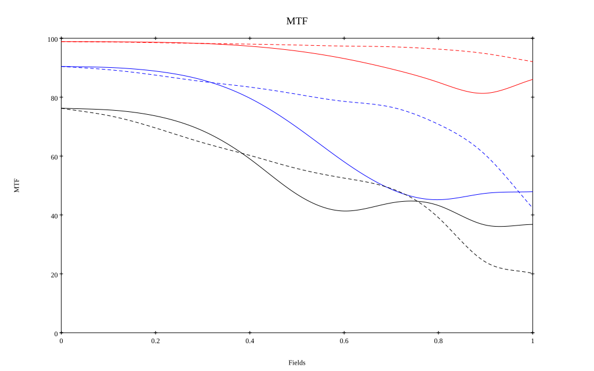
* 10=red,30=blue,50=black cycles/mm
* Solid lines represent sagittal, dashed lines tangential
* To generate above, MTFs for wavelengths 587.5618(d), 486.1327(F), 656.2725(C) were calculated across 10 fields, and then averaged
## Polychromatic Geometric MTF (Weighted)
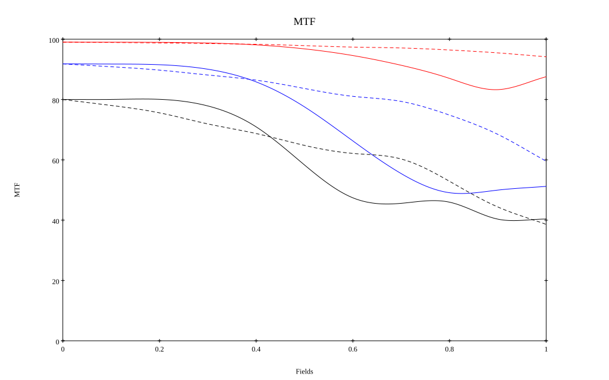
* 10=red,30=blue,50=black cycles/mm
* Solid lines represent sagittal, dashed lines tangential
* To generate above, MTFs for wavelengths 587.5618(d) wt(1.0), 656.2725(C) wt(0.475), 546.074(e) wt(0.98), 486.1327(F) wt(0.49), 435.8343(g) wt(0.15) were calculated across 10 fields, and then combined using weighted average
# 200mm f2.8
## Layouts
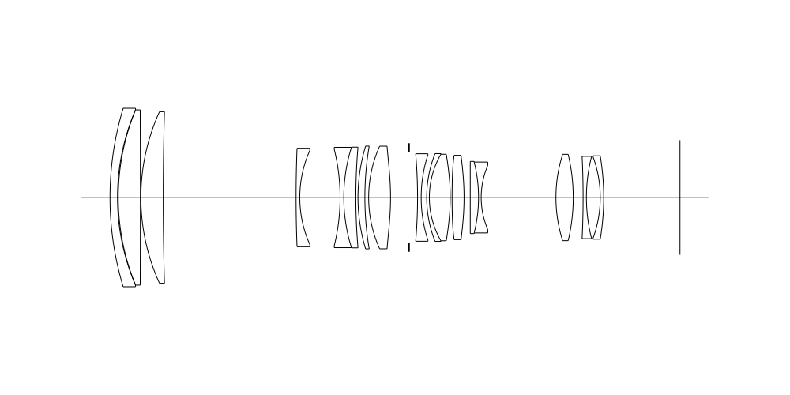
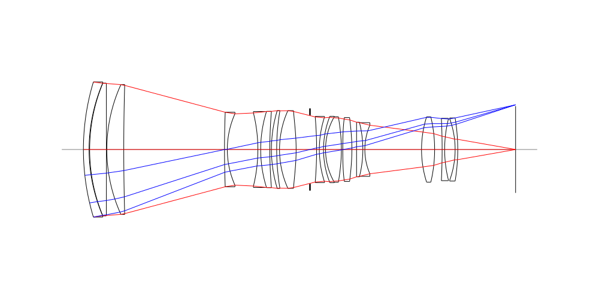
## Spot Diagrams

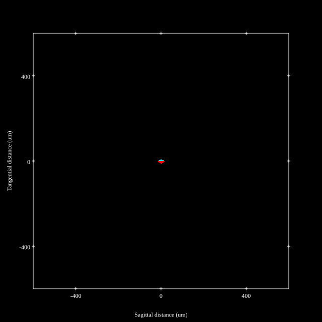
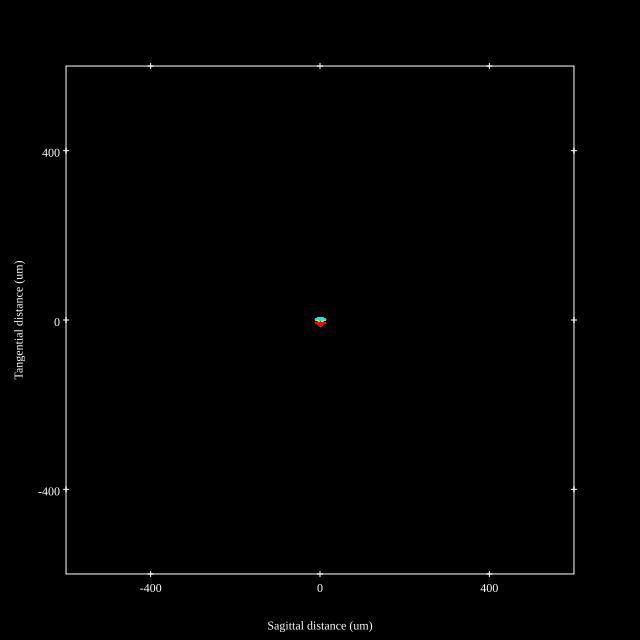
## Paraxial Parameters
| parameter | value |
| ---       | ---   |
| effective_focal_length |193.9
| back_focal_length | 28.775
| optical_invariant | 3.789
| object_distance | 1.0E10
| image_distance | 28.775
| power | 0.005
| pp1_H | -76.242
| ppk_H' | -165.125
| ffl_F | -270.142
| fno | 2.854
| enp_dist_P | 233.29
| enp_radius | 33.967
| exp_dist_P' | -45.922
| exp_radius | 13.082
| m | -0
| red | -5.157290201674774E7
| n_obj | 1
| n_img | 1
| img_ht | 21.629
| obj_ang | 6.365
| obj_na | 0
| img_na | -0.175|
## Spot Analysis
| Field | Spot Mean Radius (µm) | Spot Max Radius (µm) |
| ---   | ---              | ---             |
 | Field(x=0.0, y=0.0) | 2.483 | 4.914|
 | Field(x=0.0, y=0.1) | 2.577 | 6.318|
 | Field(x=0.0, y=0.2) | 2.895 | 7.238|
 | Field(x=0.0, y=0.3) | 3.225 | 8.155|
 | Field(x=0.0, y=0.4) | 3.578 | 9.261|
 | Field(x=0.0, y=0.5) | 4.032 | 10.53|
 | Field(x=0.0, y=0.6) | 4.577 | 12.118|
 | Field(x=0.0, y=0.7) | 5.134 | 13.853|
 | Field(x=0.0, y=0.8) | 5.67 | 14.383|
 | Field(x=0.0, y=0.9) | 6.072 | 14.921|
 | Field(x=0.0, y=1.0) | 6.205 | 14.175|
## Polychromatic Geometric MTF
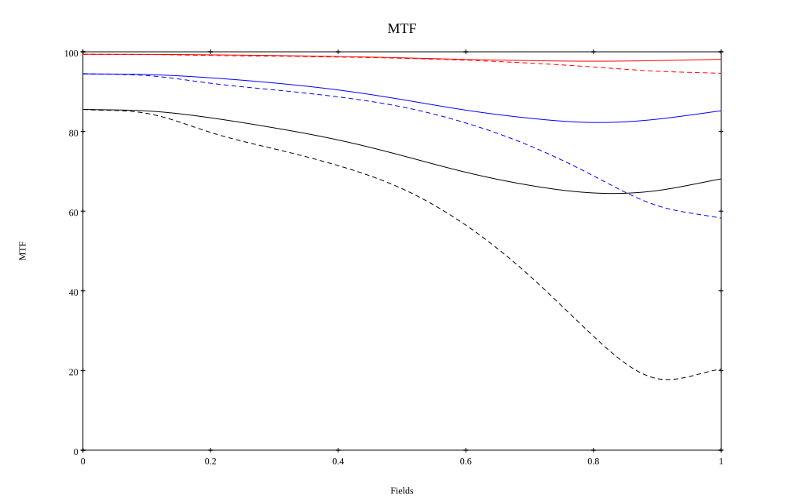
* 10=red,30=blue,50=black cycles/mm
* Solid lines represent sagittal, dashed lines tangential
* To generate above, MTFs for wavelengths 587.5618(d), 486.1327(F), 656.2725(C) were calculated across 10 fields, and then averaged
## Polychromatic Geometric MTF (Weighted)
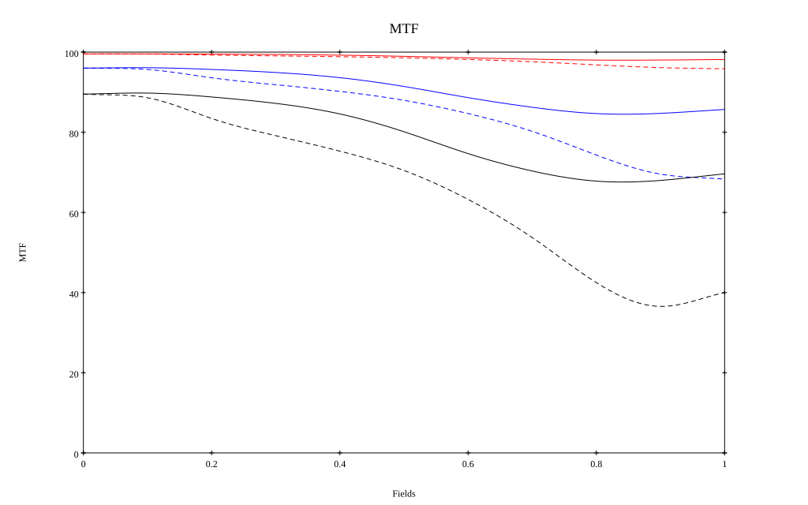
* 10=red,30=blue,50=black cycles/mm
* Solid lines represent sagittal, dashed lines tangential
* To generate above, MTFs for wavelengths 587.5618(d) wt(1.0), 656.2725(C) wt(0.475), 546.074(e) wt(0.98), 486.1327(F) wt(0.49), 435.8343(g) wt(0.15) were calculated across 10 fields, and then combined using weighted average
## Resources
* [OpticalBench Compatible Data File, tab delimited](./prescription.txt)
* [Zemax file](./JP2023-039817_Example02P.zmx)

Generated from `JP2023-039817_Example02P.txt`, status **Accepted**

Report / Zemax file generated using [Beam42](https://github.com/BeamFour/Beam42) on 2026-10-17
