# Tamron 70-180mm F/2.8 Di III VXD G2
## Patent Information
| Country | Patent Number | Example | Year of Application | Inventors | Organisation | Link |
| ---     | ---           | ---     | ---                 | ---       | ---          | ---  |
|US | US 2025/0076623 | 1 | 2023 | Hisayuki Yamanaka | Tamron Co Ltd | [link](https://patents.google.com/patent/US20250076623A1/en) |
## Surface Data
Note that where glass types are shown the refractive index and abbe number is as per assigned glass type

| ID  | Radius | Thickness | Diameter | nd  | vd  | Glass Make | Glass |
| --- | ---    | ---       | ---      | --- | --- | ---        | ---   |
| 1 | 155.5198 | 1.5 | 63.5 | 1.8061 | 33.27 | Hoya | NBFD15 |
| 2 | 83.6531 | 7.1965 | 60.48 | 1.497 | 81.61 | Hoya | FCD1 |
| 3 | -1844.7834 | 0.2 | 63.5 |  |  |  |
| 4 | 73.3988 | 6.9834 | 61.72 | 1.437 | 95.1 | Hoya | FCD100 |
| 5 | 461.0825 | d5 | 61.72 |  |  |  |
| 6 | 47.5905 | 4.6723 | 37.06 | 1.85883 | 30.0 | Hoya | NBFD30 |
| 7 | 579.8823 | 0.7769 | 37.06 |  |  |  |
| 8 | 195.9849 | 1.2 | 34.48 | 1.755 | 52.32 | Hoya | TAC6 |
| 9 | 23.4952 | 5.8813 | 29.46 |  |  |  |
| 10 | 952.5687 | 1.0 | 30.5 | 1.72916 | 54.67 | Hoya | TAC8 |
| 11 | 54.2303 | 0.2 | 28.72 |  |  |  |
| 12 | 33.1087 | 3.6676 | 30.92 | 1.84666 | 23.78 | Hoya | FDS90 |
| 13 | 92.4947 | 3.7917 | 28.81 |  |  |  |
| 14 | -42.622 | 1.0 | 28.81 | 2.00069 | 25.46 | Hoya | TAFD40 |
| 15 | -206.1433 | d15 | 31.28 |  |  |  |
| 16 | AS | 1.0 | 29.713 |  |  |  |
| 17 | 38.511 | 4.9076 | 33.46 | 1.7433 | 49.22 | Hoya | NBF1 |
| 18 | 745.9337 | 0.9873 | 33.46 |  |  |  |
| 19 | 44.9383 | 1.0 | 32.06 | 2.00069 | 25.46 | Hoya | TAFD40 |
| 20 | 20.7729 | 6.9899 | 28.38 | 1.59282 | 68.62 | Hoya | FCD505 |
| 21 | 320.7119 | 3.1443 | 30.94 |  |  |  |
| 22 | -110.539 | 0.9 | 27.54 | 1.61266 | 44.46 | Hikari | E-KZFH1 |
| 23 | 26.197 | 3.2065 | 29.32 | 1.85451 | 25.15 | Hoya | NBFD25 |
| 24 | 46.4599 | 1.35 | 29.32 |  |  |  |
| 25 | 43.7334 | 8.0145 | 28.48 | 1.59282 | 68.62 | Hoya | FCD505 |
| 26 | -23.4024 | 1.1 | 28.48 | 1.8707 | 40.73 | Hoya | TAFD32 |
| 27 | 876.6337 | 1.5574 | 28.48 |  |  |  |
| 28 | 68.9746 | 4.7794 | 27.44 | 1.85108 | 40.12 | Hikari | Q-LASFH58S |
| 29 | -46.2047 | d29 | 28.94 |  |  |  |
| 30 | 1529.6006 | 2.3821 | 25.7 | 1.92286 | 20.88 | Hoya | E-FDS1 |
| 31 | -77.7371 | 0.8 | 25.7 | 1.72916 | 54.67 | Hoya | TAC8 |
| 32 | 31.7386 | d32 | 24.26 |  |  |  |
| 33 | 107.0583 | 4.9111 | 32.56 | 1.58313 | 59.46 | Hoya | BACD12 |
| 34 | -62.381 | 15.4427 | 32.56 |  |  |  |
| 35 | -22.0 | 0.2 | 29.02 | 1.5361 | 41.21 |  |
| 36 | -24.0197 | 1.7 | 29.02 | 1.90366 | 31.32 | Hoya | TAFD25 |
| 37 | -49.68 | d37 | 33.64 |  |  |  |
| 38 | CG | 2.5 | 45.58 | 1.5168 | 64.2 | Hoya | BSC7 |
| 39 | CG | 1.0 | 45.58 |  |  |  |
## Aspherical Data
| ID  | Type | k   | P1 | P2 | P3 | P4 | P5 |
| --- | --- | --- | --- | --- | --- | --- | --- |
| 28| EVEN | 0.0 | 0.0 | -6.97969E-6 | -2.19527E-9 | 1.07027E-11 | -4.77707E-14 |
| 29| EVEN | 0.0 | 0.0 | 2.77578E-7 | -6.55276E-9 | 9.34354E-12 | -4.50201E-14 |
| 33| EVEN | 0.0 | 0.0 | 7.58265E-6 | -7.72695E-9 | 8.97112E-11 | -1.49928E-13 |
| 34| EVEN | 0.0 | 0.0 | 4.65516E-6 | -1.27998E-8 | 1.10482E-10 | -2.0207E-13 |
| 35| EVEN | 0.0 | 0.0 | 1.14513E-5 | 1.2741E-9 | 6.82309E-11 | -1.12878E-13 |
## Variables
| Variable | 70mm f2.8 | 180mm f2.8 |
| --- | --- | --- |
| Focal length |72.0664 |174.6514 |
| F-Number |2.9104 |2.9103 |
| Angle of View |32.6314 |13.4628 |
| d5 | 2.0014 | 53.1842 |
| d15 | 27.1298 | 2.0 |
| d29 | 5.1074 | 2.4998 |
| d32 | 14.5385 | 16.9614 |
| d37 | 17.2805 | 17.2805 |
# 70mm f2.8
## Layouts
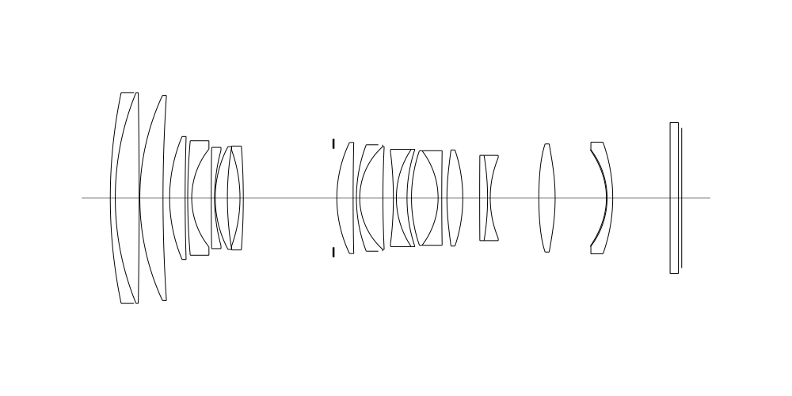
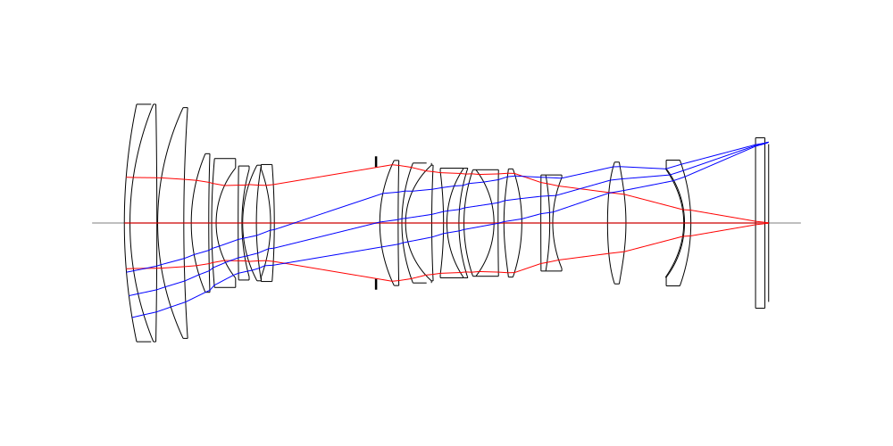
## Spot Diagrams
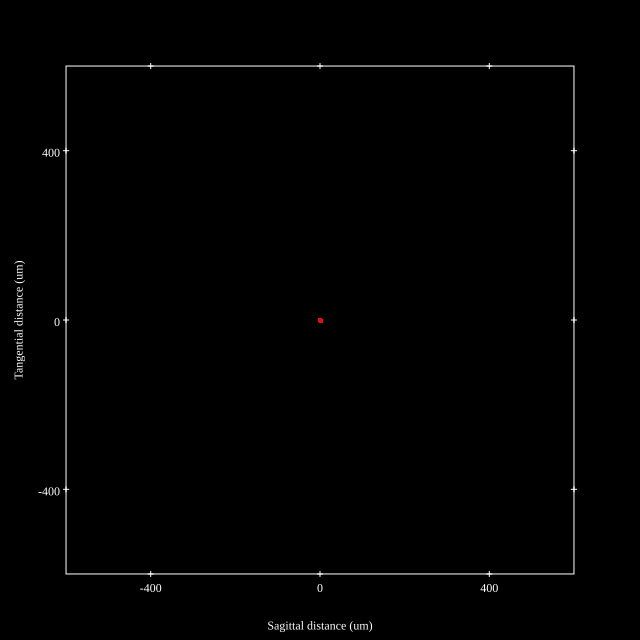
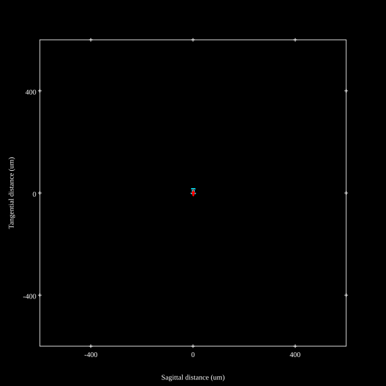

## Paraxial Parameters
| parameter | value |
| ---       | ---   |
| effective_focal_length |72.067
| back_focal_length | 1.014
| optical_invariant | 3.586
| object_distance | 1.0E10
| image_distance | 1.014
| power | 0.014
| pp1_H | 45.701
| ppk_H' | -71.053
| ffl_F | -26.366
| fno | 2.942
| enp_dist_P | 63.694
| enp_radius | 12.249
| exp_dist_P' | -56.641
| exp_radius | 9.802
| m | -0
| red | -1.387593765672813E8
| n_obj | 1
| n_img | 1
| img_ht | 21.095
| obj_ang | 16.316
| obj_na | 0
| img_na | -0.17|
## Spot Analysis
| Field | Spot Mean Radius (µm) | Spot Max Radius (µm) |
| ---   | ---              | ---             |
 | Field(x=0.0, y=0.0) | 1.651 | 4.342|
 | Field(x=0.0, y=0.1) | 1.825 | 7.698|
 | Field(x=0.0, y=0.2) | 2.164 | 9.055|
 | Field(x=0.0, y=0.3) | 2.463 | 9.714|
 | Field(x=0.0, y=0.4) | 2.681 | 9.333|
 | Field(x=0.0, y=0.5) | 2.983 | 12.068|
 | Field(x=0.0, y=0.6) | 3.491 | 19.26|
 | Field(x=0.0, y=0.7) | 3.974 | 25.19|
 | Field(x=0.0, y=0.8) | 3.988 | 24.387|
 | Field(x=0.0, y=0.9) | 3.812 | 21.036|
 | Field(x=0.0, y=1.0) | 5.548 | 18.068|
## Polychromatic Geometric MTF
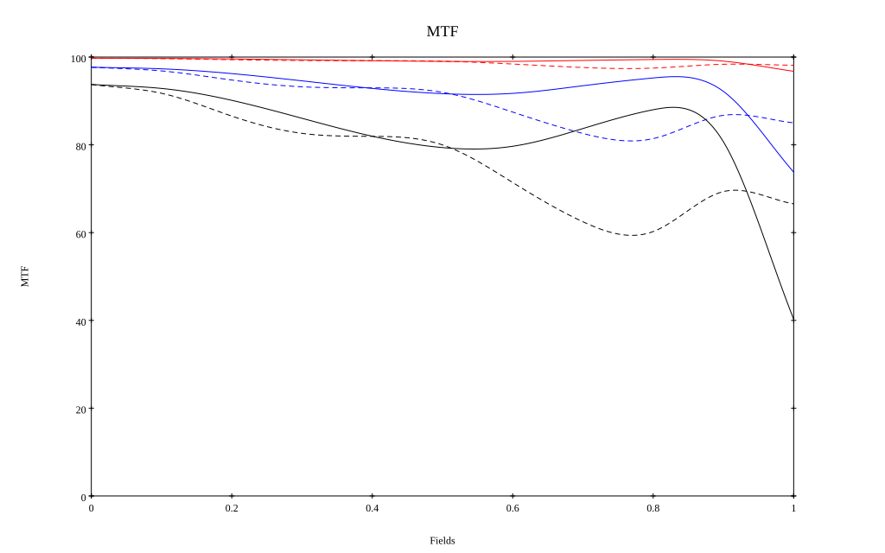
* 10=red,30=blue,50=black cycles/mm
* Solid lines represent sagittal, dashed lines tangential
* To generate above, MTFs for wavelengths 587.5618(d), 486.1327(F), 656.2725(C) were calculated across 10 fields, and then averaged
## Polychromatic Geometric MTF (Weighted)
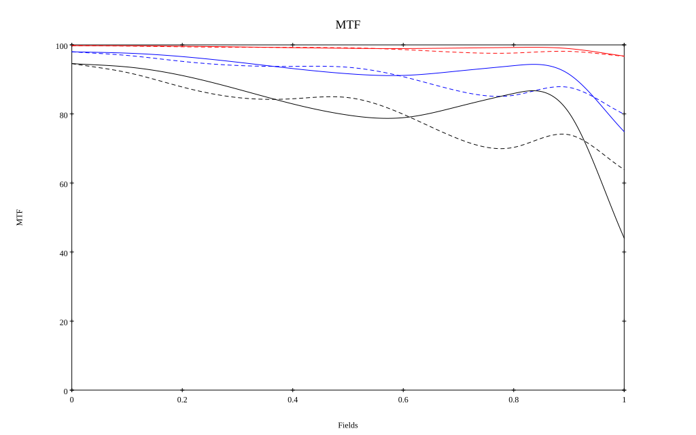
* 10=red,30=blue,50=black cycles/mm
* Solid lines represent sagittal, dashed lines tangential
* To generate above, MTFs for wavelengths 587.5618(d) wt(1.0), 656.2725(C) wt(0.475), 546.074(e) wt(0.98), 486.1327(F) wt(0.49), 435.8343(g) wt(0.15) were calculated across 10 fields, and then combined using weighted average
# 180mm f2.8
## Layouts
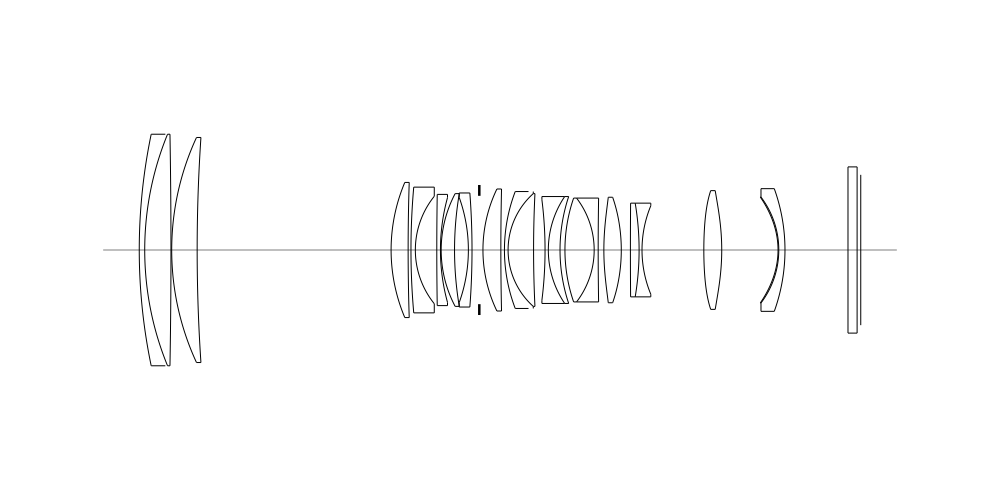
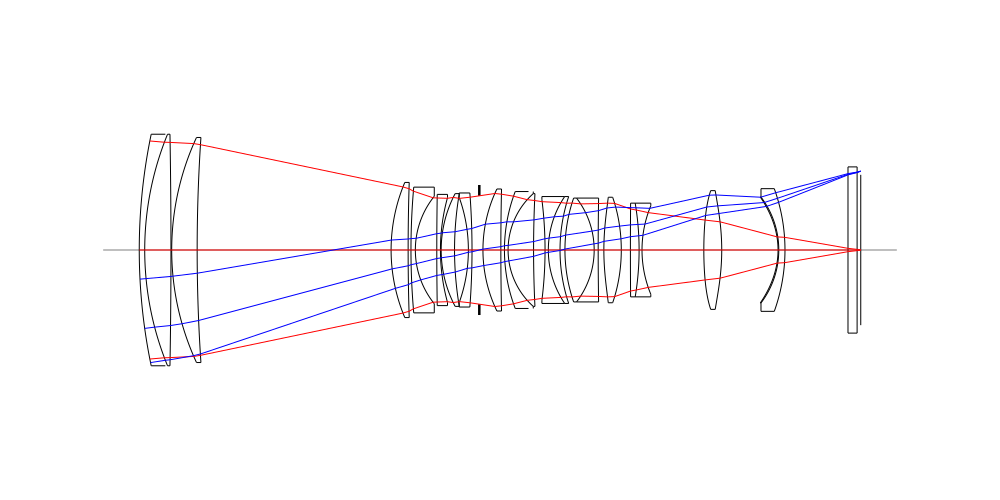
## Spot Diagrams

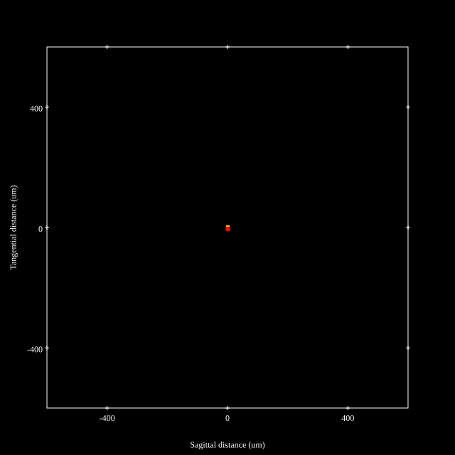

## Paraxial Parameters
| parameter | value |
| ---       | ---   |
| effective_focal_length |174.654
| back_focal_length | 1.001
| optical_invariant | 3.529
| object_distance | 1.0E10
| image_distance | 1.001
| power | 0.006
| pp1_H | -167.642
| ppk_H' | -173.653
| ffl_F | -342.297
| fno | 2.921
| enp_dist_P | 177.961
| enp_radius | 29.901
| exp_dist_P' | -57.63
| exp_radius | 10.038
| m | -0
| red | -5.725598019804204E7
| n_obj | 1
| n_img | 1
| img_ht | 20.614
| obj_ang | 6.731
| obj_na | 0
| img_na | -0.171|
## Spot Analysis
| Field | Spot Mean Radius (µm) | Spot Max Radius (µm) |
| ---   | ---              | ---             |
 | Field(x=0.0, y=0.0) | 1.133 | 2.596|
 | Field(x=0.0, y=0.1) | 1.616 | 6.12|
 | Field(x=0.0, y=0.2) | 2.321 | 7.725|
 | Field(x=0.0, y=0.3) | 2.715 | 8.263|
 | Field(x=0.0, y=0.4) | 2.978 | 7.793|
 | Field(x=0.0, y=0.5) | 3.307 | 7.888|
 | Field(x=0.0, y=0.6) | 3.717 | 8.445|
 | Field(x=0.0, y=0.7) | 4.158 | 9.23|
 | Field(x=0.0, y=0.8) | 4.768 | 9.898|
 | Field(x=0.0, y=0.9) | 5.632 | 10.342|
 | Field(x=0.0, y=1.0) | 6.37 | 12.652|
## Polychromatic Geometric MTF
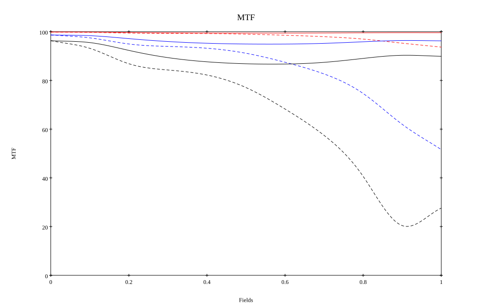
* 10=red,30=blue,50=black cycles/mm
* Solid lines represent sagittal, dashed lines tangential
* To generate above, MTFs for wavelengths 587.5618(d), 486.1327(F), 656.2725(C) were calculated across 10 fields, and then averaged
## Polychromatic Geometric MTF (Weighted)
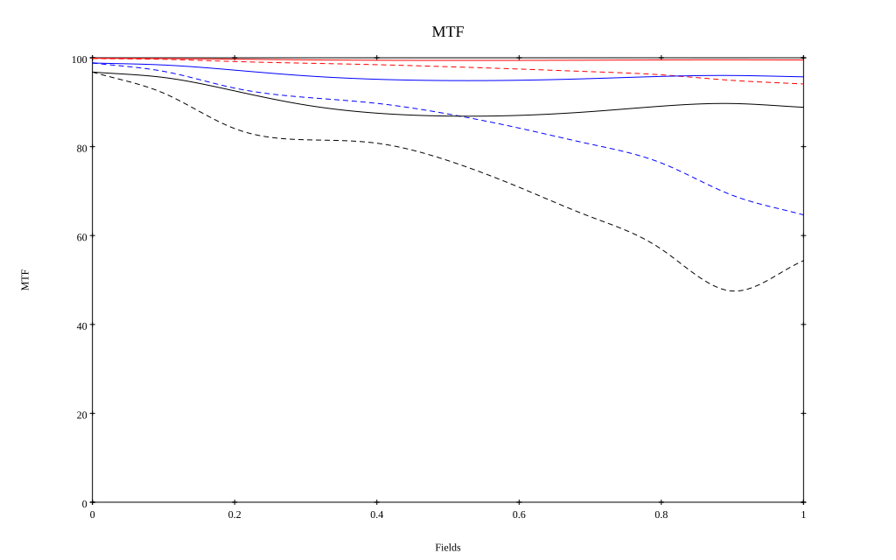
* 10=red,30=blue,50=black cycles/mm
* Solid lines represent sagittal, dashed lines tangential
* To generate above, MTFs for wavelengths 587.5618(d) wt(1.0), 656.2725(C) wt(0.475), 546.074(e) wt(0.98), 486.1327(F) wt(0.49), 435.8343(g) wt(0.15) were calculated across 10 fields, and then combined using weighted average
## Resources
* [OpticalBench Compatible Data File, tab delimited](./prescription.txt)
* [Zemax file](./US20250076623_Example01.zmx)

Generated from `US20250076623_Example01.txt`, status **Candidate**

Report / Zemax file generated using [Beam42](https://github.com/BeamFour/Beam42) on 2026-10-31
