# Tamron 70-180mm F/2.8 Di III VXD
## Patent Information
| Country | Patent Number | Example | Year of Application | Inventors | Organisation | Link |
| ---     | ---           | ---     | ---                 | ---       | ---          | ---  |
|JP | JP 2021-043375 | 1 | 2019 | Wataru Kusaka | Tamron Co Ltd | [link](https://patents.google.com/patent/JP2021043375A/en) |
## Surface Data
Note that where glass types are shown the refractive index and abbe number is as per assigned glass type

| ID  | Radius | Thickness | Diameter | nd  | vd  | Glass Make | Glass |
| --- | ---    | ---       | ---      | --- | --- | ---        | ---   |
| 1 | 200.0 | 1.5 | 60.5 | 1.8061 | 33.27 | Hoya | NBFD15 |
| 2 | 107.65 | 5.9 | 59.951 | 1.437 | 95.1 | Hoya | FCD100 |
| 3 | -2760.0 | 0.2 | 59.874 |  |  |  |
| 4 | 88.88 | 7.0 | 59.416 | 1.497 | 81.61 | Hoya | FCD1 |
| 5 | -5000.0 | d5 | 58.899 |  |  |  |
| 6 | -192.1 | 1.0 | 34.6 | 1.6968 | 55.46 | Hoya | LAC14 |
| 7 | 110.42 | 2.734 | 33.647 |  |  |  |
| 8 | -114.0 | 1.0 | 33.585 | 1.497 | 81.61 | Hoya | FCD1 |
| 9 | 80.74 | 3.0 | 33.791 | 1.92286 | 20.88 | Hoya | E-FDS1 |
| 10 | 502.6 | 1.939 | 33.723 |  |  |  |
| 11 | -99.5 | 1.0 | 33.718 | 1.6968 | 55.46 | Hoya | LAC14 |
| 12 | 185.0 | d12 | 34.124 |  |  |  |
| 13 | 80.6553 | 0.25 | 35.6 | 1.51118 | 50.92 | SUMITA | KF8 |
| 14 | 100.0 | 4.9 | 35.609 | 1.83481 | 42.72 | Hoya | TAFD5F |
| 15 | -100.0 | d15 | 35.556 |  |  |  |
| 16 | 74.05 | 4.4 | 34.246 | 1.59282 | 68.62 | Hoya | FCD505 |
| 17 | -176.2 | 0.2 | 33.749 |  |  |  |
| 18 | 92.0 | 4.2 | 32.19 | 1.497 | 81.61 | Hoya | FCD1 |
| 19 | -92.0 | 1.0 | 31.423 | 1.85451 | 25.15 | Hoya | NBFD25 |
| 20 | 148.3 | 2.272 | 30.32 |  |  |  |
| 21 | AS | 2.074 | 29.223 |  |  |  |
| 22 | 0.0 | 1.0 | 28.621 | 1.90366 | 31.32 | Hoya | TAFD25 |
| 23 | 29.24 | 7.5 | 27.541 | 1.497 | 81.61 | Hoya | FCD1 |
| 24 | -315.0 | 0.201 | 27.441 |  |  |  |
| 25 | 38.55 | 5.6 | 27.2 | 1.60342 | 38.01 | Hoya | E-F5 |
| 26 | -70.5 | d26 | 26.983 |  |  |  |
| 27 | 198.0 | 1.8 | 23.008 | 1.92286 | 20.88 | Hoya | E-FDS1 |
| 28 | -198.0 | 0.8 | 22.484 | 1.7725 | 49.62 | Hoya | TAF1 |
| 29 | 25.61 | d29 | 20.8 |  |  |  |
| 30 | -463.4111 | 0.15 | 25.938 | 1.51118 | 50.92 | SUMITA | KF8 |
| 31 | 310.32 | 1.0 | 25.982 | 1.85451 | 25.15 | Hoya | NBFD25 |
| 32 | 67.2 | d32 | 26.257 |  |  |  |
| 33 | 48.45 | 6.0 | 27.973 | 1.91082 | 35.25 | Hoya | TAFD35 |
| 34 | -48.45 | 4.762 | 28.0 |  |  |  |
| 35 | -20.8842 | 2.0 | 26.582 | 1.85108 | 40.12 | Hikari | Q-LASFH58S |
| 36 | -67.1148 | 29.793 | 27.875 |  |  |  |
| 37 | CG | 2.5 | 42.044 | 1.51633 | 64.14 |  |
| 38 | CG | 1.0 | 42.802 |  |  |  |
## Aspherical Data
| ID  | Type | k   | P1 | P2 | P3 | P4 | P5 | P6 | P7 |
| --- | --- | --- | --- | --- | --- | --- | --- | --- | --- |
| 13| EVEN | 0.0 | 0.0 | -3.6774E-6 | 2.997E-10 | -9.1982E-13 | 5.5729E-15 | -1.5995E-17 | 1.6461E-20 |
| 30| EVEN | 0.0 | 0.0 | 1.2249E-5 | 1.1169E-8 | -1.3534E-10 | 8.8621E-13 | -1.9489E-15 | 0  |
| 35| EVEN | 0.0 | 0.0 | 5.3883E-5 | -2.8626E-7 | 1.8129E-9 | -6.4552E-12 | 9.87E-15 | 1.5279E-18 |
| 36| EVEN | 0.0 | 0.0 | 4.6766E-5 | -2.6564E-7 | 1.4488E-9 | -5.029E-12 | 8.296E-15 | -2.8195E-18 |
## Variables
| Variable | 70mm f2.8 | 180mm f2.8 |
| --- | --- | --- |
| Focal length |72.102 |174.6 |
| F-Number |2.91 |2.91 |
| Angle of View |34.006 |13.44 |
| d5 | 3.0819746125235987 | 62.34839965727671 |
| d12 | 29.7781571713343 | 0.9953792755050908 |
| d15 | 3.2941369346671463 | 1.1104964105702475 |
| d26 | 1.899180739027441 | 1.9342165150219695 |
| d29 | 16.3924932931302 | 15.93765325650968 |
| d32 | 2.4086287483718234 | 2.4888208113762085 |
# 70mm f2.8
## Layouts
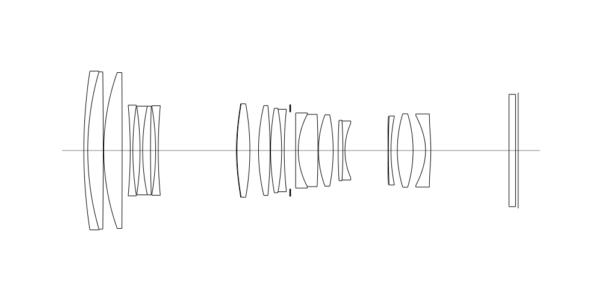
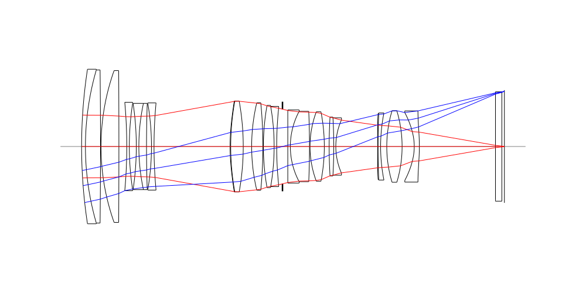
## Spot Diagrams
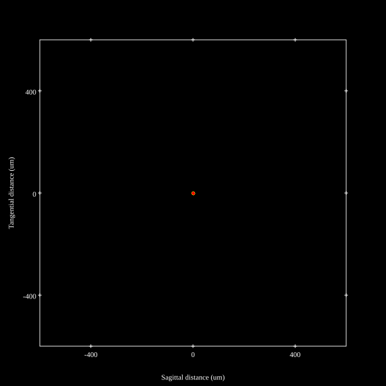
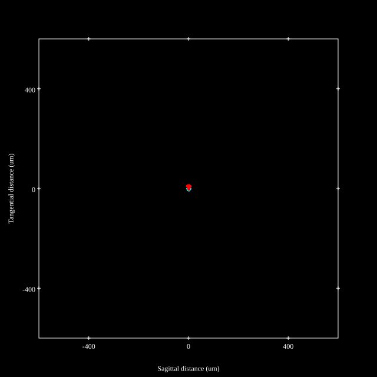
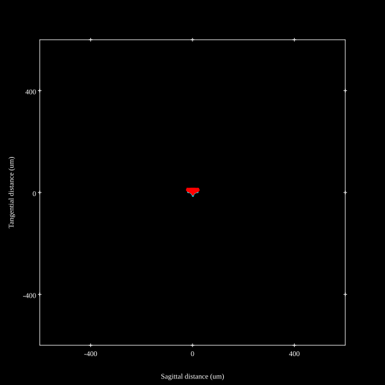
## Paraxial Parameters
| parameter | value |
| ---       | ---   |
| effective_focal_length |72.125
| back_focal_length | 1.006
| optical_invariant | 3.766
| object_distance | 1.0E10
| image_distance | 1.006
| power | 0.014
| pp1_H | 47.022
| ppk_H' | -71.118
| ffl_F | -25.103
| fno | 2.928
| enp_dist_P | 52.917
| enp_radius | 12.317
| exp_dist_P' | -65.663
| exp_radius | 11.386
| m | -0
| red | -1.3864882426270568E8
| n_obj | 1
| n_img | 1
| img_ht | 22.055
| obj_ang | 17.003
| obj_na | 0
| img_na | -0.171|
## Spot Analysis
| Field | Spot Mean Radius (µm) | Spot Max Radius (µm) |
| ---   | ---              | ---             |
 | Field(x=0.0, y=0.0) | 1.661 | 4.78|
 | Field(x=0.0, y=0.1) | 1.997 | 7.07|
 | Field(x=0.0, y=0.2) | 2.8 | 9.427|
 | Field(x=0.0, y=0.3) | 3.637 | 12.262|
 | Field(x=0.0, y=0.4) | 4.31 | 13.14|
 | Field(x=0.0, y=0.5) | 4.754 | 12.995|
 | Field(x=0.0, y=0.6) | 5.133 | 13.344|
 | Field(x=0.0, y=0.7) | 5.723 | 16.12|
 | Field(x=0.0, y=0.8) | 6.896 | 20.535|
 | Field(x=0.0, y=0.9) | 8.519 | 23.44|
 | Field(x=0.0, y=1.0) | 11.094 | 28.826|
## Polychromatic Geometric MTF
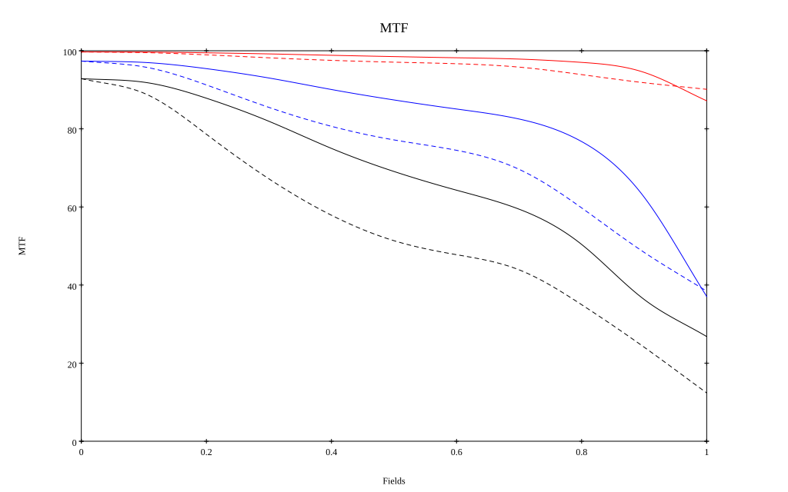
* 10=red,30=blue,50=black cycles/mm
* Solid lines represent sagittal, dashed lines tangential
* To generate above, MTFs for wavelengths 587.5618(d), 486.1327(F), 656.2725(C) were calculated across 10 fields, and then averaged
## Polychromatic Geometric MTF (Weighted)
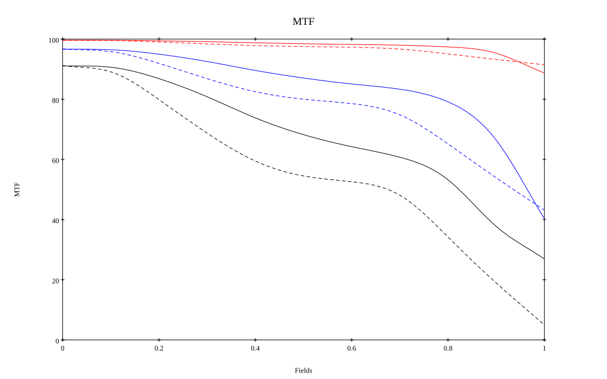
* 10=red,30=blue,50=black cycles/mm
* Solid lines represent sagittal, dashed lines tangential
* To generate above, MTFs for wavelengths 587.5618(d) wt(1.0), 656.2725(C) wt(0.475), 546.074(e) wt(0.98), 486.1327(F) wt(0.49), 435.8343(g) wt(0.15) were calculated across 10 fields, and then combined using weighted average
# 180mm f2.8
## Layouts
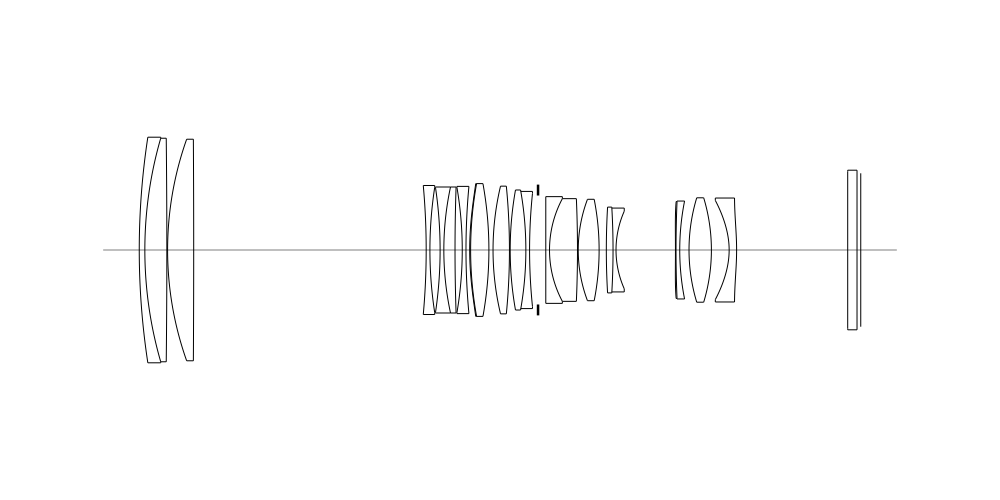
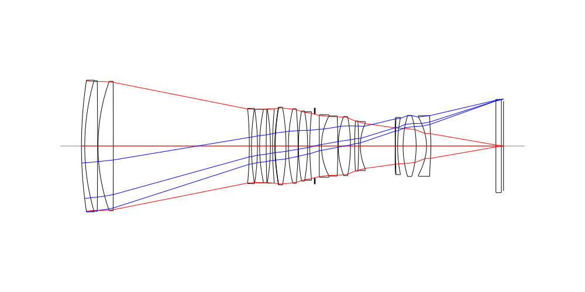
## Spot Diagrams

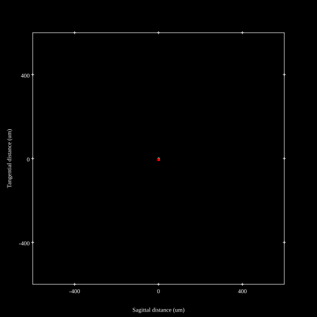
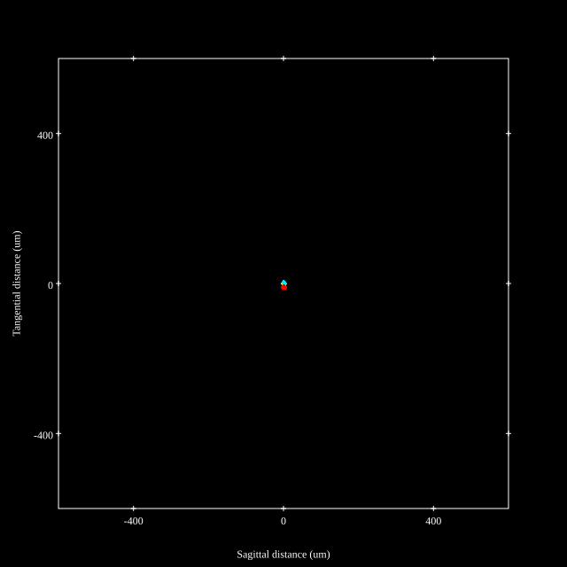
## Paraxial Parameters
| parameter | value |
| ---       | ---   |
| effective_focal_length |174.599
| back_focal_length | 0.992
| optical_invariant | 3.526
| object_distance | 1.0E10
| image_distance | 0.992
| power | 0.006
| pp1_H | -85.796
| ppk_H' | -173.607
| ffl_F | -260.396
| fno | 2.918
| enp_dist_P | 198.631
| enp_radius | 29.922
| exp_dist_P' | -65.428
| exp_radius | 11.382
| m | -0
| red | -5.727398127309009E7
| n_obj | 1
| n_img | 1
| img_ht | 20.573
| obj_ang | 6.72
| obj_na | 0
| img_na | -0.171|
## Spot Analysis
| Field | Spot Mean Radius (µm) | Spot Max Radius (µm) |
| ---   | ---              | ---             |
 | Field(x=0.0, y=0.0) | 1.046 | 2.398|
 | Field(x=0.0, y=0.1) | 1.128 | 2.858|
 | Field(x=0.0, y=0.2) | 1.496 | 3.945|
 | Field(x=0.0, y=0.3) | 1.943 | 4.606|
 | Field(x=0.0, y=0.4) | 2.428 | 4.307|
 | Field(x=0.0, y=0.5) | 2.989 | 5.787|
 | Field(x=0.0, y=0.6) | 3.567 | 7.187|
 | Field(x=0.0, y=0.7) | 4.218 | 8.529|
 | Field(x=0.0, y=0.8) | 5.143 | 10.205|
 | Field(x=0.0, y=0.9) | 5.947 | 11.941|
 | Field(x=0.0, y=1.0) | 6.759 | 13.639|
## Polychromatic Geometric MTF
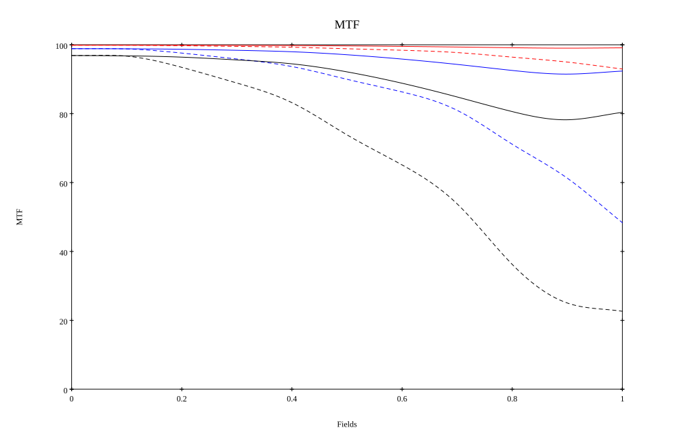
* 10=red,30=blue,50=black cycles/mm
* Solid lines represent sagittal, dashed lines tangential
* To generate above, MTFs for wavelengths 587.5618(d), 486.1327(F), 656.2725(C) were calculated across 10 fields, and then averaged
## Polychromatic Geometric MTF (Weighted)
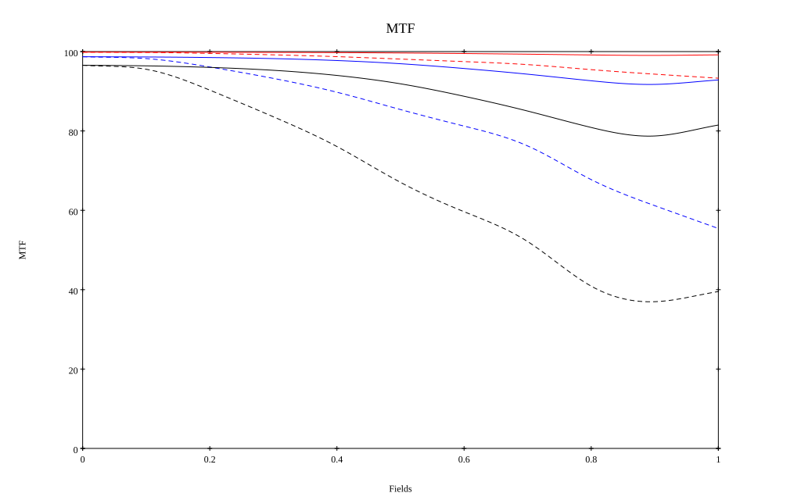
* 10=red,30=blue,50=black cycles/mm
* Solid lines represent sagittal, dashed lines tangential
* To generate above, MTFs for wavelengths 587.5618(d) wt(1.0), 656.2725(C) wt(0.475), 546.074(e) wt(0.98), 486.1327(F) wt(0.49), 435.8343(g) wt(0.15) were calculated across 10 fields, and then combined using weighted average
## Resources
* [OpticalBench Compatible Data File, tab delimited](./prescription.txt)
* [Zemax file](./JP2021-043375_Example01P.zmx)

Generated from `JP2021-043375_Example01P.txt`, status **Accepted**

Report / Zemax file generated using [Beam42](https://github.com/BeamFour/Beam42) on 2026-10-25
