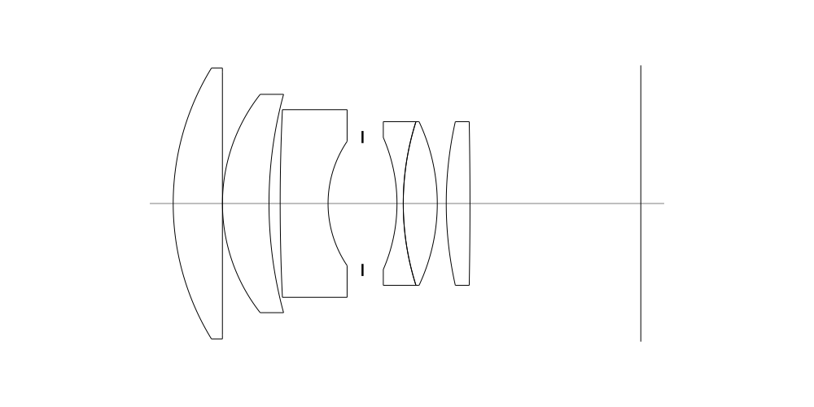
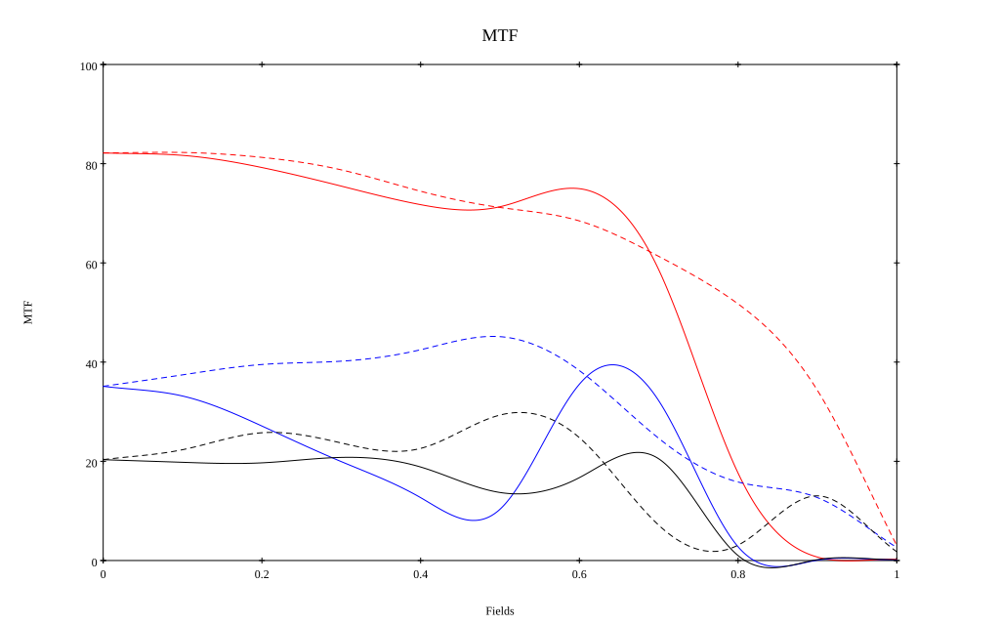

# Carl Zeiss Contarex 1.4/85mm Planar T*
## Patent Information
| Country | Patent Number | Example | Year of Application | Inventors | Organisation | Link |
| ---     | ---           | ---     | ---                 | ---       | ---          | ---  |
|US | US3948584 | EX 4 | 1973 | Heinrich Basista, Bernhard Sonnenberg | Carl Zeiss AG | [link](https://patents.google.com/patent/US3948584A/en) |
## Surface Data
Note that where glass types are shown the refractive index and abbe number is as per assigned glass type

| ID  | Radius | Thickness | Diameter | nd  | vd  | Glass Make | Glass |
| --- | ---    | ---       | ---      | --- | --- | ---        | ---   |
| 1 | 57.902 | 11.0075 | 60.56 | 1.65113 | 55.89 | Schott | N-LAK22 |
| 2 | 0.0 | 0.102 | 58.8965 |  |  |  |
| 3 | 39.542 | 10.404 | 48.8183 | 1.65113 | 55.89 | Schott | N-LAK22 |
| 4 | 93.1005 | 2.499 | 42.99 |  |  |  |
| 5 | 440.5125 | 10.71 | 41.9502 | 1.76182 | 26.53 | Schott | N-SF14 |
| 6 | 24.786 | 7.70525 | 27.78 |  |  |  |
| 7 | AS | 7.70525 | 27.0416 |  |  |  |
| 8 | -37.06595 | 1.4025 | 30.2837 | 1.57501 | 41.51 | Hikari | J-LF7 |
| 9 | 60.435 | 0.0 | 36.6 |  |  |  |
| 10 | 60.435 | 7.6075 | 36.6 | 1.744 | 44.79 | Ohara | S-LAM2 |
| 11 | -43.112 | 2.006 | 36.6 |  |  |  |
| 12 | 83.5805 | 5.304 | 36.6 | 1.713 | 53.83 | Schott | N-LAK8 |
| 13 | -1000.535 | 38.194 | 36.6 |  |  |  |
## Layouts

## Spot Diagrams

## Paraxial Parameters
| parameter | value |
| ---       | ---   |
| effective_focal_length |84.965
| back_focal_length | 38.288
| optical_invariant | 10.308
| object_distance | 1.0E10
| image_distance | 38.288
| power | 0.012
| pp1_H | 31.335
| ppk_H' | -46.677
| ffl_F | -53.63
| fno | 1.5
| enp_dist_P | 61.78
| enp_radius | 28.322
| exp_dist_P' | -24.17
| exp_radius | 20.85
| m | -0
| red | -1.1769580191125403E8
| n_obj | 1
| n_img | 1
| img_ht | 30.925
| obj_ang | 20
| obj_na | 0
| img_na | -0.333|
## Spot Analysis
| Field | Spot Mean Radius (µm) | Spot Max Radius (µm) |
| ---   | ---              | ---             |
 | Field(x=0.0, y=0.0) | 10.127 | 23.79|
 | Field(x=0.0, y=0.1) | 10.22 | 36.611|
 | Field(x=0.0, y=0.2) | 11.346 | 52.898|
 | Field(x=0.0, y=0.3) | 13.724 | 76.918|
 | Field(x=0.0, y=0.4) | 18.205 | 112.309|
 | Field(x=0.0, y=0.5) | 26.087 | 163.021|
 | Field(x=0.0, y=0.6) | 26.869 | 128.186|
 | Field(x=0.0, y=0.7) | 37.085 | 180.743|
 | Field(x=0.0, y=0.8) | 62.116 | 236.939|
 | Field(x=0.0, y=0.9) | 99.262 | 299.273|
 | Field(x=0.0, y=1.0) | 138.265 | 348.656|
## Polychromatic Geometric MTF

* 10=red,30=blue,50=black cycles/mm
* Solid lines represent sagittal, dashed lines tangential
* To generate above, MTFs for wavelengths 587.5618(d), 486.1327(F), 656.2725(C) were calculated across 10 fields, and then averaged
## Polychromatic Geometric MTF (Weighted)

* 10=red,30=blue,50=black cycles/mm
* Solid lines represent sagittal, dashed lines tangential
* To generate above, MTFs for wavelengths 587.5618(d) wt(1.0), 656.2725(C) wt(0.475), 546.074(e) wt(0.98), 486.1327(F) wt(0.49), 435.8343(g) wt(0.15) were calculated across 10 fields, and then combined using weighted average
## Resources
* [OpticalBench Compatible Data File, tab delimited](./prescription.txt)
* [Zemax file](./US3948584_Example04.zmx)

Generated from `US3948584_Example04.txt`, status **TODO**

Report / Zemax file generated using [Beam42](https://github.com/BeamFour/Beam42) on 2026-11-22
